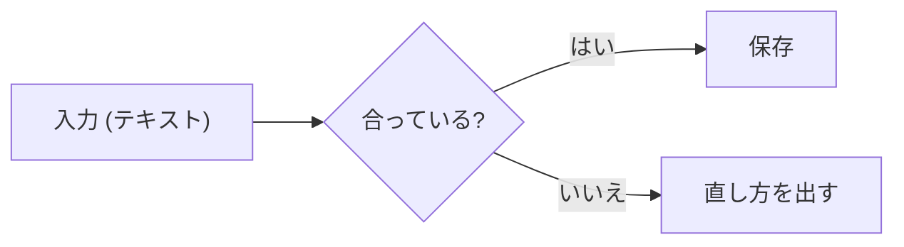

# 文書の決まり

**これ 1 か所が正。** `check.sh` はこの文書の「検査」の表のとおりに調べる。取り込んだ repo のスキルや `CLAUDE.md` には中身を写さず、この文書を指す。

読む人: 文書を書く Claude Code（Codex でも同じ）と人。

## 書き方の原則

| # | 原則 | すること |
|---|---|---|
| 1 | 結論を先に | 頭の 1〜3 行で、何の文書か・読むと何が分かるか・結論を書く。読む人が 30 秒で全体をつかめるように |
| 2 | 中身だけ | 挨拶・「〜について説明します」・「以上です」を書かない。事実・決まり・理由から始める |
| 3 | 見て分かる形 | 3 つ以上を比べるなら表。流れや関係は図（Mermaid）。長い箇条書きを続けない |
| 4 | あいまいにしない | `適切に`・`必要に応じて` のような言葉を、数・条件・コマンド・設定の値に置き換える |
| 5 | たどれる | 触れたファイルにはリンクを張る。repo の中は相対パス。repo の外は `<you>` などに置き換え、自分の PC のパスを残さない |
| 6 | 確かめたことと、そうでないことを分ける | 回したコマンドと出た結果を書く。回していないことは「確かめていない」と書く |

## 形（GitHub の Markdown）

### 見出し

- `#`（H1）は文書の頭に 1 つだけ。題にする。
- 章は `##`、節は `###`。段を飛ばさない（`##` の下に `####` を置かない）。

### 注意の枠

強めたいことだけに使う。続けて並べない・入れ子にしない。

| 枠 | 使うとき |
|---|---|
| `> [!NOTE]` | 背景・補足 |
| `> [!TIP]` | 知っていると楽になること |
| `> [!IMPORTANT]` | 必ず守ること |
| `> [!WARNING]` | 壊れる・遅くなる・合わなくなるおそれ |
| `> [!CAUTION]` | データが消える・秘密が漏れるおそれ |

### コードの枠

全部の枠に言語を書く（`sh`・`powershell`・`ts`・`json`・`yaml`・`mermaid`・`text` など）。言語の無い出力やプロンプトは `text`。変更を見せるときは `diff`。

````markdown
```diff
- void OldMethod();
+ void NewMethod(int priority);
```
````

枠の中に枠を書くときは、外側の枠の記号を内側より長くする（上の例は、外側が 4 つ・内側が 3 つ）。

### 図（Mermaid）

ラベルに `()` や記号が入るときは `"` で囲む（囲まないと図が描けない）。



### リンク

- repo の中: 文書からの相対パス（`../src/app.ts`）か、repo の直下からのパス（`/src/app.ts`）。行は `#L10-L25` で示せる。
- repo の外: URL。PC の中のファイルなら、パスの人ごとに違う所を `<you>` に置き換える（`C:\Users\<you>\…`）。

## frontmatter

置き場の文書（既定は `docs/` の下）は、頭に frontmatter を付ける。

```yaml
---
generated_by: Claude {モデル名}   # AI が書いたときだけ
date: 2026-11-11                 # YYYY-MM-DD
type: guide                      # 下の「種類」のどれか
project: <repo の名前>
---
```

AI が書いた文書は、最後に次の 1 行を付ける。

```markdown
> この文書は Claude {モデル名} が生成しました。内容の正確性は人間のレビューを経て確認してください。
```

## 種類（type）とひな形

| type | 書くもの | ひな形 |
|---|---|---|
| `spec`・`design`・`architecture` | 仕組みの形・データの流れ・決めたことと理由 | [templates/design.md](templates/design.md) |
| `guide` | 手順（前提・順番・確かめ方・困ったとき） | [templates/guide.md](templates/guide.md) |
| `reference` | 一覧（設定の名前・コマンド・値） | 表を中心に。ひな形なし |
| `report` | その時点の記録（後から書き換えない） | [templates/report.md](templates/report.md) |

## 置き場

取り込み先の `CLAUDE.md` の「置き場」に従う。無ければ `docs/` の下に置き、`CLAUDE.md` に置き場の節を足すことをユーザーに提案する。コードのフォルダ（`src/` など）に `.md` を置かない。

## 検査（check.sh）

| # | 検査 | 内容 | 結果 |
|---|---|---|---|
| D1 | H1 | `#` の見出しがちょうど 1 つ | 止める |
| D2 | 見出しの段 | 段を飛ばさない（`##` の次に `####` が来ない） | 止める |
| D3 | コードの枠 | 開ける行に言語がある（```` ``` ```` も `~~~` も） | 止める |
| D4 | frontmatter | `frontmatter_paths`（既定 `docs`）の下の文書に、`frontmatter_keys`（既定 `date type project`）がある・`type` が `types` のどれか・`date` が `YYYY-MM-DD` | 止める |
| D5 | リンク先 | 相対パスのリンク先のファイルがある（URL・`#` だけのリンク・`` ` `` の中は見ない） | 止める |
| D6 | 自分の PC のパス | `C:\Users\<名前>`・`/Users/<名前>`・`/home/<名前>` が無い（コードの枠の中も見る。`<you>` などの置き換えは通す） | 止める |
| D7 | あいまいな言葉 | `vague_words` の言葉（既定は下の「値」の表）。`` ` `` の中は見ない | 警告だけ |

コードの枠の中は D3・D6 のほかは見ない（`# コメント` は見出しにならない）。

## 機械で見られないもの

書いた後、出す前に自分で見る。

- 頭の 1〜3 行で、何の文書で何が分かるかが言えているか
- 挨拶・前置き・締めのあいさつが無いか
- 3 つ以上を比べている所が表になっているか
- 回していないことを「確かめた」と書いていないか
- AI が書いた文書に、`generated_by:` と最後の 1 行があるか

## 値（document-authoring.conf）

repo の直下に `document-authoring.conf` を置くと、既定を上書きできる（無くても動く）。ひな形は [document-authoring.conf.example](document-authoring.conf.example)。

| 名前 | 既定 | 意味 |
|---|---|---|
| `check_paths` | `docs README.md` | ファイルを渡さないときに調べる所（空白で区切る） |
| `frontmatter_paths` | `docs` | frontmatter が要る所。空なら要らない |
| `frontmatter_keys` | `date type project` | frontmatter に要る名前。AI だけが書く repo なら `generated_by` を足す |
| `types` | `spec\|design\|architecture\|guide\|reference\|report` | `type:` に書ける種類 |
| `vague_words` | `適切に\|適宜\|必要に応じて\|十分な\|よしなに\|いい感じに` | D7 の言葉（正規表現 ERE）。空なら警告しない |

## 止まったら

表示された項目（D1〜D7）と行のとおりに直して、`check.sh` を回し直す。検査のほうが違うと思ったら、文書を曲げずに、この repo（document-authoring）を直して送り返す（README の「直したら送り返す」）。
