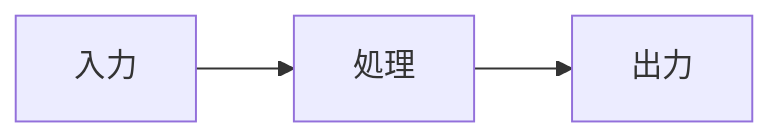

# <機能の名前> の設計

<何の仕組みか・何を決めたかを 1〜3 行で。>

## 1. 目的と範囲

| 項目 | 中身 |
|---|---|
| 解きたいこと | <困りごと> |
| 読む人 | <開発する人・運用する人> |
| 扱わないこと | <今回は決めないこと> |

## 2. 形



| 部品 | 役目 | ファイル |
|---|---|---|
| <名前> | <役目> | `<パス>` |

## 3. 詳しい決まり

<データの形・関数や API の入出力・状態の移り変わり。>

## 4. 外れたとき

| 起きること | 動き |
|---|---|
| <入力が無い> | <どうするか> |

## 5. 比べた案

| 案 | よい点 | 悪い点 | 選んだか・理由 |
|---|---|---|---|
| A（採用） | <…> | <…> | <…> |
| B | <…> | <…> | <…> |

## 6. 確かめ方

```sh
<確かめるコマンド>
```

> この文書は Claude {モデル名} が生成しました。内容の正確性は人間のレビューを経て確認してください。
