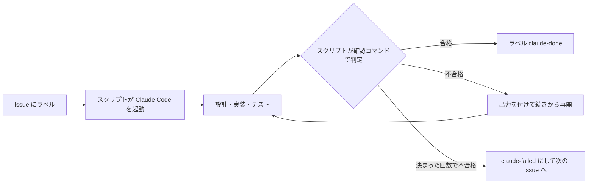
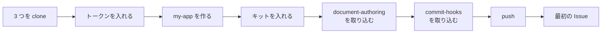

# Issue 駆動キット（issue-driven-kit）

GitHub Issue に合格の条件と確認コマンドを書いてラベルを付けると、Claude Code が合格するまで設計・実装・テストを無人で回す仕組みを、自分のリポジトリに入れるキットです。

## Summary (English)

Write pass criteria and a check command in a GitHub Issue, add a label, and Claude Code runs design, implementation and tests unattended until the check passes.
Track record (as of 2026-11-09, counted by `scripts/issue-run/stats.mjs`): in the original Unity repository KaedeScapeBuii (private), 95 of 100 unattended Issues passed (81 on the first try) over 466 commits; in this repository kaedeasset/issue-driven-kit (public), 45 of 47 passed (44 on the first try).
It works by combining headless mode (`claude -p`), a Stop hook, `--resume` with the check command's output, and deny rules in settings, so the agent neither stops halfway, claims "done" without passing, nor runs dangerous operations.

## 実績

2026-11-09 時点の記録です（更新し続ける数字ではありません）。`node scripts/issue-run/stats.mjs` で、無人の回が Issue に書いた結果のコメントから数えました（人が直してから閉じた Issue は合格に入れていません）。

| 対象 | 数字 |
|---|---|
| 元の Unity のリポジトリ KaedeScapeBuii（private） | 19 日（2026-10-22〜11-09）・コミット 466 件・無人の回に渡した Issue 100 件のうち 95 件が合格（81 件は 1 回目で合格） |
| KaedeScapeBuii で作った物 | Unity の撮影ツール。描画方式 3 つ（Built-in・URP・HDRP）で EXE まで |
| このリポジトリ kaedeasset/issue-driven-kit（公開） | 無人の回に渡した Issue 47 件のうち 45 件が合格（44 件は 1 回目で合格） |

合格した Issue はどれ？ → [kaedeasset/issue-driven-kit の合格した Issue の一覧](https://github.com/kaedeasset/issue-driven-kit/issues?q=label%3Aclaude-done)

## Issue 駆動を支える技術

AI に仕事を任せると、途中で止まる・合格していないのに「できた」と言う・やってはいけない操作をする、の 3 つが起きます。キットはこれを次の仕組みで防ぎます。

人がやるのは、合格の条件を書くことと、結果を見て閉じる・push することです。

| 困りごと | 解き方 | 使っている Claude Code の機能 |
|---|---|---|
| 人がいないと進まない | スクリプトが Issue を 1 件ずつ取り、Claude Code を無人で起動する | Headless（`claude -p`） |
| 区切りで返答を終えて止まる | 合格の報告が書かれるまで、返答を終えさせない | Hooks（Stop hook） |
| 合格していないのに「できた」と言う | 合否はスクリプトが確認コマンドを回して決め、落ちたら出力を付けて同じ会話を続きから再開する | `--resume` |
| テストのほうを書き換えて合格にする | 判定に使うファイルの指紋を開始時に取り、変わっていたら合格にしない | （スクリプト） |
| push・削除など危ない操作をする | 設定で必ず断り、確認の画面も出さない | Settings（deny）・`--permission-mode auto`・`--permission-prompts none` |
| 質問して待ち続ける | 質問の道具を外し、「戻せるほうを選んで、選んだことを書く」決まりを渡す | `--disallowed-tools`・指示文と CLAUDE.md |
| 設定が効いているか分からない | スクリプトが起動前に `claude -p` で試し、Stop hook が呼ばれることと deny が効くことを確かめてから始める | （スクリプト） |

AI が途中で止まらないのはなぜ？ → [issue-run.md](docs/guides/working/issue-run.md)・無人の回の決まりの正は？ → [issue-run-spec.md](shared/spec/issue-run-spec.md)

人の側は、次の道具で支えます。

| 道具 | 役目 |
|---|---|
| スキル `github-issue` | 会話で Issue（ゴール・合格の条件・確認コマンド）を書く |
| スキル `design-cycle` | ゴールから合格判定まで（設計・実装・テスト・NG の振り分け）を回す |
| worktree のレーン | 作業を並べて動かし、朝に main へ同期する |
| CLAUDE.md | 短く保ち、作業ごとの文書へ振り分ける |
| [document-authoring](https://github.com/kaedeasset/document-authoring)（別のリポジトリ） | 設計書・手順書を決まった形で書き、検査（`check.sh`）を通してから出す。キットとは別に入れる（[導入ガイドの 5.3](shared/manuals/issue-driven-kit-install-guide.md#53-文書の決まりを入れるdocument-authoring別のリポジトリ)） |
| [commit-hooks](https://github.com/kaedeasset/commit-hooks)（別のリポジトリ） | コミットメッセージの形と、載せてはいけない物（秘密・生成物・大きいファイル）を git のフックで止める。無人の回のコミットも同じ検査を通る。キットとは別に入れる（[導入ガイドの 5.4](shared/manuals/issue-driven-kit-install-guide.md#54-コミットの検査を入れるcommit-hooks別のリポジトリ)） |

誰が何をして、1 件がどう流れる？ → [issue-driven-development.md](docs/guides/working/issue-driven-development.md)

## 設計で決めたこと

- 一つの決まりは一か所に書く（仕様 → 2 つの版 → 見本の順に直す）。
- 合否は AI の言葉ではなく、確認コマンドの実行結果で決める。
- npm の依存を持たない（Node.js の標準の部品だけ）。

なぜそう決めた？ ほかに何を決めた？ → [基本設計](docs/design/issue-driven-kit-basic-design.md)

## 版を選ぶ

| | **Unity 版** | **Node 版** |
|---|---|---|
| 向いているリポジトリ | Unity のプロジェクト | Node.js＋TypeScript（vitest・`node --test`）。.NET・Java など、テストの結果を JUnit の XML に書ける道具のプロジェクトも |
| 動く OS | Windows | Windows・Mac（どの版で確かめた？ → [確かめた版](shared/manuals/issue-driven-kit-install-guide.md#確かめた版)） |
| スクリプト | PowerShell 7 | Node.js 22.14.0 だけ（PowerShell は使わない） |

## 使ってみる

3 つのリポジトリを使います。下の手順を上から順に進めると、新しいリポジトリ `my-app` に 3 つが入り、最初の Issue が無人で回ります。

| リポジトリ | 役目 |
|---|---|
| [kaedeasset/issue-driven-kit](https://github.com/kaedeasset/issue-driven-kit)（ここ） | Issue を無人で回す仕組み |
| [kaedeasset/document-authoring](https://github.com/kaedeasset/document-authoring) | 設計書・手順書の書き方と検査（`check.sh`） |
| [kaedeasset/commit-hooks](https://github.com/kaedeasset/commit-hooks) | コミットメッセージの形と載せない物を、git のフックで止める |

- 例は Windows です。フォルダーは `C:\tools`（3 つの置き場）と `C:\work\my-app`（自分のリポジトリ）を使います。
- 「ターミナル」は PowerShell の窓です。「Claude Code」は、ターミナルで `claude` と打って起動した Claude Code の入力欄です。
- 先に [Claude Code](https://code.claude.com) を入れておきます。
- Mac・Unity 版・いまあるリポジトリに入れるときの手順は、[導入ガイド](shared/manuals/issue-driven-kit-install-guide.md) にあります。

### 1. 3 つを C:\tools に clone する

| 順 | どこで | 入力する | 見るところ |
|---|---|---|---|
| 1 | ターミナル | `mkdir C:\tools` → `mkdir C:\work` → `cd C:\tools` → `claude` | Claude Code が起動する |
| 2 | Claude Code | `Git・GitHub CLI・Node.js 22.14.0 が入っているか確かめて、無い物を入れて。npm は 11.6.2 にして` | `node --version` が `v22.14.0`、`npm --version` が `11.6.2` |
| 3 | Claude Code | `! gh auth login`（画面の問いに答えて、ブラウザでログインする） | `Logged in to github.com` |
| 4 | Claude Code | `kaedeasset の issue-driven-kit・document-authoring・commit-hooks の 3 つを、ここに clone して` | `C:\tools` の下に 3 つのフォルダーができる |
| 5 | Claude Code | `/exit` | ターミナルに戻る |

### 2. 無人の回のトークンを入れる

無人の回が長く動く途中で、ログインが切れないようにします。トークンは秘密の値なので、Claude Code の会話には貼りません。

| 順 | どこで | 入力する | 見るところ |
|---|---|---|---|
| 1 | ターミナル | `claude setup-token` | ブラウザで承認すると、ターミナルにトークンが出る |
| 2 | ターミナル | `[Environment]::SetEnvironmentVariable("CLAUDE_CODE_OAUTH_TOKEN", "<出たトークン>", "User")` | 何も出ない（ユーザーの環境変数に入る） |
| 3 | ターミナル | `exit` で窓を閉じ、新しいターミナルを開く | 新しい窓だけが、入れた環境変数を読む |

### 3. 自分のリポジトリ C:\work\my-app を作る

| 順 | どこで | 入力する | 見るところ |
|---|---|---|---|
| 1 | ターミナル | `cd C:\work` → `claude` | Claude Code が起動する |
| 2 | Claude Code | `GitHub に private のリポジトリ my-app を作って、ここに clone して` | `C:\work\my-app` ができる |
| 3 | Claude Code | `/exit` → ターミナルで `cd C:\work\my-app` → `claude` | `my-app` で Claude Code が起動する |
| 4 | Claude Code | `このリポジトリを Node.js 22.14.0・npm 11.6.2・TypeScript・vitest の最小のプロジェクトにして。package.json の engines と .nvmrc に版を書いて、テストを 1 本入れて、npm test が通るようにして。コミットはまだしないで` | `npm test` が通る |

### 4. 3 つを my-app に入れる

`my-app` の Claude Code で続けます。

| 順 | どこで | 入力する | 見るところ |
|---|---|---|---|
| 1 | Claude Code | `C:\tools\issue-driven-kit\shared\manuals\issue-driven-kit-install-guide.md を読んで、このリポジトリに Node 版を入れて。まず --dry-run で、写すファイルと、ぶつかるファイルを見せて` | 写すファイルの一覧。最後の行が `Result: PASS (DryRun・何も書いていない)` |
| 2 | Claude Code | `入れて。npm install まで回して、CLAUDE.md の <…> の所も全部このリポジトリに合わせて埋めて` | 最後の行が `Result: PASS (… 件を写した …)`。`CLAUDE.md` に `<…>` が残っていない |
| 3 | Claude Code | `テストの入口を、全部・0 件・わざと落とすテストを 1 本足す、の 3 つで回して、最後の Result: 行と終了コードを見せて。わざと落とすテストは最後に消して` | 全部は `Result: PASS`、0 件とわざと落とすは `Result: FAIL` |
| 4 | Claude Code | `issue-run の点検を回して` | 最後の行が `Result: PASS  WARN <数>`（NG が 0） |
| 5 | Claude Code | `ここまでの分をコミットして` | 作業ツリーが綺麗になる（6・7 の取り込みは、綺麗でないと始まらない） |
| 6 | Claude Code | `C:\tools\document-authoring\docs\install.md を読んで、そのとおりにこのリポジトリへ document-authoring を取り込んで。push はしないで` | `DOC-TEST PASS cases=<数>`。最後にコミットまでする |
| 7 | Claude Code | `C:\tools\commit-hooks\docs\install.md を読んで、そのとおりにこのリポジトリへ commit-hooks を取り込んで。push はしないで` | `HOOKS-TEST PASS cases=<数>` と `HOOKS-INSTALL … verdict=PASS`（profile は `node`）。最後のコミットがフックを通る |
| 8 | Claude Code | `pushして` | GitHub の `my-app` に上がる |

### 5. 最初の Issue を回す

最初は、合否を機械で測りやすい「文書を書かせる Issue」にします。

| 順 | どこで | 入力する | 見るところ |
|---|---|---|---|
| 1 | Claude Code | `<作りたい物の説明>。基本設計書にして、その後どこから Issue 駆動にするか検討して` | 基本設計書と、決めること（推しの案つき） |
| 2 | Claude Code | `おすすめで決めて` → `詳細設計を書かせる Issue にして` | Issue の下書き |
| 3 | Claude Code | `コミットしてpushしてから作って` | GitHub に Issue ができる |
| 4 | 新しいターミナル | `cd C:\work\my-app` → `node scripts/issue-run/issue-run.mjs` | 無人の回が Issue を取って動き出す |
| 5 | Claude Code | `issue-run を起動した` → `様子見て` | 進み具合の報告 |
| 6 | Claude Code | 4 のターミナルが終わったら `終わったみたい` | 合否と、無人の回が自分で決めたことの報告 |
| 7 | Claude Code | `コミットしてpushして` → `doneはcloseして` | まとめが入り、合格した Issue が閉じる |

多くの段で、次に入力するプロンプトが入力欄に灰色で出ます（Tab → Enter で送れる）。

### 3 つを新しくする

`my-app` の Claude Code で `C:\tools の 3 つを git pull して、このリポジトリのキット・document-authoring・commit-hooks を新しくして。手を入れたファイルとの差を先に見せて` と入力します（キットは `--update`、ほかの 2 つは `git subtree pull`）。

各手順の詳しい説明・困ったときは？ → [導入ガイド](shared/manuals/issue-driven-kit-install-guide.md)

## 中身

| 置き場 | 中身 |
|---|---|
| [`shared/spec/`](shared/spec/) | 無人の Issue 実行の仕様の正（2 つの版はこれを実装する） |
| `editions/unity/`・`editions/node/` | 2 つの版：`files/`（利用先に写す物）と入れるスクリプト |
| [`shared/manuals/`](shared/manuals/) | 使う人向けの説明書（導入ガイド・チーム向けガイドなど） |
| [`docs/design/`](docs/design/) | キットの設計 |
| `tests/` | キット自身のテスト（`npm test`＝`node --test`） |

## 作者・ライセンス

人がゴールと合格の条件を書き、結果を確かめて push します。設計からコミットまでは Claude Code が行いました。[MIT](LICENSE)。

このリポジトリは公開です。作者の private のリポジトリの中身は入れていません（抜いた物は [`shared/SOURCE.md`](shared/SOURCE.md)）。

- **記録の番号について：** 説明書の中の「記録 22/01」「P54」のような呼び名は、作者の private の記録の番号です。記録そのものは入れていませんが、説明書はそれだけで読めるように書いてあります。

---

> この文書は Claude Opus 5.5 が生成しました。内容の正確性は人間のレビューを経て確認してください。
