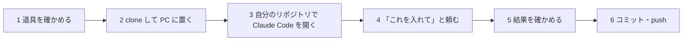

# はじめての導入 — clone してから、自分のリポジトリで最初のコミットが通るまで

[README](../README.md) に戻る。

この説明書は**人**が読むものです。commit-hooks を自分の PC に clone し、自分のリポジトリを開いた Claude Code に「これを入れて」と頼み、最初のコミットが通るまでを順に書きます。
Claude Code が実際に進める細かい手順は [導入ガイド（install.md）](install.md) にあります。人がそれを読む必要はありません。

> [!NOTE]
> - **入力するプロンプト**は `text` の枠です。Claude Code の入力欄にそのまま貼ってください。`<…>` は自分の値に置き換えます。
> - **実行するコマンド**は `powershell`（Windows）・`bash`（Mac）・`sh`（どちらでも同じ）の枠です。

## 0. 全体の流れ



人がするのは、**clone する・プロンプトを貼る・聞かれたことに答える・結果を見る・push を決める**の 5 つだけです。調べる・取り込む・試験を回す・入れる・設定を書く・コミットするのは Claude Code がします。

---

## 1. 道具を確かめる

| 道具 | 確かめるコマンド | 無いとき |
|---|---|---|
| git | `git --version` | Windows は Git for Windows（`winget install --id Git.Git -e`）。フックはこれに入っている sh で動く。Mac は `xcode-select --install` |
| Claude Code | `claude --version` | 公式の手順（https://code.claude.com ）で入れる |
| 自分のリポジトリ | `git status` が通る | 先に `git init` するか clone する |

**自分のリポジトリの作業ツリーを綺麗にしておきます**（`git status` が `nothing to commit, working tree clean`）。取り込み（`git subtree add`）は、未コミットの変更があると始まりません。途中の作業があるなら、先にコミットするか、Claude Code に「今の変更をコミットして」と頼みます。

Node.js・Python などは要りません。フックは sh だけで動きます。

---

## 2. clone して PC に置く

**自分のリポジトリの外**に置きます（中に置くと、それ自体が自分のリポジトリのファイルになってしまいます）。置き場はどこでもかまいません。この説明書では次の場所を例にします。

```powershell
# Windows
git clone https://github.com/kaedeasset/commit-hooks.git D:\tools\commit-hooks
```

```bash
# Mac
git clone https://github.com/kaedeasset/commit-hooks.git ~/tools/commit-hooks
```

**この clone は何に使う？**

- Claude Code に読ませる**説明書と中身の見本**です。Claude Code はここの `docs/install.md` を読んで手順を進めます。
- 自分のリポジトリに入るのは、この clone を写した物ではなく、`git subtree` で GitHub から取り込んだ物です（`Tools/commit-hooks/` に入ります）。だから、あとで更新を受け取るときも GitHub から `git subtree pull` するだけで済みます。
- clone した後に、clone の中で何かを実行する必要はありません。**次の 3 へ進みます。**

---

## 3. 自分のリポジトリで Claude Code を開く

```powershell
cd D:\<自分のリポジトリ>
claude
```

Claude Code は、**開いたフォルダーのリポジトリ**にフックを入れます。commit-hooks の clone の中で開かないでください。

---

## 4. 「これを入れて」と頼む

次のプロンプトを貼ります。パスは 2 で clone した場所に変えます。

```text
D:\tools\commit-hooks\docs\install.md を読んで、そのとおりにこのリポジトリへ commit-hooks を取り込んで。
取り込みは install.md の手順 2 のとおり GitHub から git subtree add で入れて（clone したフォルダーは読むだけ）。
1 の調べた結果・選んだ profile・各コマンドの最後の行を報告して。push はしないで。
```

Mac なら 1 行目のパスを `~/tools/commit-hooks/docs/install.md` にします。

> [!TIP]
> clone は要らない、という人は 1 行目を `https://github.com/kaedeasset/commit-hooks の docs/install.md を読んで、` にしても同じように進みます。clone しておくと、Claude Code がネットの中身ではなく手元のファイルを読むので、どの版を読ませたかがはっきりします。

### Claude Code が順にすること

| 段 | Claude Code がすること | 人がすること |
|---|---|---|
| 1 調べる | 既にあるフック・husky などの有無・これまでのコミットの件名・フレームワーク（Unreal・Unity・Node.js・どれでもない）を調べる | 既にあるフックを残すか聞かれたら答える |
| 2 取り込む | `git subtree add` で `Tools/commit-hooks/` に取り込む（コミットが 1 件できる） | — |
| 3 試す・入れる | `test.sh` で 63 の場合を回し（1〜2 分かかる）、`install.sh <profile>` で `.git/hooks/` に入れる | — |
| 4 本物で確かめる | 形の違うコミットが止まり、正しい形が通ることを試す（試したコミットは取り消す） | — |
| 5 その repo だけの違い | 必要なら `commit-hooks.conf`（種類を足す・生成物を足す）を書く | — |
| 6 スキルと規約 | `.claude/skills/commit/SKILL.md` を置き、`CLAUDE.md` に 1 行足し、`.gitattributes` に改行の決まりを足す | 既にコミットのスキルがあるなら、置き換え方を確かめる |
| 7 コミット | 5・6 の変更をコミットする。**これがフックの最初の本番**になる | — |

途中で質問が来たら答えます。よく聞かれるのは次の 2 つです。

- **「既に `pre-commit` があります。残しますか」** — `install.sh` は既にあるフックを上書きせず止まります。何のフックか分からなければ「中身を説明して」と聞き返してから決めます。
- **「husky（`core.hooksPath`）を使っています」** — `.git/hooks/` は読まれないので、husky のフックから本体を呼ぶ形にします。「install.md の hooksPath を使う repo のとおりにして」と答えれば進みます。

---

## 5. 結果を確かめる

Claude Code の報告に、次の 3 つが入っていれば入っています。

| 見るところ | 合格の形 |
|---|---|
| 試験 | `HOOKS-TEST PASS cases=63 os=<OS>` |
| 入れる | `HOOKS-INSTALL ... verdict=PASS` |
| 最初の本番 | 7 のコミットが通った（`git log --oneline -3` に取り込みと設定のコミットが並ぶ） |

自分の目でも確かめたいなら、自分のリポジトリで次を実行します。**止まれば効いています**（空のコミットなので、止まっても何も壊れません）。

```sh
git commit --allow-empty -m "fix: 試し"
# → COMMIT-MSG FAIL M4,M5 …
```

---

## 6. コミット・push

取り込みと設定は、Claude Code が 4 の段 7 でもうコミットしています。push は人が決めます。

```text
push して
```

チームのリポジトリなら、ほかの人も pull した後に `sh Tools/commit-hooks/install.sh <profile>` を 1 回実行します（`.git/hooks/` は git で共有されないため、PC ごとに入れます）。Claude Code に「commit-hooks のフックをこの PC に入れて」と頼んでもかまいません。

---

## 入れた後の毎日の使い方

| したいこと | Claude Code に入力するプロンプト | 起きること |
|---|---|---|
| コミットする | `コミットして` | スキルが、今回変えたファイルだけをステージし、`rules.md` の形でメッセージを書く。フックに止められたら、出力を読んで自分で直してコミットし直す |
| 全部コミットする | `全部コミットして` | 未追跡のファイルも含める（生成物・秘密は除く） |
| 止まった理由を知る | `フックに止められた理由を説明して` | 外れた項目（M1〜M5・P1〜P7）と、`rules.md` の該当の行を説明する |
| 更新を受け取る | `commit-hooks を GitHub から subtree pull で更新して、test.sh を回して` | `Tools/commit-hooks/` が新しくなる。`commit-hooks.conf` は上書きされない |
| 自分の repo だけ決まりを変える | `commit-hooks.conf で、コミットの種類に perf を足して` | その repo だけに効く。更新で消えない |
| やめる | `commit-hooks のフックを外して` | `.git/hooks/` の 2 本を消す（戻し方は [install.md](install.md#戻し方)） |

人が自分でコミットするときも、同じフックが効きます。形は [rules.md](../rules.md) の見本をまねてください。

**`--no-verify` は使いません。** Claude Code にも使わせません（CLAUDE.md の 1 行とスキルで伝えてあります）。止まったら、検査と中身のどちらが違うかを見ます。検査が違うなら、[運用マニュアル](operations.md)の「取り込み先で直した分を返す」で直して送り返します。

---

## うまくいかないとき

| 起きたこと | 原因 | 直し方 |
|---|---|---|
| `git subtree add` が `fatal: working tree has modifications.  Cannot add.` で止まる | 未コミットの変更がある | 先にコミットする（1 の最後） |
| `HOOKS-INSTALL … verdict=FAIL` で `core.hooksPath` と出る | husky・lefthook を使っている | 4 の「husky」の答え方 |
| `HOOKS-INSTALL … verdict=FAIL` で既にあるフックと出る | 前から `commit-msg`・`pre-commit` がある | 中身を見て、残すか消すかを決める |
| フックが `\r` や `bad interpreter` で落ちる | 改行が CRLF になった | 取り込み先の `.gitattributes` に `Tools/commit-hooks/** text eol=lf` を足し、`Tools/commit-hooks/` を入れ直す（[install.md の「改行」](install.md#改行)） |
| チームのほかの人の PC で止まらない | `.git/hooks/` は PC ごと | その PC で `install.sh <profile>` を 1 回 |
| Claude Code が clone したフォルダーにフックを入れようとする | Claude Code を clone の中で開いた | 自分のリポジトリで開き直す（3） |
