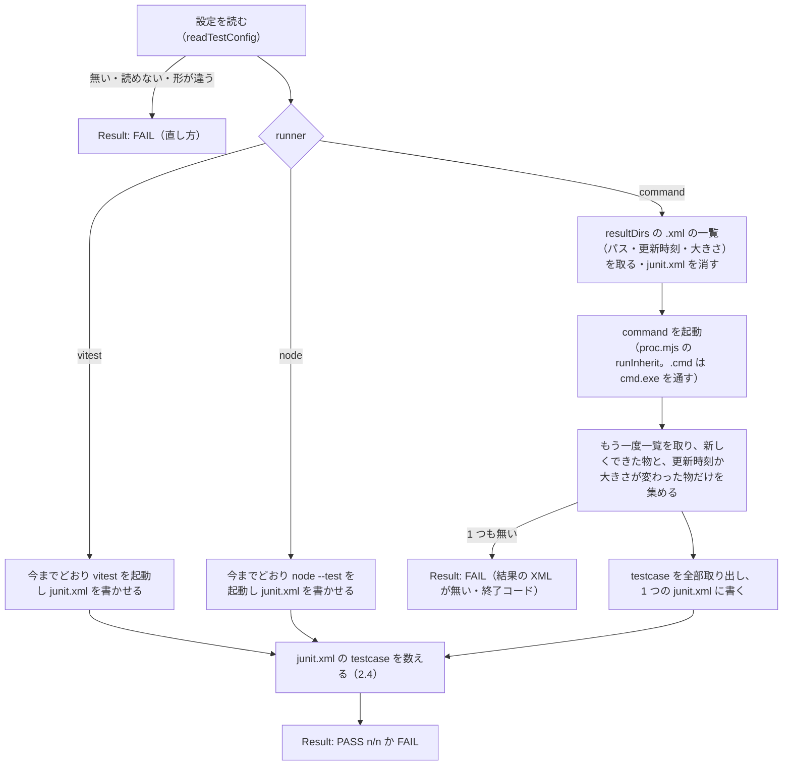

# テストの入口の決まりと設定 — 仕様に 1 か所で書き、どの言語のテストも同じ入口で回す（P-1・P-6）

> Generated by Claude Opus 5.5 — 2026年11月3日

| 項目 | 内容 |
|---|---|
| 状態 | 設計書・**実装済み**（#43・#44・#45 がいずれも 1 回目で合格。2026-11-03 20:17〜20:58。直下の移行は同じ日に会話で）。C-14 は回1で人が確かめる |
| 元 | 計画 [`issue-driven-examples-plan.md`](issue-driven-examples-plan.md) の回0 **P-1**（テストの入口の決まりを仕様に書き、決めたコマンドを回して JUnit の XML を読む形を足す）と **P-6**（設定を `.issue-kit/config.json` へ移す・Node の前提を外す・移行ガイド）。E5 の決定（Node 版を共通の実行役にする） |
| ユーザーの指定（2026-11-03） | 「テストを起動する道具が共通」（Node の入口が各言語のテストの道具を起動する）・「移行ガイドを作って、スクリプトがかわったら利用方法も変える、人に見せるOSSを作ってる途中なので、余計な後方互換は不要」 |
| 変える物 | 仕様（`shared/spec/issue-run-spec.md` の 9 章と新しい 11 章）・Node 版の脚本（`test.mjs`・`doctor.mjs`・`issue-run.mjs`・`lib.mjs`・`proc.mjs`・`check-lib.mjs` の中身）・無人の回の実行用の設定（`.claude/issue-run/settings.json` の deny）・Node 版のひな形（`CLAUDE.md`・commit スキル）・入れる脚本（`install.mjs`）・キットの試験・手順書・導入ガイド・キットの基本設計・キットの `CLAUDE.md`（直下の写しの行）・移行ガイド（新しく作る）・キット自身と見本の設定 |
| 変えない物 | Unity 版の脚本（`editions/unity/files/` は元のリポジトリの写し。仕様 9 章に今の動きを書くだけ）・無人の回の決まり（仕様 1〜8 章。9 章の Node 版の列に deny の行を足すだけ）・`check-lib.mjs` の使い方（`runTests`・`requireTests` の形） |
| 見直し | 初版を別のエージェントに見直させ、指摘 14 件（高 3・中 8・低 3）を反映した（2026-11-03） |

---

## 0. ゴールと合格の条件

### 0.1 ゴール

**利用者が、TypeScript でも .NET でも Java でも、`.issue-kit/config.json` に「どの道具でテストを回し、結果がどこに出るか」を書くだけで、`node scripts/test.mjs` が各言語のテストの道具を起動し、決まった形（最後の `Result:` 行・終了コード・結果の XML）で合否を返す。Issue の確認コマンドの `requireTests` も、どの言語でも同じに使える。** テストの入口の決まりは仕様に 1 か所で書かれていて、今の利用者は移行ガイドを読んで新しい設定に移せる。

### 0.2 合格の条件

| # | 条件 | 測り方 | 機械／人 |
|---|---|---|---|
| C-1 | 仕様に「11. テストの入口」の章があり、2.1 の 5 つ（起動・最後の行・終了コード・0 件・結果の XML）と設定の形を書いている。9 章の表に Unity 版と Node 版のテストの入口の違いの行がある | 見出しと決まった語を探す試験 | 機械 |
| C-2 | テストの入口が `.issue-kit/config.json` だけを読む。`package.json` の `issueKit` を読まない。設定が無い・読めない・形が違うときは、直し方を書いて `Result: FAIL` | 試験（設定なし・`package.json` の `issueKit` だけ・JSON でない・`runner` が知らない値）。Node 版の脚本に `issueKit` の語が 0 件 | 機械 |
| C-3 | `runner: "vitest"` と `runner: "node"` が、設定の置き場が変わっただけで今までどおり動く（全部・0 件・わざと落とす・名前で絞る） | K-5 の試験を新しい設定で回す。見本のプロジェクト（`examples/node-sample/`） | 機械 |
| C-4 | `runner: "command"` で、決めたコマンドを起動し、`resultDirs` の XML のうち**この回で新しくできたか中身が変わった物だけ**（2.3 の前後の比べ）を読み、1 つの `junit.xml` にまとめて、2.4 の判定で `Result:` を出す | 試験（偽のテストの道具として、JUnit の XML を書く小さな Node の脚本を使う）：全部通る・1 本落ちる・0 件・XML が無い・前の回の XML だけがある・すぐに回し直しても二重に数えない・XML は全部通るのにコマンドが非 0 で終わる・CDATA の中に `</testcase>` がある | 機械 |
| C-4b | 無人の回が `.issue-kit/` を書き換えられない（設定を「通る XML を書くだけ」に変えて合格を作れない） | 実行用の設定の deny に `.issue-kit/**` の `Edit`・`Write` があり、点検がそれを見る（試験） | 機械 |
| C-5 | `runner: "command"` の `--filter` は、設定の `filterArgs` があればそれで絞り、無ければ「名前で絞れない」と書いて FAIL | 試験 | 機械 |
| C-6 | Windows で `command` の先頭が `.cmd`・`.bat`（`mvnw.cmd` など）でも起動できる | 試験（`.cmd` の偽の道具。Windows だけ） | 機械 |
| C-7 | 点検（doctor）が設定を読み、runner ごとに要る物（vitest・テストのファイル・コマンドの実体）があるかを見る。設定が無ければ NG | 試験 | 機械 |
| C-8 | 無人の回の指示文の「確かめ」の行が、設定の runner に合わせた名前を出す（vitest・node --test・コマンドの先頭の名前） | `lib.mjs` の単体の試験 | 機械 |
| C-9 | 入れる脚本が `.issue-kit/config.json` のひな形を写し、利用先が手を入れる物として扱う（`--update` で上書きしない） | 入れる脚本の試験 | 機械 |
| C-10 | 移行ガイドが `shared/manuals/` にあり、「何が変わる・移す手順・確かめ方・.NET と Java の設定の例」の節がある | 見出しを探す試験 | 機械 |
| C-11 | キットの中の利用者を移した：キット自身・見本のプロジェクトに `.issue-kit/config.json` があり、どちらの `package.json` にも `issueKit` が無い。`issueKit` の語が、探す所（`editions/`・`shared/`（移行ガイドを除く）・`docs/guides/`・`scripts/`・`examples/`・直下の `package.json` と `CLAUDE.md`）に 0 件。探さない所は `docs/design/`・`docs/reports/`・`tests/`・`.issue-run/`・移行ガイド | 語を探す試験 | 機械 |
| C-12 | Node 版の `CLAUDE.md` のひな形と commit スキルの頭書きが、言語と道具を決め打ちしない（`テストは **vitest**`・`Node.js＋TypeScript（テストは vitest）` の行が、利用先が埋める欄になっている） | 語を探す試験 | 機械 |
| C-13 | キットの試験が全部通る（K-2：Node 版に PowerShell が無い、を含む） | `node scripts/test.mjs` → `Result: PASS` | 機械 |
| C-14 | 移行ガイドを読んで、.NET か Java の小さなプロジェクトに設定を書き、入口が `Result: PASS` を返す | 回1の .NET・Java の C1・C2 で人が確かめる（この変更の合格には入れず、回1の記録に残す） | 人 |

---

## 1. 今の形（2026-11-03 にソースで確かめた）

| 所 | 今の形 |
|---|---|
| 設定 | `package.json` の `issueKit`（`testRunner`：`vitest`（既定）か `node`・`testFiles`）。読むのは `scripts/test.mjs`・`scripts/issue-run/doctor.mjs`・`scripts/issue-run/issue-run.mjs`（`lib.testRunnerOf`） |
| テストの入口（`test.mjs`） | vitest か `node --test` を起動し、JUnit の XML を `.issue-run/test-results/junit.xml` に書かせて数える。0 件は FAIL。最後の行は `Result: PASS <n>/<n>` か `Result: FAIL (<理由>)`。PASS 0・FAIL 1 |
| 確認コマンドの手伝い（`check-lib.mjs`） | `runTests` は `node scripts/test.mjs` を回して最後の `Result:` 行を見る。`requireTests` は `junit.xml` の `<testcase name="…">` を、名前そのものか `… > 名前` の終わりで照らす |
| 決まりの置き場 | キットの基本設計の K-5 と、手順書 `node-test-procedure.md`。仕様には無い |
| Unity 版の入口（`unity-test.ps1`） | 最後の行は `Result: PASS|FAIL|BLOCKED  <要約>`。PASS 0・FAIL 1・BLOCKED 3（エディタが開いている・エディタが無い）。0 件は FAIL。結果は Unity の XML で、`requireTests` に当たる物は無い |
| Windows の `.cmd` | Node は `.cmd`・`.bat` を直接起動できない。`scripts/issue-run/proc.mjs` の `run()` が `cmd.exe` を通して起動する（中の `invocation` は export していない）。`run()` は出力を受け取って返す作り（画面へ流さない）で、環境は `{ ...process.env, ...env }` と上に重ねる（消せない） |
| 無人の回の deny | 実行用の設定は `CLAUDE.md`・`.claude/**`・`docs/inspecs/**` などの書き換えを断る。`.issue-kit/` は断っていない |
| キット自身 | `package.json` に `issueKit: { testRunner: "node", testFiles: "tests/*.test.mjs" }` |
| 見本のプロジェクト | `examples/node-sample/package.json` に `issueKit` は無い（vitest の既定） |

---

## 2. 詳しい設計

### 2.1 仕様に足す章「11. テストの入口」（両方の版の決まり）

仕様 `shared/spec/issue-run-spec.md` の 10 章の後に足す。中身は次の 5 つと、Node 版の設定（2.2）。

| 決まり | 中身 |
|---|---|
| 起動 | 作業場所の直下で、決まったコマンド 1 つで全部のテストを回す（Unity 版 `Scripts/unity-test.ps1`・Node 版 `node scripts/test.mjs`） |
| 最後の行 | 出力の最後の行が `Result: ` で始まり、次の語が `PASS`・`FAIL`（Unity 版は `BLOCKED` も）。合否はこの行と終了コードだけで読む |
| 終了コード | PASS は 0、FAIL は 1（Unity 版の BLOCKED は 3） |
| 0 件 | 回ったテストが 0 件なら FAIL（名前の打ち間違い・テストの消し忘れで合格にしない） |
| 結果の XML（Node 版） | `.issue-run/test-results/junit.xml` に、JUnit の形（`<testcase name="…">` と、落ちたら `<failure>` か `<error>`、飛ばしたら `<skipped>`）で置く。`check-lib.mjs` の `requireTests` はこれを読む。走らせるたびに作り直す |

9 章の表に 2 行足す。

| 所 | Unity 版 | Node 版 |
|---|---|---|
| テストの入口 | `Scripts/unity-test.ps1`。`Result: PASS|FAIL|BLOCKED  <要約>`。BLOCKED は 3 | `node scripts/test.mjs`。`Result: PASS <n>/<n>` か `Result: FAIL (<理由>)` |
| テストの入口の設定 | 引数（`-TestPlatform` など） | `.issue-kit/config.json`（11 章）。実行用の設定の deny に `.issue-kit/**` の `Edit`・`Write` を入れ、無人の回に書き換えさせない |

### 2.2 設定 `.issue-kit/config.json`

```json
{
  "test": {
    "runner": "command",
    "command": ["dotnet", "test", "--logger", "junit;LogFilePath=.issue-run/test-results/raw/{assembly}.xml"],
    "resultDirs": [".issue-run/test-results/raw"],
    "filterArgs": ["--filter", "DisplayName~{filter}"]
  }
}
```

| 欄 | 要るとき | 形 | 意味 |
|---|---|---|---|
| `test.runner` | いつも | `"vitest"`・`"node"`・`"command"` | どの道具で回すか。既定の値は無い（書いていなければ FAIL） |
| `test.files` | `node` | 文字列の配列（例 `["tests/*.test.mjs"]`） | `node --test` に渡すファイル。今の `testFiles` |
| `test.command` | `command` | 文字列の配列（先頭が道具、残りが引数）。シェルを通さない | 全部のテストを回すコマンド |
| `test.resultDirs` | `command` | 作業場所の直下から見たフォルダーの配列 | コマンドが JUnit の XML を書くフォルダー。中を下の階層まで見て、拡張子 `.xml` の物を読む |
| `test.filterArgs` | 任意（`command`） | 文字列の配列。`{filter}` を `--filter` の値に置き換える | `--filter` のときに `command` の後ろに足す引数。無ければ `--filter` は FAIL |

- 置き場を `.issue-kit/` にするのは、入れる脚本がすでに `.issue-kit/version` を置く所で、キットの物だと分かるため。`package.json` が無いリポジトリ（.NET・Java）でも同じ所に置ける。
- 形の確かめは `test.mjs` と `doctor.mjs` で同じ関数（2.6 の `readTestConfig`）を使い、2 か所で別々に書かない。

### 2.3 テストの入口（`scripts/test.mjs`）の流れ



- **前後の一覧の比べで選ぶ**のは、時刻だけで選ぶと、ファイルの時刻の丸め（NTFS・FAT）や、すぐに回し直したときに前の回の XML を二重に数えるため。起動の前からあって何も変わっていない XML は読まない（消さない）。
- 起動は `proc.mjs` に足す `runInherit(name, args, { cwd, env })` で行う。今の `run()` は出力を受け取る作り（画面へ流せない）で、環境を上に重ねるため `NODE_TEST_CONTEXT` を消せない。`runInherit` は `stdio: 'inherit'`・渡した `env` をそのまま使う・`.cmd`・`.bat` は今の `run()` と同じ内部の関数（`invocation`）で `cmd.exe` を通す。
- `cmd.exe` を通すときは、引数に `%` か `"` があれば起動せずに FAIL（`cmd.exe` が `%…%` を展開し、引用符が崩れるため）。理由に「cmd.exe を通す道具の引数に % と \" は使えない」と書く。
- `command` の起動は、`--file` を受け付けない（ファイルの指定は道具ごとに違うため）。`--file` が来たら「command では --file を使えない。filterArgs で名前で絞る」と書いて FAIL。
- コマンドの出力は、今の vitest・`node --test` と同じに、そのまま画面へ流す（`stdio: 'inherit'`）。
- 子のプロセスに渡す環境から `NODE_TEST_CONTEXT` を外すのは、今と同じ（キットの試験の中から呼ばれたとき用）。

### 2.4 合否の判定（3 つの runner で同じにする）

今の vitest の数え方（`<testsuites>` の属性を読む）をやめ、**3 つとも `<testcase>` を 1 つずつ数える**形にそろえる（`node --test` で使っている形。Surefire の XML は `<testsuites>` を持たないことがあるため、属性に頼らない）。

| 数える物 | 決め方 |
|---|---|
| 回った数 `ran` | `<testcase>` の数から、中に `<skipped` がある物を引く。`node` のときは今までどおり「ファイルの名前の testcase」も引く |
| 落ちた数 `bad` | 中に `<failure` か `<error` がある `<testcase>` の数 |
| 判定 | `ran <= 0` → `Result: FAIL (0/0（テストが 0 件）)`。`bad > 0` か、道具の終了コードが 0 でない → `Result: FAIL (<ran-bad>/<ran>)`。それ以外 → `Result: PASS <ran>/<ran>` |

まとめた `junit.xml` の形：

```xml
<?xml version="1.0" encoding="UTF-8"?>
<testsuites>
  <testsuite name="&lt;集めたファイルの名前&gt;">
    <testcase name="…" classname="…">…（元の中身をそのまま）…</testcase>
  </testsuite>
</testsuites>
```

`<testcase>` の要素はそのまま写す（属性も中身も変えない）。`requireTests` は今までどおり `name` を読む。

正規表現で `<testcase>` を切り出す前に、次の手当てをする（`countJunit`・`mergeJunit` で同じ下ごしらえの関数を使う）。

| 弱い所 | 手当て |
|---|---|
| CDATA（`<![CDATA[…]]>`）の中に `</testcase>`・`<failure` の文字がある | 切り出す前に CDATA を印に置き換え、写すときに元に戻す（数えるときは中を見ない） |
| `<system-out>`・`<system-err>` の中の文字 | 同じく、数えるときは中を見ない（CDATA でなくても、要素の中を印に置き換える） |
| まとめる XML の `testsuite` の `name` に入れるファイル名の `&`・`<`・`"` | XML の決まりで書き換える |
| XML 宣言・BOM・`testsuite` の入れ子 | `testcase` だけを写すので影響しない |
| UTF-16 の XML | 読めず 0 件になり FAIL（安全な側に倒れる）。手順書に「UTF-8 で書かせる」と書く |

### 2.5 道具ごとの設定の例（キットの中では手順書と移行ガイドにだけ書く）

| 道具 | 設定 |
|---|---|
| vitest | `{ "test": { "runner": "vitest" } }` |
| `node --test` | `{ "test": { "runner": "node", "files": ["tests/*.test.mjs"] } }`（キット自身） |
| .NET（xUnit と `JunitXml.TestLogger`） | `{ "test": { "runner": "command", "command": ["dotnet", "test", "--logger", "junit;LogFilePath=.issue-run/test-results/raw/{assembly}.xml"], "resultDirs": [".issue-run/test-results/raw"], "filterArgs": ["--filter", "DisplayName~{filter}"] } }` |
| Java（Maven Wrapper・Surefire・Failsafe） | `{ "test": { "runner": "command", "command": ["mvnw.cmd", "-q", "verify"], "resultDirs": ["target/surefire-reports", "target/failsafe-reports"] } }`（Mac は `./mvnw`） |

- .NET の `requireTests` の名前は、xUnit の `DisplayName` が `testcase` の `name` に出る形にする（案件の詳細設計で決める。キットは `name` を読むだけ）。
- .NET の例は `dotnet test` の VSTest の方式のもの。Microsoft.Testing.Platform の方式を選んだプロジェクトでは `--logger` を受け付けない。`LogFilePath` の相対パスの基準と `{assembly}` の置き換えは、まだ実測していない。回1の .NET の C1 で確かめ、移行ガイドと手順書の例を直す（C-14）。
- `filterArgs` の `{filter}` には値をそのまま入れる。dotnet の `--filter` で特別な意味を持つ字（`( ) & | = ! ~ ,`）は、利用者が `\` で逃がす（テストの名前に使わないのが簡単）。
- Java の `filterArgs` は道具の決まりが名前でなくクラスとメソッドなので、例には書かない（`--filter` は使わず、全部を回して `requireTests` で名前を見る）。

### 2.6 モジュールの分け方（ロジックを外へ出す）

| 置き場 | 足す関数（ふつうの関数・ファイルにもプロセスにも触らない） | 試験 |
|---|---|---|
| `scripts/issue-run/lib.mjs` | `parseTestConfig(text)` → `{ ok, config }` か `{ ok: false, why }`（2.2 の形の確かめ。直し方を含む理由） | 単体 |
| 同上 | `countJunit(xmlText, { isFileEntry })` → `{ ran, bad }`（2.4） | 単体 |
| 同上 | `mergeJunit([{ name, text }])` → まとめた XML の文字列（2.4） | 単体 |
| 同上 | `testRunnerLabel(config)` → `vitest`・`node --test`・コマンドの先頭の名前（今の `testRunnerOf` を置き換える。C-8） | 単体 |
| 同上 | `pickNewResults(before, after)` → 新しくできた物と、更新時刻か大きさが変わった物のパス（2.3） | 単体 |
| `scripts/issue-run/proc.mjs` | `runInherit(name, args, { cwd, env })`（2.3）。`cmd.exe` を通すときの `%`・`"` の断り | C-6 の試験 |
| `scripts/issue-run/check-lib.mjs` | `runTests` の `spawnSync` に `maxBuffer: 64 * 1024 * 1024` を付ける（既定の 1MB を Maven や dotnet の長い出力が超えると、子が殺されて偽の FAIL になる）。使い方は変えない | 長い出力の試験 |
| `scripts/test.mjs` | 設定のファイルを読む・道具を起動する・XML を集める・`Result:` を出す（入出力だけ） | K-5 の試験・C-4〜C-6 の試験 |
| `scripts/issue-run/doctor.mjs` | 設定を読み、runner ごとに要る物を見る（C-7）。deny の `need` に `.issue-kit/**` を足す（C-4b） | 試験 |

`test.mjs` は今は `scripts/issue-run/` の外にあり、何も読み込んでいない。`./issue-run/lib.mjs` と `./issue-run/proc.mjs` を読み込む（どちらも Node の標準の部品だけ。D11。入れた後も `scripts/` と `scripts/issue-run/` の並びは同じ）。

**今の試験を直す：** 一時フォルダーに `test.mjs` だけ、または `doctor.mjs` と `proc.mjs` だけを写して回している試験は、読み込みで落ちる。写す物に `scripts/issue-run/lib.mjs`・`proc.mjs` を足す（`tests/node.test.mjs` の `vitest が無ければ FAIL`・`nodeTestProject`・`点検（Node 版）: node:test のプロジェクトで vitest を求めない`）。`package.json` の `issueKit` を書いている所（`tests/node.test.mjs` の 149〜156 行・487 行・536 行の辺り）は `.issue-kit/config.json` を書く形にする。K-1 の部品の一覧（`tests/node.test.mjs` の `nodeFiles`）に `.issue-kit/config.json` を足す。

### 2.7 点検（`doctor.mjs`）の「テストの仕組み」

| 設定 | 見る物 | 結果 |
|---|---|---|
| 無い・読めない・形が違う | — | NG（`parseTestConfig` の理由） |
| `vitest` | `package.json` の依存に vitest があるか・`node_modules/vitest` があるか | 無ければ NG（今と同じ） |
| `node` | `test.files` が 1 つ以上か | 今と同じ |
| `command` | `command[0]` の実体が見つかるか。PATH は `proc.mjs` の `which` で見る。`mvnw.cmd` のように作業場所の直下にある物は PATH に無いので、**作業場所の直下からの相対パスを見る処理を新しく書く** | 無ければ NG |
| deny | 実行用の設定の deny に `.issue-kit/**` の `Edit`・`Write` があるか（今の `need` の一覧に足す） | 無ければ NG |
| `npm test` | `package.json` があるときだけ、`scripts.test` が `scripts/test.mjs` を呼ぶか | 今と同じ WARN。`package.json` が無ければ見ない |

### 2.8 入れる脚本（`install.mjs`）

- `editions/node/files/.issue-kit/config.json` を足す（中身 `{ "test": { "runner": "vitest" } }`）。入れる脚本はこれを写す。
- `USER_OWNED` に `.issue-kit/config.json` を足す（利用先が書き換える物。`--update` で上書きしない。初めて入れるときにぶつかったら `.issue-kit/config.kit.json` を横に置く）。
- キットのリポジトリ自身の `.issue-kit/config.json` は、`node` の設定（2.5）を**直下を `--update` で入れ直す前に**手で書く。先に書いておかないと、`--update` がひな形（`vitest`）を新しいファイルとして写し、キット自身の試験が FAIL になる。書いた後の `--update` は、利用先が手を入れる物として残す（毎回「残した 1 件」に出るのは正しい動き）。
- 実行用の設定（`editions/node/files/.claude/issue-run/settings.json`）の deny に、`Edit(//{{REPO}}/.issue-kit/**)`・`Write(//{{REPO}}/.issue-kit/**)` を足す（C-4b）。`docs/guides/procedures/issue-goal-setting.md` の「deny のパス」の行にも `.issue-kit/` を足す（合格の条件に入れない）。

### 2.9 Node の前提を外す（P-6 の (b)）

範囲は、利用先が .NET や Java のときに誤りになる 2 か所だけにする（例として Cloudflare や vitest が出てくる所は、例として読めるので変えない。12 章の「未採用の改善」）。

| ファイル | 今 | 変えた後 |
|---|---|---|
| `editions/node/files/CLAUDE.md` 12 行目 | `Node.js **22.14.0**（`.nvmrc`）・npm **11.6.2**・TypeScript・テストは **vitest**。<使うサービス…>` | `<使う言語・実行環境と版・テストの道具（例: TypeScript・Node.js 22.14.0・vitest／C#・.NET 10・xUnit／Java・JDK 25・JUnit）>。キットの脚本には Node.js **22.14.0**・npm **11.6.2** が要る（作る物が Node でなくても）。テストの入口の設定は `.issue-kit/config.json`` |
| 同 `npm run typecheck` の行 | 決め打ち | `<型の確かめ・lint などの決まったコマンド（あれば）>` |
| 同「守るもの」の `package.json`・`migrations/`・`wrangler`・`.wrangler/`・`.dev.vars` の行 | 決め打ち | 利用先が埋める欄にする（`<依存の定義と lock の扱い>`・`<DB の移行の扱い>`・`<デプロイ・公開のコマンド>`・`<生成物と秘密のファイル>`）。例として今の値を括弧で残す |
| `editions/node/files/.claude/skills/commit/SKILL.md` 頭書き | `このプロジェクトは Node.js＋TypeScript（テストは vitest）。` | `このプロジェクトの言語とテストの道具は CLAUDE.md の「プロジェクト」に書いてある。` |

ひな形の `CLAUDE.md` は、入れた後に Claude Code が利用先に合わせて埋める（導入ガイドの手順）。共有の決まり（`shared/claude-md/`）の段落は変えない（キットの試験が見る）。

### 2.10 移行ガイド（新しく作る）

置き場：`shared/manuals/issue-driven-kit-migration-guide.md`（利用者に渡す説明書。版が上がるたびに節を足す）。

| 節 | 中身 |
|---|---|
| 1. この版で変わること | `package.json` の `issueKit` をやめ、`.issue-kit/config.json` を読む。後方互換は無い（古い欄は読まない）。`command` で .NET・Java などのテストも回せる |
| 2. 移す手順 | (1) キットを `--update` で上げる (2) `.issue-kit/config.json` を書く（`issueKit.testRunner` → `test.runner`、`issueKit.testFiles` → `test.files`。文字列なら配列にする）(3) `package.json` から `issueKit` を消す (4) 確かめる。Claude Code への言い方の例も書く |
| 3. 確かめ方 | `node scripts/issue-run/doctor.mjs` の「テストの仕組み」が OK・`node scripts/test.mjs` が `Result: PASS` |
| 4. .NET と Java の設定の例 | 2.5 の表 |
| 5. 古い形のまま上げたとき | 入口が `Result: FAIL（.issue-kit/config.json が無い。移行ガイドの 2 章）` を出す。直し方は 2 章 |

### 2.11 直す文書と設定（同じ変更の中で）

| ファイル | 直すこと |
|---|---|
| `shared/spec/issue-run-spec.md` | 11 章を足す・9 章に 2 行（2.1） |
| `editions/node/files/docs/guides/procedures/node-test-procedure.md` | 「試験の仕組みを選ぶ」を `.issue-kit/config.json` と 3 つの runner に書き直す。2.5 の例。結果の読み方の表に新しい FAIL の理由 |
| `shared/manuals/issue-driven-kit-install-guide.md` | 手順 4 などの `package.json`（`scripts.test`・vitest）の所に、`.issue-kit/config.json` を書く手順を足す。言語が Node でないときの分かれ道 |
| `docs/design/issue-driven-kit-basic-design.md` | 4.3 の `test.mjs` の行・K-5 の行を新しい設定に。テストの入口の決まりの正は仕様 11 章と書く |
| `package.json`（キット） | `issueKit` を消す。`.issue-kit/config.json` に `node` の設定 |
| `examples/node-sample/` | `.issue-kit/config.json` に `vitest` の設定を足す |
| `editions/node/files/.claude/issue-run/prompt.md` | 型の確かめの行の `package.json` の例はそのまま（Node の案件の例として読める） |
| 直下の写し（`scripts/`・`.claude/`・`docs/guides/`） | `editions/node/files/` を直し、直下の `.issue-kit/config.json` を書いた後に、`node editions/node/install.mjs --target . --update` で入れ直す（CLAUDE.md） |
| キットの `CLAUDE.md` | 「直下の `scripts/test.mjs`（`node --test` を回す）と `scripts/git-hooks/` だけはキット用」の行を直す。`scripts/test.mjs` は版の写しと同じ中身で、キット用なのは `scripts/git-hooks/` と、`node` の設定を書いた `.issue-kit/config.json` |

### 2.12 試験の名前

| 試験の名前（`tests/node.test.mjs`・`tests/kit.test.mjs`） | 確かめること | 条件 |
|---|---|---|
| `テストの入口の設定: 無い・読めない・形が違うなら直し方を出す` | `parseTestConfig` の理由 | C-2 |
| `テストの入口（Node 版）: 設定が無ければ FAIL` | `.issue-kit/config.json` が無い作業場所で FAIL と直し方 | C-2 |
| `テストの入口（Node 版）: package.json の issueKit を読まない` | `issueKit` だけがある作業場所で FAIL | C-2 |
| `テストの入口（Node 版）: vitest が無ければ FAIL`（今の試験を新しい設定に） | 今の K-5 | C-3 |
| `テストの入口（Node 版）: node:test で 0 件なら FAIL` ほか今の 3 本（新しい設定に） | 今の K-5 | C-3 |
| `テストの入口（command）: 全部通れば PASS` | 偽の道具が通る XML を書く → `Result: PASS 2/2`・`junit.xml` に名前 | C-4 |
| `テストの入口（command）: 1 本落ちれば FAIL` | `Result: FAIL (1/2)` | C-4 |
| `テストの入口（command）: 0 件なら FAIL` | testcase の無い XML → `Result: FAIL (0/0…)` | C-4 |
| `テストの入口（command）: 結果の XML が無ければ FAIL` | XML を書かない道具 → FAIL と終了コード | C-4 |
| `テストの入口（command）: 前の回の XML を読まない` | 前の回の XML だけが残っていて、道具が何も書かない → FAIL | C-4 |
| `テストの入口（command）: すぐに回し直しても二重に数えない` | 2 回続けて回し、2 回目も `Result: PASS 2/2` | C-4 |
| `JUnit の数え方: CDATA と system-out の中の文字で数えを誤らない` | `countJunit` | C-4 |
| `新しい結果の選び方: できた物と変わった物だけを選ぶ` | `pickNewResults` | C-4 |
| `点検（Node 版）: deny に .issue-kit が無ければ NG` | | C-4b |
| `テストの入口（command）: cmd.exe を通す道具の引数に % があれば起動しない` | Windows だけ回す | C-6 |
| `確認コマンドの手伝い: 長い出力でも Result 行を読む` | 2MB を出す偽の道具 → `runTests` が PASS を読む | 2.6 |
| `テストの入口（command）: XML が通っても道具が非 0 なら FAIL` | | C-4 |
| `テストの入口（command）: filterArgs で名前で絞る・無ければ FAIL` | | C-5 |
| `テストの入口（command）: Windows で .cmd の道具を起動できる` | Windows だけ回す | C-6 |
| `JUnit の数え方: skipped を数えず failure と error を落ちたとする` | `countJunit` | C-4 |
| `JUnit をまとめる: testcase をそのまま写す` | `mergeJunit` | C-4 |
| `点検（Node 版）: テストの仕組みを設定から見る` | 設定なし NG・vitest・node・command の実体 | C-7 |
| `指示文の確かめの行: runner に合わせた名前を出す`（今の 2 本を置き換え） | `testRunnerLabel` | C-8 |
| `入れる脚本（Node 版）: 設定のひな形を写し、--update で残す` | | C-9 |
| `移行ガイド: 決まった節がある` | 見出し | C-10 |
| `issueKit の語が、キットの版と共有の部品と見本に残っていない` | 語を探す（`editions/`・`shared/`（移行ガイドを除く）・`examples/`。直下の分は直下の移行のときに会話で確かめる） | C-11 |
| `Node 版のひな形が言語とテストの道具を決め打ちしない` | 語を探す | C-12 |
| `仕様にテストの入口の章がある` | 見出しと語 | C-1 |

偽の道具は、試験の中で作る小さな Node の脚本（引数で「通る・落ちる・0 件・書かない」を選び、`resultDirs` に XML を書く）。Windows の `.cmd` の試験は、その脚本を呼ぶ `.cmd` を作って `command[0]` にする。

---

## 3. 作る順

| 順 | すること | 確かめ |
|---|---|---|
| 1 | 仕様に 11 章と 9 章の 2 行（2.1） | C-1 の試験 |
| 2 | `lib.mjs` に 2.6 の関数と単体の試験・`proc.mjs` に `runInherit`・`check-lib.mjs` の `maxBuffer` | 単体の試験 |
| 3 | `test.mjs`（2.3）と試験（C-2〜C-6） | 試験 |
| 4 | `doctor.mjs`・`issue-run.mjs`・実行用の設定の deny（C-4b・C-7・C-8）・今の試験の直し（2.6 の終わり） | 試験 |
| 5 | `install.mjs` と設定のひな形（C-9） | 試験 |
| 6 | ひな形の `CLAUDE.md`・commit スキル（C-12） | 試験 |
| 7 | 移行ガイド・手順書・導入ガイド・キットの基本設計（C-10・C-11） | 試験 |
| 8 | キット自身と見本を移す（C-11）。**直下の `.issue-kit/config.json` を先に書き**、`package.json` の `issueKit` を消してから、直下を `--update` で入れ直す。キットの `CLAUDE.md` の写しの行を直す | `node scripts/test.mjs` → `Result: PASS`（C-13） |

1 つの Issue にすると大きい（本体と試験で 900 行ほどの見込み）。無人で回すなら、1〜2（仕様と関数）・3〜5（入口・点検・入れる脚本）・6〜7 と見本（ひな形・文書・見本の設定）の 3 件に分け、順に前提でつなぐ。8 の**直下の移行**（直下の `.issue-kit/config.json`・`package.json` の `issueKit` を消す・`--update` で入れ直す・キットの `CLAUDE.md` の行）は、3 件の後に会話でする。確認コマンドは直下の `check-lib.mjs` を読み込むので直下の写しは守るファイルになり、直下の `CLAUDE.md` は実行用の設定が書き換えを断るため（C-11 の直下の分はそのとき確かめる）。

---

## 4. エッジケースと NG のときの扱い

| 場面 | 扱い |
|---|---|
| `resultDirs` のフォルダーが無い | 無い物は飛ばす。全部無くて XML が 0 個なら「結果の XML が無い」で FAIL |
| XML が JUnit の形でない（`<testcase>` が無い） | 0 件として FAIL（0 件の決まり） |
| 道具が時間内に終わらない | 入口は時間を切らない（無人の回の 1 回の上限が切る。仕様 3 章） |
| 前の回の XML が `resultDirs` に残っている | 起動の前後の一覧を比べ、変わっていない物は読まない。消さない（利用先の物を消さないため） |
| ファイルの時刻の丸め・すぐの回し直し | 時刻だけで選ばず、更新時刻か大きさが変わったかで選ぶ（2.3）。中身も時刻も大きさも同じに書き直された XML は読まれないが、そのときは「結果の XML が無い」で FAIL になり、合格を誤らない |
| `command` の引数に空白 | 配列で渡し、シェルを通さない（`.cmd` のときだけ `proc.mjs` の方法で 1 つずつ引用符で囲む） |
| 設定の `runner` が `command` なのに `command` が空 | 形が違うとして FAIL |

---

## 5. 選ばなかった案

| 案 | 選ばなかった理由 |
|---|---|
| `package.json` の `issueKit` も読み続ける（後方互換） | ユーザーの指定（余計な後方互換は不要）。読む所が 2 つになると、どちらが正か分からなくなる |
| 設定を `package.json` に残し、.NET と Java にも `package.json` を置く | .NET と Java の案件に Node の物を置かない（計画 E5） |
| .NET 版・Java 版のテストの入口を別の脚本で作る | 決まりを 1 か所に保てない。言語ごとの違いは「起動するコマンド」と「XML の場所」だけ |
| `command` をシェルの 1 行の文字列で受ける | 引数の引用符が Windows と Mac で違い、空白の入ったパスで壊れる |
| XML を集める前に `resultDirs` を消す | 利用先のフォルダーを消すのは取り返しがつかない。時刻で選ぶ |
| Node の `fs.globSync` で `resultDirs` を glob にする | Node 22 では試しの部品。フォルダーの配列で足りる |

---

## 6. 指示との対応

| ユーザーの言葉 | この設計で答える所 |
|---|---|
| 「テストを起動する道具が共通ってこと？node」 | 0.1・2.3（Node の入口が各言語の道具を起動する） |
| 「余計な後方互換は不要」 | C-2・5 章（`package.json` を読まない） |
| 「移行ガイドを作って、スクリプトがかわったら利用方法も変える」 | C-10・C-11・2.10・2.11 |
| 「それらはここのキットの要だよね」 | 2.1（決まりを仕様に 1 か所で書く） |

---

## 7. 未採用の改善（気づいたが、この設計に入れないもの）

- Node 版のスキル（commit・pr・save-report・file-header など）の例が Cloudflare・vitest・D1 で書かれている。例として読めるので変えない。
- 無人の回の実行用の設定の deny に `wrangler deploy` があり、.NET・Java のデプロイのコマンド（`dotnet publish`・`mvn deploy`）が無い。デプロイを断る決まりを言語に依存しない形にするかは、別に考える。
- 無人の回への指示文の「wrangler dev などの開発サーバーを起動したままにしない」（`lib.mjs` の `workspaceStateText`）は Node の例。「など」で読めるので変えない。
- Unity 版の入口は `Result:` 行の後ろの形（`PASS  <要約>`）が Node 版（`PASS <n>/<n>`）と違う。仕様 9 章に書くだけにし、そろえるのは元のリポジトリで直してから写す。
