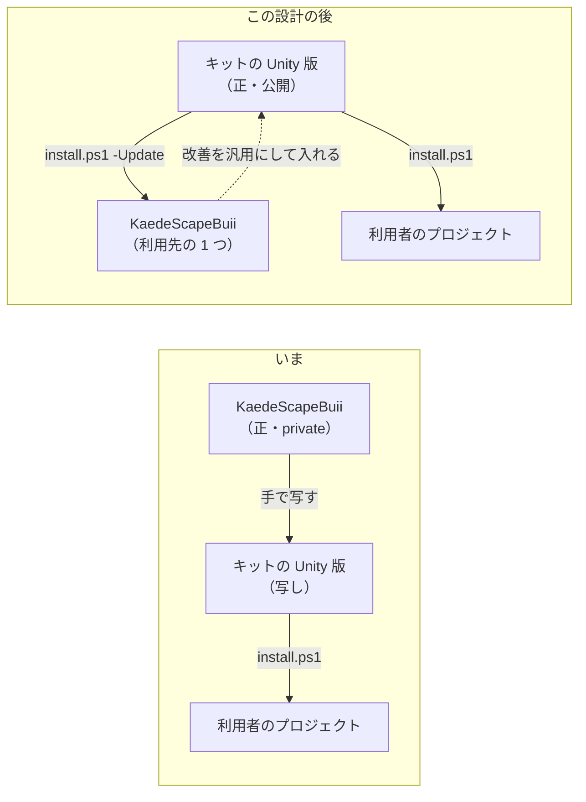

# Unity 版を元のリポジトリの写しから切り離す設計

Unity 版（`editions/unity/files/`）の正を、作者の private のリポジトリ KaedeScapeBuii からキットへ移す。
KaedeScapeBuii は「Unity 版を入れた利用先」になり、改善はキットに入れてから `install.ps1 -Update` で届ける。
試験 K-4 は「参照と同じ」を見るのをやめ、「入れた結果」と「写す物に、特定のプロジェクトだけの語が無い」の 2 本に置き換える。

状態: **決定**（2026-11-13。5 章の E1〜E6 はユーザー「推しの案　でやって」で推しの案に決定。了承の前に別のエージェントが見直し、指摘 12 件を反映した。9 章）。

## 0. ゴールと合格の条件

**ゴール**: Unity のプロジェクトを持つ利用者が Unity 版を入れ、入った文書とスクリプトを読んで、作者のプロジェクトの名前・版・フォルダーの話が 1 つも出てこないのを見て、自分のプロジェクトの道具として使えると分かる。作者は、KaedeScapeBuii で見つけた改善をキットに入れ、`-Update` の 1 回で KaedeScapeBuii に戻せる。

| # | 合格の条件 | 誰が・どう確かめるか | 段 |
|---|---|---|---|
| S-1 | `editions/unity/files/` に、3.2 の「固有の語」が 0 件 | 機械。試験「K-4 固有の語」 | U2 |
| S-2 | 空の git の作業場所に入れると一覧どおりの物ができ、`-DryRun` は何も書かず、2 回目は 0 件を写す。環境変数が無くても回る | 機械。試験「K-4 入れた結果」（Windows と pwsh があるとき） | U1 |
| S-3 | 3.1 の表の 6 つのファイルに、旧い決まりの語（`実物の写し`・`参照との比べ`・`元のリポジトリで直してから写す`・`KIT_UNITY_REFERENCE`）が 0 件 | 機械。語を見る試験 1 本 | U1 |
| S-4 | 3.4 の A の改善 6 つが Unity 版にあり、仕様 9 章の Unity 版の欄と合う | 機械（関数の名前と決まった文字列を見る試験）と、AI の判定（U3 の Issue が合格した後、会話のセッションが判定役のエージェントを立て、仕様の欄とスクリプトを並べて読ませる。何を直したかは渡さない） | U3 |
| S-5 | 3.5 の B のスクリプト 5 本が一覧にあり、構文の誤りが 0 件で、固有の語が 0 件 | 機械 | U4 |
| S-6 | `node scripts/test.mjs` の最後の行が `Result: PASS` | 機械 | 全部の段 |
| S-7 | U2 の言い換えで、決まりと手順の中身が減っていない（見出しの数が同じ・一覧のファイルが全部ある・消えた段落は 3.2 の「消す」と決めた物だけ） | 機械（見出しの数とファイルの一覧）と、AI の判定（判定役が U2 の差分を読む） | U2 |
| S-8 | KaedeScapeBuii に `-Update` で入れた後、利用先が手を入れる 3 つ（`CLAUDE.md`・`.gitignore`・`.gitattributes`）を除いて差が 0 件（2 回目の `-Update` が `0 件を写した` と出す）で、KaedeScapeBuii のテストが `Result: PASS` | KaedeScapeBuii のセッション（このリポジトリの外）。結果はユーザーが伝える | U5 |
| S-9 | 入った文書を読んで、作者のプロジェクトの話が無いと感じる | ユーザーの最終判定 | U2 の後 |

その段の条件が全部満たされるまで、その段を「できた」と報告しない。

## 1. 目的と範囲

| 項目 | 中身 |
|---|---|
| 解きたいこと | Unity 版が private のリポジトリの写しなので、(1) 写しに作者のプロジェクトの名前・Unity の版・フォルダーの例が残る、(2) 元のリポジトリの改善が 3 週間キットに届かなかった、(3) 元のリポジトリだけの中身（商品の撮影の手順など）は公開できず、K-4 が通る日が来ない |
| 読む人 | キットを直す Claude Code と作者 |
| 扱わないこと | UE 版（`editions/unreal/files/`。E5）・Node 版のスクリプト・無人の回の決まりそのもの（仕様の 1〜8 章）。まとめを Issue ごとに 1 ファイルにする改善（仕様 6 章を変えるので別の設計。3.4 の後ろ） |

指示との対応:

| ユーザーの指示（そのまま） | この設計のどこで答えるか |
|---|---|
| 「今後Unityの方のも反映したい」 | 2 章の向き（キットが正）・4 章 U3〜U5 |
| 「K-4の差を仕分けて」 | 3.3 の仕分けの表 |
| 「KaedeScapeBuii依存をキットと分離した方がいいよね？UnityのキットとしてOSSにしてるから」 | E1（正をキットへ）・E2（K-4 の置き換え）・3.2（固有の語） |
| 「推しの案　でやって」 | 5 章の E1〜E6 を推しの案で決定 |

## 2. 形



| 部品 | 役目 | ファイル |
|---|---|---|
| Unity 版の部品 | 利用先に写す物。**ここが正** | `editions/unity/files/` |
| 入れるスクリプト | 写す。利用先が手を入れる 3 つ（`CLAUDE.md`・`.gitignore`・`.gitattributes`）は `-Update` で上書きしない（今のまま。変えない） | [install.ps1](../../editions/unity/install.ps1) |
| 試験 K-4（2 本） | 入れた結果・固有の語が無いこと | [kit.test.mjs](../../tests/kit.test.mjs) |
| 仕様 9 章 | Unity 版の欄。U1 と U3 で直す | [issue-run-spec.md](../../shared/spec/issue-run-spec.md) |
| 決まりの文 | 「実物の写し」を「キットが正」に置き換える | 3.1 の表 |

## 3. 詳しい決まり

### 3.1 置き換える決まりの文（U1）

旧い文は消して置き換える（例外を書き足さない）。

| 所 | いまの文 | 置き換えた後 |
|---|---|---|
| [CLAUDE.md](../../CLAUDE.md)「守るもの」 | 「`editions/unity/files/` は KaedeScapeBuii で動いた実物の写し。…K-4（参照との比べ）の許す差を…」 | 「`editions/unity/files/` はキットが正。特定のプロジェクトだけの語（名前・Unity の版・フォルダー）を入れない（試験 K-4 が見る）。元は KaedeScapeBuii で、改善はキットに入れてから `install.ps1 -Update` で戻す。」 |
| [基本設計](issue-driven-kit-basic-design.md) K-4 の行 | 「…このリポジトリと同じ部品の組ができる（名前を埋めた後の差が、決めた所だけ）」 | 「Unity 版に固有の語が無く、空の作業場所に入れると一覧どおりの物ができる」 |
| 基本設計 2 章の図 | 「KaedeScapeBuii の実物の写し」 | 「キットが正」 |
| [SOURCE.md](../../shared/SOURCE.md) | 「正はそちらにある。キットの中では直さない」・K-4 の伏せ方の行 | 「2026-11-13 まで写しだった。いまはキットが正」。伏せ方の行から K-4 の話を消す。写した記録の表は残す |
| [label-wording-design.md](label-wording-design.md) 37・38 行目 | 「実物の写し。変えると K-4 の許す差を足す…」「見本の『札』は…Unity 版と揃える」 | 37: Unity 版も言い換えの対象（この設計の U2）。38: 見本の本文は元の Issue の本文そのままなので変えない（答えのファイルに響く） |
| [仕様](../../shared/spec/issue-run-spec.md) 9 章の 4 行 | 「まだ（元のリポジトリで直してから写す）」 | 「まだ」（直す場所はキット。向きは書かない） |
| [kit.test.mjs](../../tests/kit.test.mjs) の頭のコメントと K-4 | 「参照（KaedeScapeBuii）と同じ物ができる … 環境変数 KIT_UNITY_REFERENCE があるときだけ」 | 「K-4 入れた結果」（3.7） |

### 3.2 固有の語（試験「K-4 固有の語」が見る物）

一覧は試験のファイルの 1 か所（`tests/kit.test.mjs` の定数 `unityForbidden`）に置く。`editions/unity/files/` の全部のファイルを 1 行ずつ見て、当たった行を `ファイル:行` で出す。大文字と小文字を分ける。

| # | 語（正規表現） | 理由 | いま当たる行の数（2026-11-13 に `git grep -c` で数えた） |
|---|---|---|---|
| F1 | `[Kk]aede[Ss]cape` | 作者のプロジェクトの名前（`KaedeScapeBuii`・`kaedescape`） | `KaedeScapeBuii` が 39 行・15 ファイル |
| F2 | `kaedevn` | 作者の別のプロジェクトの名前 | 63 行・20 ファイル |
| F3 | `(?<![A-Za-z])Scape`・`(?<![a-z])scape-`・`SCAPE` | 作者のプロジェクトの呼び名・クラス・スクリプト・ログの印（`Scape M1`・`ScapeCommand`・`build-scape-exe.ps1`・`SCAPE-AUTOSHOT`） | F1 の行のほかに、`genai-cli-mcp-policy.md` に 5 行以上（見直しで見つかった。`Scape M1` などの語を足した後の数は U2 で数える） |
| F4 | `6000\.\d+` | Unity の版の番号 | `6000.x.yf1` の形が 3 行・3 ファイル。ほかに `Unity 6000.6` が 2 行 |
| F5 | `mkanakureon` | 作者のアカウント | 4 行・2 ファイル |
| F6 | Windows と Mac のユーザーのフォルダーのパスで、名前が `<you>` でない物（置き換える前の K-4 の `mask` が伏せていた 3 つの形） | PC の中のパス | 0 行 |
| F7 | `札` | 言い換える語 | 19 行・6 ファイル |
| F8 | `#(?![123]\b)\d{1,3}\b` | private の Issue の番号（「#61」「#103」）。例に使う番号は `#1`〜`#3` だけにする（ひな形の「- #1」・コミットの例の「Issue #3」は残る。U2 の Issue を作るときに、全部の番号を禁じると例まで当たると分かり、狭めた） | `#` と数字の行は 32 行（例の番号を含む） |
| F9 | `\bM1\b`・`\bD9\b`・`ShotService`・`ShotCapturer`・`TestWorldBuilder` | 作者のプロジェクトの段・決めごと・クラスの名前（F3 に当たらない物。`genai-cli-mcp-policy.md` にある） | 10 行前後（U2 の Issue を作るときに見つけた） |

言い換え方（U2 の Issue の本文にそのまま入れる。無人の回が自分で決める所を残さない）:

| いまの書き方 | 置き換えた後 |
|---|---|
| 「このリポジトリ（KaedeScapeBuii・Unity 6000.6.6f1）」 | 「このリポジトリ」。版は `ProjectSettings/ProjectVersion.txt` を指す |
| 版の表の行「Unity ・ 6000.6.6f1（d20c9ac777da）」・「Unity 6000.6」 | 「Unity ・ `ProjectSettings/ProjectVersion.txt` の版」・「Unity 6」。版のハッシュも消す |
| 「kaedevn（UE）の issue-run をそのまま持ってきた」 | 「元は Unreal Engine のプロジェクトの仕組み」 |
| 「kaedevn #15・#33 で…」「2026-11-01 #61: …」のような由来 | 番号とプロジェクトの名前を外し、起きたことだけを残す（「始めた回が約 80 分待って打ち切られたことがある」）。E3 |
| 例の中の Issue の番号（`-Issue 12`・「#12」） | `-Issue 12` はそのまま（`#` が無いので当たらない）。`#1`〜`#3` はそのまま。ほかの番号の例は「#<番号>」か `#1`〜`#3` |
| `issue-goal-setting.md` 9 章の表の、Issue の番号の列 | 列の中身を「—」にする（行と出来事は残す） |
| 見出しの中の固有の語（`genai-cli-mcp-policy.md` の「2.3 M1 での実際」「6. kaedevn での事実」など） | 見出しは消さずに言い換える（「2.3 実際にできたこと」「6. 元のプロジェクトでの事実」）。**見出しの数はどのファイルも変えない** |
| パスの例 `C:\Users\<you>\Documents\UnityProject\KaedeScapeBuii-wt2` | `C:\work\<プロジェクト>-wt2` |
| POSIX 形の例 `c/Users/<you>/Documents/UnityProject/KaedeScapeBuii` | `c/work/<プロジェクト>` |
| 名前空間の例 `KaedeScapeBuii.Tests.EditMode` | `<名前空間>.Tests.EditMode`（ひな形の `CLAUDE.md` と同じ書き方）。`issue-goal-setting.md` の確認コマンドの例は、表の行と正規表現を同じ名前空間にそろえる |
| `github-repo.md` の `mkanakureon/…` | `<owner>/<リポジトリ>` |
| `save-report/SKILL.md` の `project: KaedeScapeBuii`（固定値） | `project: <リポジトリの名前>`（`git remote get-url origin` の最後の名前） |
| 「札」 | ラベルを指す所は「ラベル」、Issue の役目を言う所（「Issue は…の札」）は「指示書」。KaedeScapeBuii が既に使っている言い方 |
| `genai-cli-mcp-policy.md` の、作者のプロジェクトの道具の話（2.3 節・5 章。`ScapeCommand`・`-scape-autoshot`・`ShotService` など） | 節ごと一般の書き方に直す（「プロジェクトの CLI」「撮影の引数」）。一般の書き方にできない段落は消す（**消してよいのはここだけ**） |
| 確かめた Unity の版 | 写す物には書かない。導入ガイド（`shared/manuals/issue-driven-kit-install-guide.md`）の「確かめた版」に既にある |

### 3.3 K-4 の差の仕分け（2026-11-13・KaedeScapeBuii `29fc518` と比べた）

12 ファイルが違った。中身で 3 つに分ける。

| 分類 | 中身 | どうするか |
|---|---|---|
| A. どの Unity のプロジェクトにも効く改善 | 3.4 の 6 つ | U3 でキットに入れる |
| B. 汎用だが、キットに無いスクリプトが要る | 3.5 の 5 本と、それを使う手順 | U4 でキットに入れる |
| C. KaedeScapeBuii だけの物 | 3.6 の表 | キットに入れない。KaedeScapeBuii の中で、キットが持たないファイルへ移す（U5） |

### 3.4 A: 入れる改善（U3）

| # | 改善 | 触る所 | 仕様 9 章 |
|---|---|---|---|
| A1 | Unity エディタが作業場所を開いていたら、Issue を始めずに `BLOCKED`（終了コード 3）で終わる。`-DryRun` は知らせるだけ。回の途中で開かれたときだけ、今の「バッチモードを禁じて渡す」を使う | `Scripts/issue-run.ps1`（`Get-UnityHolders` を分ける）・`issue-run.md` | 「使用中の判定」の欄に、始めないことと終了コードを書く |
| A2 | 残った「実行中」のラベルを、対象を数える前に外す（`-DryRun` は外さずに知らせる） | `Scripts/issue-run.ps1`・`issue-run.md` | 行を足す（Node 版は対象を数えた後に外す。「Node 版はまだ」） |
| A3 | 無人の回の中から呼ばれたら（`ISSUE_RUN_ROOT` がある）作業場所を聞かない。確認コマンドにも `ISSUE_RUN_ROOT` を渡す | `Scripts/issue-run.ps1` | 欄は足さない（Unity 版だけの、作業場所を選ぶ画面の話） |
| A4 | `-DryRun` は実行中のロックで止めない | `Scripts/issue-run.ps1` | 行を足す（仕様 7 章の二重起動の話。Node 版は `--dry-run` でも止まる。「Node 版はまだ」） |
| A5 | `UNITY_EXE` をユーザーの環境変数から読む・`gh` が PATH に無ければ `Program Files\GitHub CLI` を探す | `Scripts/issue-run.ps1` | 欄は足さない。コメントの中の PC のドライブ・Issue の番号・まだ無いファイルの名前（`issue-gh.ps1`）は外して入れる |
| A6 | Windows の Smart App Control が Unity の DLL を止めたら（ログに `0x800711C7`）、`FAIL` でなく `BLOCKED`（3）にする。点検にも足す | `Scripts/unity-test.ps1`・`Scripts/issue-run-doctor.ps1`・`unity-test-procedure.md`・`issue-driven-development.md` | 欄は足さない（テストの入口の `BLOCKED` は今の欄にある） |

- 入れるときは KaedeScapeBuii の行をそのまま写さず、3.2 の言い換えを当ててから入れる。仕様 → スクリプト → 見本の順（`CLAUDE.md`「守るもの」）。
- 試験: 読み取りの関数は今の [read-fixtures.ps1](../../tests/unity/read-fixtures.ps1) と同じく構文木で取り出して回す。外に触る所（`gh`・`Get-CimInstance`）を通さずに確かめられる分だけ関数に出して回す。出せない所は、関数の名前と決まった文字列があることを見る（判定不能の試験と同じ形）。
- **入れない物（未採用の改善）**: まとめを Issue ごとに 1 ファイル（`Docs/Reports/IssueRuns/issue-<番号>-<日時>.md`）にする改善。仕様 6 章（1 回の実行に 1 本・名前・題・並び順）と 6.1（まとめの相対パス）を変えるので、「仕様 → 両方の版 → 見本」の別の設計にする。それまで Unity 版のまとめは今の形のまま。

### 3.5 B: 足すスクリプト（U4）

| ファイル | 行の数 | 役目 | 入れる前に外す物 |
|---|---|---|---|
| `Scripts/issue-protect.ps1` | 23 | 守るファイルを決める関数 `Get-ProtectedFiles`（`issue-run.ps1` と `issue-create.ps1` が同じ物を読む） | キットに無い設計書を指すコメント |
| `Scripts/issue-gh.ps1` | 25 | `gh` を探す共通の部品 | — |
| `Scripts/issue-create.ps1` | 83 | 下書きから Issue を作り、無人の回が拾えるまで確かめる | 作者のプロジェクトの説明書のパスの行・キットに無い設計書を指すコメント・Issue の番号 |
| `Scripts/issue-result.ps1` | 76 | 回った跡を見る（`PASS` 0・`FAIL` 1・`NOTRUN` と `RUNNING` 2） | UI の撮影の PNG を探す所（キットに無いスクリプトの出力）。まとめを探す先は、今の形（`Docs/Reports/YYYY/MM/DD/NN-issue-run.md`）に合わせる |
| `Scripts/issue-close.ps1` | 35 | 決まった形のコメントを付けて閉じる | 頭のコメントの「確認せずに進めてよい」と作者の別のプロジェクトの名前 |

- `Scripts/issue-run.ps1` も直す: 中の `Get-ProtectedFiles` を消して `issue-protect.ps1` を読み、呼び出し 4 か所に `$RepoRoot` を渡す。
- `tests/kit.test.mjs` の一覧 `unityFiles` に 5 本を足す。
- `github-issue/SKILL.md` と `issue-goal-setting.md` の手順を、この 5 本を使う形に直す。
- `new-issue-check.ps1`（166 行）は入れない。作者のプロジェクトの設計書の表の形に頼っているため（C）。
- 「Issue の作成・閉じるは確認せずに進める」は、スキルにもスクリプトのコメントにも入れない。キットの `CLAUDE.md` の原則 1（外への書き込みは先に確認する）とぶつかり、どちらにするかは利用先が自分の `CLAUDE.md` で決めること。

### 3.6 C: キットに入れない物と、KaedeScapeBuii での行き先（U5）

| 物 | いまの置き場（KaedeScapeBuii） | 行き先 | 理由 |
|---|---|---|---|
| Asset Store のフォルダー・`Projects/*/` の行 | `.gitignore` | そのまま | `.gitignore` は利用先が手を入れる物で、`-Update` が上書きしない |
| 撮影・全画面・URP・HDRP の手順（約 100 行） | `unity-test-procedure.md` | KaedeScapeBuii の新しい手順書（キットが持たない名前）。`CLAUDE.md` の入口から指す | `unity-test-procedure.md` はキットが持つので、`-Update` で上書きされる |
| `new-issue-check.ps1` とその使い方 | `Scripts/`・`github-issue/SKILL.md` | スクリプトはそのまま。使い方は `CLAUDE.md` の入口か上の手順書へ | スキルはキットが持つ |
| まとめを Issue ごとに 1 ファイルにする形 | `Scripts/issue-run.ps1` | `-Update` で今の形に戻る。続けたいなら、先に 3.4 の後ろの別の設計を通す | 仕様 6 章 |
| Unity の版の番号 | スキル・方針の文書 | 書かない（`ProjectSettings/ProjectVersion.txt` が正） | 3.2 |
| 「Python は無い」などその PC の事情・「Issue の作成は確認せずに進める」 | `github-issue/SKILL.md` | `CLAUDE.md` | 利用先が決めること |

U5 の順（KaedeScapeBuii のセッションがする。このリポジトリのセッションは触らない）:

1. 上の表のとおり、C を行き先へ移してコミットする。
2. `pwsh <キット>\editions\unity\install.ps1 -Target . -Update -DryRun` で、`update` と `keep` の一覧を見る（`-Update` を付けないと、違うファイルが「ぶつかる」になり `Result: FAIL` で終わる）。
3. `-Update` で入れ、`git diff` を読む。消えて困る行があれば、それは C の移し漏れなので 1 へ戻る。
4. KaedeScapeBuii のテストを回す（`Result: PASS`）。`.issue-kit/version` ができる（いまは無い）。

### 3.7 試験

| 試験の名前 | 見る物 | いつ回るか | 段 |
|---|---|---|---|
| `K-4 入れた結果: Unity 版を空の作業場所に入れると一覧どおりの物ができる` | `-DryRun` は書かない・入れた後に `unityFiles` が全部あり、中身がキットの物と同じ・`.issue-kit/version` の `edition` が `unity`・2 回目は `0 件を写した` | Windows と pwsh があるとき（環境変数は要らない） | U1 |
| `決まりの文に、Unity 版が写しだった頃の語が無い` | 3.1 の 6 つのファイルに S-3 の 4 つの語が無い（試験のファイル自身は、語を組み立てて持つ） | いつも | U1 |
| `K-4 固有の語: Unity 版に特定のプロジェクトだけの語が無い` | 3.2 の F1〜F8 | いつも | U2 |

## 4. 作る順

| 段 | すること | 満たす条件 | 進め方 |
|---|---|---|---|
| U1 | 3.1 の決まりの文を置き換える。K-4 を「入れた結果」に置き換え、決まりの文の試験を足す。テストは通ったまま | S-2・S-3・S-6 | 会話（`CLAUDE.md` は無人の回が書き換えられない） |
| U2 | 3.2 の言い換えを `editions/unity/files/` に当て、試験「K-4 固有の語」を足す | S-1・S-6・S-7・S-9 | 無人の回。確認コマンドは、Issue の本文に F1〜F8 を直に書いた検査（試験のファイルに頼らない）・見出しの数・`node scripts/test.mjs` |
| U3 | A の 6 つ。仕様 9 章 → スクリプト → 手引き → 試験 | S-4・S-6 | 無人の回。A1〜A5（`issue-run.ps1`）と A6（テストの入口）の 2 件に分ける |
| U4 | B の 5 本と手順・`issue-run.ps1` の `Get-ProtectedFiles` の出し直し | S-5・S-6 | 無人の回 |
| U5 | KaedeScapeBuii に入れ直す（3.6） | S-8 | KaedeScapeBuii のセッション |

- **どの段の後も `node scripts/test.mjs` は通る。** 「K-4 固有の語」の試験は、言い換えと同じ U2 のコミットで足す（U1 で先に足すと、U2 が終わるまで `main` のテストが落ちる）。
- **順の理由**: U3 は U2 の後（入れる行に 3.2 の言い換えを当てるので、固有の語の検査が先に要る）。U4 は U3 の後（`issue-create.ps1` は `issue-run.ps1 -Issue <番号> -DryRun` を呼ぶ。A3〔聞かない〕と A4〔ロックで止めない〕が無いと、無人の回の中で止まる）。
- このリポジトリにはレーンの worktree が無いので、U1 は `main` でする（今までの Issue と同じ）。

## 5. 決めること（2026-11-13 に全部決定）

| # | 決めること | 決定（推しの案） | ほかの案 | 理由 |
|---|---|---|---|---|
| E1 | Unity 版の正をどこに置くか | **キット** | KaedeScapeBuii のまま（写しを続ける） | 公開の OSS の部品が private のリポジトリに従うと、C がある限り同じにならない。Node 版は初めからキットが正で、キット自身と rpg-online-cloudflare に `--update` で届いている |
| E2 | K-4 をどうするか | **「入れた結果」と「固有の語が無い」に置き換える**（番号 K-4 はそのまま使う） | 消す／許す差を 12 ファイルぶん書く | 消すと、固有の語が戻っても気づけない。許す差を書くと、KaedeScapeBuii が進むたびに直すことになる |
| E3 | 由来の Issue の番号（「kaedevn #15」など）を残すか | **番号を外し、起きたことだけ残す** | 「元のリポジトリの #15」として残す | 利用者はたどれない。理由（何が起きたか）は残るので、決まりの根拠は読める |
| E4 | B の 5 本を入れるか | **入れる**（U4） | 入れず、A だけにする | A3・A4 は `issue-create.ps1` が `-DryRun` を呼ぶことから来た直しで、5 本が無いと手引きと実物がずれたままになる。5 本で 242 行 |
| E5 | UE 版（`editions/unreal/files/`）も同じにするか | **今回は変えない**（写しのまま） | 同じにする | 入れるスクリプトが無く、利用者は入れない。置いた理由は「PowerShell の判定不能の元」で、今日その役目を終えた。消すか版にするかは別に決める |
| E6 | KaedeScapeBuii への入れ直し（U5）をいつするか | **U4 の後に 1 回** | U2・U3・U4 のたび | 途中で入れると、まだキットに無い改善（A・B）を KaedeScapeBuii から消すことになる |

## 6. 外れたとき

| 起きること | 動き |
|---|---|
| U2 の言い換えで、文の意味が変わる所がある（由来が無いと決まりの理由が読めない） | 番号だけ外して出来事は残す（E3）。出来事も private の中身なら、その文を消して決まりだけ残す |
| A を入れる途中で、仕様の 1〜8 章と食い違う動きが見つかる | 仕様を正として、Unity 版を仕様に合わせる。仕様を変えたいときは、この設計の外（仕様 → 両方の版 → 見本の順） |
| F3・F8 が、関係の無い語に当たる | 当たった語を見て、正規表現を狭める（試験の定数の 1 か所） |
| U5 で、`-Update` が KaedeScapeBuii の要る行を消す | C の移し漏れ。`git checkout` で戻し、3.6 の 1 へ戻る。汎用の改善だったら、キットに入れてから入れ直す |
| KaedeScapeBuii がその後も先に進む | 改善はキットに入れてから戻す（2 章の点線）。KaedeScapeBuii だけを直すと、次の `-Update` で消える |

## 7. 比べた案

| 案 | よい点 | 悪い点 | 選んだか・理由 |
|---|---|---|---|
| A. キットを正にし、K-4 を置き換える（採用） | 公開の部品が private に頼らない。改善の届く向きが Node 版と同じ 1 つになる | 言い換えが 150 行以上。KaedeScapeBuii 側で C を移す仕事が要る | 選ぶ。ゴール（利用者が自分の道具として読める）に届くのはこれだけ |
| B. 写しを続け、12 ファイルを丸ごと写し直す | 仕事が少ない。K-4 が今日通る | C（商品の撮影の手順・Asset Store のフォルダー名）が公開に出る。キットに無いスクリプトを指す文が入る | 選ばない |
| C. 写しを続け、K-4 の許す差に C を書く | C は出ない | 許す差が 100 行以上になり、KaedeScapeBuii が進むたびに直す。固有の語は残る | 選ばない |
| D. K-4 を消すだけ | いちばん軽い | 固有の語が残り、戻っても気づけない | 選ばない |

## 8. 確かめ方

```sh
node scripts/test.mjs                    # Result: PASS（S-1〜S-7 の機械の分）
node scripts/test.mjs --filter 'K-4'     # K-4 の 2 本だけ
```

この設計を書くときに確かめたこと（2026-11-13）:

| 確かめたこと | 結果 |
|---|---|
| 置き換える前の K-4 を `KIT_UNITY_REFERENCE` を付けて回す | `Result: FAIL (0/1)`。12 ファイルが参照と違う |
| ふだんのテスト | `Result: PASS 88/88`（K-4 は環境変数が無く skip） |
| `install.ps1` の利用先が手を入れる物 | `CLAUDE.md`・`.gitignore`・`.gitattributes` の 3 つ（21 行目）。`-Update` を付けないと、違うファイルは「ぶつかる」で `Result: FAIL`（47〜68 行目） |
| KaedeScapeBuii に `.issue-kit/version` があるか | 無い（キットから入れたことが無い） |
| B の 5 本の行の数 | 3.5 の表のとおり（計 242 行） |

確かめていないこと: F3 と F8 を足した後の当たる行の数（U2 の初めに数える）・`-Update` を KaedeScapeBuii に当てた結果（U5）。

## 9. 見直しの記録（2026-11-13）

了承の前に、書いた本人でないエージェントが実物と比べて見直した。指摘 12 件と直した所:

| # | 指摘 | 直した所 |
|---|---|---|
| 1 | まとめを Issue ごとにする改善が仕様 6 章とぶつかる | A から外し、未採用の改善にした（3.4 の後ろ・1 章・3.6） |
| 2 | 仕様 9 章の「元のリポジトリで直してから写す」の 4 行に触れていない | 3.1 と S-3 に足した |
| 3 | F3 の「ほかは 0 か所」が誤り・取りこぼしがある | F3 を広げ、`genai-cli-mcp-policy.md` の言い換えの行を足した |
| 4 | B の固有の語の数が合わない・語に当たらない固有の中身がある | 3.5 を「入れる前に外す物」の列に書き直した。F1 を広げた |
| 5 | U5 の `-DryRun` のコマンドが `Result: FAIL` で終わる | `-Update -DryRun` に直した |
| 6 | 「差が 0 件」は利用先が手を入れる 3 つがあり満たせない | S-8 を書き直した |
| 7 | S-1 は中身を消すだけでも合格する・言い換えの表に穴がある | S-7 と F8 を足し、言い換えの表を埋め、F4 を広げた |
| 8 | 「U3 と U4 は入れ替えられない」の理由が違う | 4 章の「順の理由」を書き直し、3.5 に `issue-run.ps1` の直しを足した |
| 9 | U1 の後に `main` のテストが落ちる | K-4 を 2 本に分け、「固有の語」の試験は U2 で足す形にした |
| 10 | A2・A4 は Node 版と動きが分かれる | 仕様 9 章に行を足すと決めた（3.4） |
| 11 | `label-wording-design.md` は 38 行目も直す | 3.1 に足した |
| 12 | 数は「か所」でなく行の数・`RUNNING` が抜けている | 3.2 の列の名前と 3.5 を直した |

> この文書は Claude Fable 5.2 が生成しました。内容の正確性は人間のレビューを経て確認してください。
