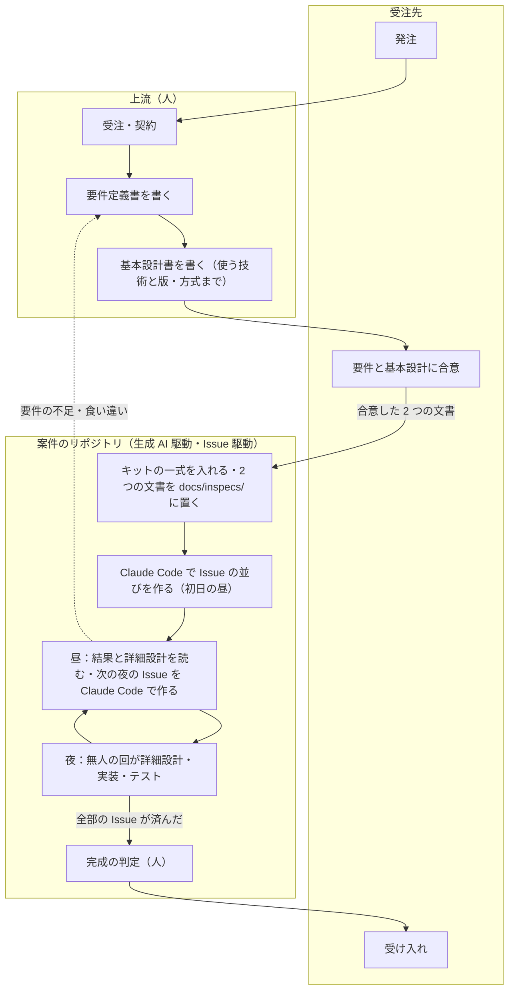

# 適用例 3 本の共通の前提 — 上流は人が書き、基本設計の後を生成 AI 駆動で作る

> Generated by Claude Opus 5.5 — 2026年11月3日

キットの適用例（TypeScript・.NET・Java の業務アプリ）を、Issue 駆動で作るための**元ネタ**。3 本の要件定義書と基本設計書は、ここで決めた前提の上に書いてある。3 本で共通の決まりはこの文書だけに書き、各文書は「共通 §n」として節の番号で指す。

| 項目 | 内容 |
|---|---|
| 文書 | [`typescript/`](typescript/)・[`dotnet/`](dotnet/)・[`java/`](java/) の `requirements.md`（要件定義書）・`basic-design.md`（基本設計書）。どちらも版 1.1。**案件のリポジトリへ持っていくのはこの 2 つだけ**（6 章）。Issue の並び・Issue・詳細設計は案件のリポジトリで作る |
| 原本（版 1.0・人の文書・読むだけ） | `docs/inspecs/2026/11/issue-driven-examples-six-documents/` |
| 1.0 から変えたこと | 開発の PC を Windows に決めた・Docker をやめて PostgreSQL を先に入れておく・夜に無人の回で連続して実装する・Issue を 1 件 400〜700 行に分ける・詳細設計の段を足し、夜の「設計書を書く」Issue で書かせる・.NET と Java は版を新しく作らず Node 版を広げて当てる・計測の決まりを足した（2026-11-03 の検討。ユーザーの指定） |
| 試し方 | 3 本を 5 回作り直し、回と回の間にキットを直して、回5で成功させる。計画と成功の条件は [`docs/design/issue-driven-examples-plan.md`](../../../design/issue-driven-examples-plan.md) |
| 説明会との関係 | 説明会の方針（`docs/inspecs/2026/11/地方IT企業向け Claude Code AI駆動開発 実践事例紹介方針（2026-11-03）.md`）の「再現できる実例」「作業時間・テスト結果」の材料になる |

---

## 1. 運用の想定：上流は人が書き、基本設計の後を生成 AI 駆動で作る

### 1.1 業務フロー

受託の案件を想定する。**受注先から受注したら、人が要件定義書と基本設計書の 2 つを書き、受注先と合意してから、案件の実装に入る。** この 2 つが上流からの入力で、案件の実装はここから始まる。



| 段 | 何をするか | 入力 | 出力 | 誰が |
|---|---|---|---|---|
| 1. 受注 | 範囲・納期・費用、生成 AI を使ってよいか、扱ってよい情報を決める | 発注 | 契約 | 人と受注先 |
| 2. 上流 | 要件定義書と基本設計書を書き、受注先と合意する | 契約・受注先との打ち合わせ | **要件定義書・基本設計書**（使う技術と版・方式まで決まっている） | 人（生成 AI は会話で下書きや見直しを手伝う程度） |
| 3. 案件の始まり | 案件のリポジトリを作り、キットの一式を入れ、2 つの文書を置く（6 章） | 2 つの文書・キット | 点検が通る案件のリポジトリ | 人と Claude Code（会話） |
| 4. 生成 AI 駆動 | 昼に Issue を作り、夜に無人の回が詳細設計・実装・テストを進める（1.3・4 章） | 2 つの文書 | 詳細設計・コード・テスト・記録 | 人（昼）・無人の回（夜） |
| 5. 完成と納品 | 要件の完成の条件を確かめ、受注先に渡す | 案件のリポジトリ | 納品物 | 人 |

この試しでは、3 本の要件定義書と基本設計書（このフォルダー）が「段 2 で人が書いて合意した物」の役をする。5 回の作り直しで測るのは、段 3〜5（生成 AI 駆動の段）だけ。

### 1.2 上流で作るものと、生成 AI 駆動で作るものの区別

| 段 | 作るもの | 書く人 | 生成 AI の使い方 | 決める責任 | 置き場 |
|---|---|---|---|---|---|
| **上流** | 受注・契約（範囲・納期・費用・生成 AI を使ってよいか・扱ってよい情報） | 人 | 使わない | 人と受注先 | 案件の外 |
| **上流** | 要件定義書（機能・業務の決まり・受入条件・非機能） | 人 | 会話で下書きや見直しを手伝わせてよい。文書を確定するのは人 | 人と受注先（合意） | 案件の `docs/inspecs/<年>/<月>/requirements.md` |
| **上流** | 基本設計書（構成・データ・API の一覧・画面の概要・テストの層・詳細設計の単位） | 人 | 同じ | 人と受注先（合意） | 案件の `docs/inspecs/<年>/<月>/basic-design.md` |
| **上流** | **使う技術と版・方式**（フレームワーク・ライブラリ・DB・実行環境の版をメジャーとマイナーまで。認証やロックなどの方式も） | 人 | 候補と今の安定版を調べさせてよい。決めるのは人 | 人（受注先と合意） | 基本設計書の「1.1 使う技術と版」と「決めた方式」 |
| 境目 | 基本設計書の合意（使う技術と版・方式まで決まっていること） | — | — | — | ここから先が生成 AI 駆動。詳細設計の中で版や方式を決めさせない |
| **生成 AI 駆動** | Issue の並び | **Claude Code**（初日の昼の会話） | 書かせる | 人が読んで直す | 案件の `docs/guides/working/issue-plan.md` |
| **生成 AI 駆動** | Issue（やること・合格の条件・確認コマンド・前提） | **Claude Code**（毎日の昼の会話。スキル `github-issue`） | 下書きを書かせ、確認コマンドを 1 回回させる | **合格の条件を決めるのは人** | 案件の GitHub Issue |
| **生成 AI 駆動** | 詳細設計（API の入出力・検証・エラー・画面の項目・テストの名前） | **無人の回**（夜の D の Issue） | 書かせる | 次の日の昼に人が読んで直す | 案件の `docs/guides/working/detailed-design/dd-*.md` |
| **生成 AI 駆動** | 実装・テスト・運用の文書 | **無人の回**（夜の実装の Issue） | 書かせる・回させる・やり直させる | 合格の条件（機械）。閉じるのは人 | 案件のリポジトリ |
| **生成 AI 駆動** | 結果の記録（まとめ・計測） | 無人の回と脚本 | 自動 | — | 案件の `docs/reports/` |
| **生成 AI 駆動** | 完成の判定・受注先への納品 | 人 | 使わない | 人 | — |

> [!IMPORTANT]
> **生成 AI 駆動の段で、要件と基本設計を変えない。** 2 つの文書は案件の `docs/inspecs/`（人の文書の置き場）に置くので、Claude Code は読むだけで、無人の回の設定も書き換えを断る。夜の Issue の中で要件の不足や食い違いが見つかったら、その Issue は止め、上流に戻す（人が直し、受注先と合意してから Issue を作り直す）。この試しでは、このフォルダーの文書を直してから次の回に持っていく。

> [!NOTE]
> 説明会で時間を見せるときは、上流の時間（人）と生成 AI 駆動の段の時間（人と無人の回）を分けて出す。この試しの計測（5 章）は生成 AI 駆動の段だけを測る。

### 1.3 生成 AI 駆動の段の回し方

**人は昼に Issue を書き、キットの無人の回が夜に実装する。朝には出来上がっている。** Issue を作りながら 30 分ずつ会話で実装するやり方はとらない。

| 誰が | すること | しないこと |
|---|---|---|
| 人（と Claude の会話） | 前の夜の結果を読む・詳細設計を読んで直させる・閉じる・次の夜の Issue を Claude Code に下書きさせ、合格の条件を確かめて作らせる（4.4） | アプリのコードを会話で直す（直した数は計測で数える。計画の S-2） |
| 無人の回 | 詳細設計を書く・実装・テスト・やり直し・コミット・結果のコメント | push・Issue を閉じる・要件と基本設計を変える |

---

## 2. 開発の環境（Windows・PostgreSQL を入れておく）

### 2.1 PC

| 項目 | 決まり |
|---|---|
| OS | Windows 11 x64 |
| 眠らせない | **電源の設定で、電源につないでいるときはスリープしない・蓋を閉じても何もしないにする。** キットの `keepAwake` は Windows では何もしない（`editions/node/files/scripts/issue-run/proc.mjs` が `none-windows` を返し、知らせを出すだけ） |
| Windows Update | 夜に回す期間は「更新の一時停止」にする（アクティブ時間は最大 18 時間で、夜と昼の両方は守れない）。再開は週末の昼に人がする |
| 画面のロック | .NET の画面のスモークテスト（UI Automation）の Issue を回す夜だけ、ロックしない。ほかの夜はロックしてよい |
| 道具の版 | Node.js 22.14.0・npm 11.6.2（3 本とも要る。キットの脚本と `js` の確認コマンドのため）・Git・gh・Claude Code。.NET 10 SDK と Windows App SDK、JDK 25 は、その版を作る前に入れる。入れた版は各リポジトリの README に書く |
| 認証 | `CLAUDE_CODE_OAUTH_TOKEN`（無人の回の長期トークン）をユーザーの環境変数に置く。点検（doctor）で確かめる |

### 2.2 PostgreSQL（Docker を使わない）

| 項目 | 決まり |
|---|---|
| 入れ方 | Windows にサービスとして入れる。起動の種類は「自動」 |
| 版 | **PostgreSQL 17** で 3 本共通。GitHub Actions の `services: postgres` も `postgres:17` にする（CI の Docker は GitHub の側で動き、手元の PC には関係しない） |
| DB とユーザー | アプリごと・用途ごとに分ける：`<app>_dev`（開発）・`<app>_test`（試験）。`<app>` は `salesflow_ts`・`salesflow_net`・`billing_java`。アプリごとに専用のユーザーを作り、自分の DB だけに権限を与える |
| 無人の回が触る DB | `<app>_test` だけ。試験の接続文字列は `<app>_test` を指す |
| 試験ごとの作り直し | 試験の入口が、毎回 `<app>_test` のスキーマを作り直してシードを入れる。2 回続けて回しても同じ結果になる |
| 秘密 | パスワードはリポジトリに入れない。ユーザーの環境変数か、`.gitignore` 済みの `.env` に置く。コミットするのは `.env.example` だけ |
| つながらないとき | 試験の入口が「DB に接続できない（<接続先>）」と 1 行出して `Result: FAIL`。実装の失敗と見分ける |
| 3 本を同じ夜に回すとき | DB はアプリごとに分かれているので取り合わない。CPU とディスクは取り合う（ビルドが重なる） |

### 2.3 Docker を使わない理由

| 案 | 夜中に止まりにくいか | 第三者が再現できるか | 同時更新のテスト | 採否 |
|---|---|---|---|---|
| **PostgreSQL を Windows のサービスとして入れる** | ◎ PC の起動と一緒に動く | ○ README に版と手順を書く | ◎ 本物 | **採用** |
| Docker Desktop と Compose（Testcontainers も） | △ Docker Desktop が起動していないと動かない。WSL2 や更新の後に止まることがある | ◎ コマンド 1 つ | ◎ | 不採用：夜中に止まるおそれ |
| Node の中で動く PostgreSQL（PGlite など）・SQLite・H2 | ◎ 何も入れない | ◎ | ✕ 接続が 1 本だったり方言が違ったりして、行のロック・同時更新・一意制約の振る舞いが本物でない | 不採用：在庫・二重請求の確かめが本物でない |

---

## 3. キットの当て方と文書の段

### 3.1 キットの当て方（3 本とも Node 版）

| 項目 | 決まり |
|---|---|
| 版 | 3 本とも **Node 版**（`editions/node/`）を入れる。.NET 版・Java 版を新しく作らない。無人の回そのもの（`claude -p`・GitHub・`js` の確認コマンド・守るファイル・前提）は言語に関係なく動く |
| 確認コマンド | Issue の確認コマンドは ```` ```js ```` の塊（仕様 9 章「版ごとに違う所」）。.NET と Java でも同じ |
| `package.json` | .NET と Java のリポジトリにも置く（依存は持たない）。キットのテストの入口が `issueKit` の欄を読むため |
| テストの入口 | `node scripts/test.mjs` が最後に `Result:` 行を出し、PASS 0・FAIL 1 で終わる。0 件は FAIL・わざと落とすと非 0（キットの K-5）。TS は vitest（`issueKit.testRunner`）。型チェック・lint・Playwright・`dotnet test`・`mvnw.cmd verify` を同じ入口で回すには、キットの準備 **P-1**（決めたコマンドを回して JUnit の XML を読む形）が要る |
| まだできないこと | P-1・P-2・P-6（計画 3 章）が済むまで、.NET と Java の Issue は無人の回で回さない |
| 版の記録 | 入れたキットの版は各リポジトリの `.issue-kit/version` |

### 3.2 文書の 4 段

キットの手順書（`docs/guides/procedures/issue-goal-setting.md` 1 章）は、新しい API や機能のような大きい仕事を「1 回目に設計書を書かせ、人が読んで直し、2 回目に実装させる」と決めている。適用例ではこれを夜と昼のくり返しに乗せる。

| 段 | 中身 | 変わる頻度 | 書く人・時 | 置き場 |
|---|---|---|---|---|
| 要件定義書 | 機能・業務の決まり・受入条件・非機能 | ほぼ変わらない（上流） | 人（受注の後） | このリポジトリの `<言語>/requirements.md` → 案件の `docs/inspecs/<年>/<月>/` |
| 基本設計書 | 構成・データ・API の一覧・画面の概要・テストの層・**使う技術と版**（メジャーとマイナーまで）・**決めた方式**・**詳細設計の単位** | ほぼ変わらない（上流） | 人（受注の後） | このリポジトリの `<言語>/basic-design.md` → 案件の `docs/inspecs/<年>/<月>/` |
| **詳細設計** | 単位ごとの API の入出力・検証・エラーの `code`・画面の項目・**テストの名前の表**（3.3） | 回ごとに書き直す | **無人の回が、実装の 1 晩前の夜に書く**（D の Issue）。人が次の日の昼に読んで直す | 案件の `docs/guides/working/detailed-design/dd-*.md` |
| Issue の並びと Issue | Issue 1 件ずつの、やること・元の文書（詳細設計の節）・合格の条件（テストの名前）・前提・守るファイル | 回ごとに直す | 並びは初日に Claude Code が書き、人が直す。Issue はその夜の前の昼に Claude Code が下書きし、人が合格の条件を確かめる（4.4） | 並びは案件の `docs/guides/working/issue-plan.md`、本文は案件の GitHub Issue |

基本設計だけで実装の Issue が書ける部分（テストの入口・スキーマ・シード・ドメインの計算）は、詳細設計を作らない。どの単位に詳細設計を作るかは、各基本設計の「詳細設計の単位」の表が正。

```text
夜1：基本設計だけで書ける土台を実装する ＋ 次の夜に要る詳細設計を書く
昼2：詳細設計を読んで直す（人のレビューの時間として測る）・夜2の Issue を書く
夜2：その詳細設計で実装する ＋ さらに次の詳細設計を書く
…
```

### 3.3 詳細設計の形と、設計書を書く Issue の合格の条件

詳細設計は、次の節をこの順で持つ。

| 節 | 書くこと |
|---|---|
| 1. 受け持つ範囲 | 基本設計の「詳細設計の単位」の行（要件の ID・API・画面） |
| 2. API | API 1 本ごとに：メソッドとパス・権限・要求の項目（名前・型・必須・検証）・応答の項目・エラー（状態コード・`code`・いつ出るか） |
| 3. 画面 | 画面 1 つごとに：項目とラベル・操作・状態（読み込み中・競合など）・テストで指す名前（`data-testid`・AutomationId・`id`） |
| 4. テストの名前の表 | `実装の Issue | テストの名前 | 何を確かめるか（入力と期待する値） | 要件の ID`。実装の Issue の合格の条件は、この名前を `requireTests` で指す |
| 5. この文書で決めたこと | 基本設計に無く、この文書で決めた点と理由。人に確かめたいこと |

設計書を書く Issue（D）の合格の条件は、**機械で確かめられることだけ**にする（中身のよしあしは、次の日の昼に人が読んで判断する。手順書 3.2）。

| 合格の条件 | 確認コマンドでの確かめ方 |
|---|---|
| ファイルがあり、git に入っている | `mustExist`・`gitTracked` |
| 5 つの節の見出しがそろっている | 見出しの行を数える |
| 基本設計のその単位の API・画面が、全部 2 節と 3 節に出てくる | パスと画面の ID を文字列で探す |
| その単位の要件の受入条件（AC）の ID が、全部 4 節の表に出てくる | ID を文字列で探す |
| 4 節の表に、実装の Issue ごとに 1 行以上ある | 表の行を数える |
| アプリのコードを変えていない | `gitClean`（アプリのコードのフォルダー） |

---

## 4. Issue の大きさと並べ方

### 4.1 大きさ

| 種類 | 1 件の大きさ | 見込みの時間 | 扱い |
|---|---|---|---|
| 実装（T・N・J） | 本体とテストで **400〜700 行** | **25〜50 分** | 標準。300 行未満はまとめ、800 行を超えるものは分ける |
| 設計書を書く（D） | 文書で 350〜450 行 | 20〜30 分 | 詳細設計の単位 1 つで 1 件 |

時間は見積もり。キットの実測（39 件合格・平均 約 4 分・最大 523 行で 13 分）は小さく、推しの直し方まで書いた Issue だったので、ビルドと DB の作り直しの分を足して大きく見ている。回1の実測で直す。

### 4.2 並べ方

| 決まり | 理由 |
|---|---|
| **その夜に回す Issue は、前の日の昼に書く**（一度に全部を作らない） | 無人の回は番号の小さい順に回す（仕様 1 章「順」）。朝に作る手直しの Issue が、その夜の新しい Issue より小さい番号になり、先に回る |
| 実装の Issue の `## 前提` に、元の詳細設計を書いた D の Issue を入れる | 人が直した詳細設計の上で実装させる（D は人が読んで直してから閉じる） |
| `## 前提` を一本の鎖にしない。認証・マスター・ドメインのように、互いに頼らない枝を並べる | 1 件落ちても、頼っていない枝は先へ進む。済んでいない前提の Issue は WAITING で飛ばされる（仕様 2.2） |
| 夜の中の鎖は 5 段まで | 1 件の失敗で止まる件数を抑える |
| **落ちた Issue（`claude-failed`）は、直したら人が閉じる** | 前提が「済んでいる」のは、閉じているか、`claude-done` で結果のコメントのコミットがブランチにあるとき（仕様 2.2）。直し方は 2 つ：会話で直して閉じる（計画の S-2 で数える）／手直しの Issue を作り、それが合格したら元の Issue を閉じる |
| 判定に使うテストの名前は詳細設計で先に決め、詳細設計のファイルは実装の Issue で守る | 実装の Issue の中で判定の基準を書き換えさせない（Java 版の要件 9 章の決まりを 3 本で共通にする） |

### 4.3 夜の回し方

```text
node scripts/issue-run/issue-run.mjs --round-minutes 60 --max-rounds 2
```

| 項目 | 値 | 理由 |
|---|---|---|
| 1 回の上限 | 60 分（既定 90） | 1 件が詰まっても夜の残りを食い尽くさない。既定のままだと最悪 90 分×4 回＝6 時間 |
| 回の数 | 2（既定 4） | 同じ |
| 利用上限 | 当たると 30 分待ってやり直す（最大 16 回）。3 本を同じ夜に並べると、1 つのアカウントの上限を取り合う | 回1の最初の 2 晩は TS だけを回して、1 晩の使用量を測る（計画 E3） |
| 起動 | 寝る前に、リポジトリごとに窓を 1 つ開いて起動する | — |

### 4.4 Claude Code で Issue の並びと Issue を作る（案件のリポジトリで）

Issue の並びと Issue は案件ごとに違うので、このリポジトリには置かない。**案件のリポジトリで、上流の 2 つの文書を元に、Claude Code で作る。** 使うのはキットのスキル `github-issue`（キットを入れると入る）で、Issue の書き方の正は案件のリポジトリの `docs/guides/procedures/issue-goal-setting.md`。

| 時 | Claude Code への言い方（例） | Claude Code がすること | 人がすること |
|---|---|---|---|
| 初日の昼（1 回） | `docs/inspecs/2026/11/ の要件定義書と基本設計書を読んで、Issue の並びを docs/guides/working/issue-plan.md に書いて。基本設計の「詳細設計の単位」ごとに、設計書を書く Issue を実装の 1 晩前の夜に置いて` | 夜ごとの表（番号・題・元の文書の節・前提・行数・分）を書く。4.1 の大きさ・4.2 の並べ方・7 章の目安に合わせる | 読んで直させる（夜の中の鎖の長さ・件数・目安からのずれ） |
| 毎日の昼 | `issue-plan.md の夜2の分を Issue にして` | 1 件ずつ、合格の条件と ```` ```js ```` の確認コマンドを書き、自分で 1 回回して「まだ作っていないから落ちる」ことを確かめ、`.issue-run/drafts/` に下書きを置く | 下書きの合格の条件を読む（**合格の条件を決めるのは人**） |
| 毎日の昼 | `作って` | `claude-run` を付けて Issue を作り、`--dry-run` で合格の条件と守るファイルを確かめて報告する | — |
| 毎日の昼 | `夜1の結果を見て` | まとめと Issue のコメントを読み、合格・不合格と理由を出す | 差分を読む・閉じる・落ちたものの直し方を決める（4.2） |
| 毎日の昼 | `DD-02 を読んだ。〜を直して` | 詳細設計を直してコミットする（文書だけ。アプリのコードは直さない） | 直す点を言う |
| 寝る前 | `Issueを回して` | `node scripts/issue-run/issue-run.mjs --dry-run` の結果と、本番のコマンド（4.3）を出す。この会話の中では回さない | 別の窓で本番を起動する |

Issue の並び（`issue-plan.md`）は Claude Code が書く文書なので、`docs/guides/working/` に置く（`docs/inspecs/` は人の文書だけ）。手直しの Issue を足したら、並びも直す。

---

## 5. 計測（説明会の方針 §3(2) に合わせる。生成 AI 駆動の段だけ）

| 何を | 単位 | どこから | 誰が |
|---|---|---|---|
| Issue・結果・分・回数・コミット | 1 件 | 無人の回のまとめ（各リポジトリの `docs/reports/`。自動） | 機械 |
| 費用（API で払った場合の換算） | 1 件 | `.issue-run/logs/*/issue-<番号>-round<N>.json` の `total_cost_usd` | 機械 |
| 変えたファイルと行数 | 1 件 | `git show --numstat` | 機械 |
| テストの件数と成功・失敗 | 1 件 | テストの入口が出す JUnit の XML | 機械 |
| 利用上限で待った回数と時間 | 1 晩 | **今は窓に出るだけでファイルに残らない**。キットの準備 P-3 で残す | 機械（P-3 の後） |
| **人が作業した時間** | 1 日 | 案件のリポジトリの `docs/inspecs/<年>/<月>/worklog.md`（人が書く）に、日付・始め・終わり・したこと（Issue を書く／結果を読む／詳細設計を読んで直す／閉じる／会話で直す）を 1 行ずつ書く | 人 |
| レビューで見つけたこと | 1 件 | 閉じるときに Issue へ 1 行コメント | 人 |

> [!IMPORTANT]
> 費用はサブスクリプションの長期トークンで回すので、実際の請求額ではない。「API で払った場合の換算」と書き分ける。従来の工数との比べは、同じ条件で測った記録が無いかぎり出さない（説明会の方針 §6）。

> [!WARNING]
> 今のキットは、利用上限で待った後のやり直しや時間切れの回で `round<N>.json` が上書き・欠けになり、費用が少なく出ることがある。直すのはキットの準備 P-3。

---

## 6. 案件のリポジトリの始め方（このリポジトリから持っていく物）

このリポジトリから案件のリポジトリへ持っていくのは、次の 2 種類だけ。**Issue の並び・Issue・詳細設計は持っていかない**（案件ごとに違うので、案件のリポジトリで Claude Code が作る。4.4）。

| 持っていく物 | 中身 | 持っていき方 | 案件のリポジトリでの置き場 |
|---|---|---|---|
| **上流の 2 つの文書** | 要件定義書・基本設計書（その言語のフォルダーの物） | 人が写す | `docs/inspecs/<年>/<月>/requirements.md`・`basic-design.md`（人が書く入力の置き場。Claude は読むだけで、無人の回の設定も書き換えを断る） |
| **キットの一式** | 設定（`.claude/`）・スキル・脚本（`scripts/`）・手順書と手引き（`docs/guides/`）・`CLAUDE.md` | 入れる脚本：`node editions/node/install.mjs --target <案件のリポジトリ> --dry-run` で確かめてから、`--dry-run` を外して入れる | 入れる脚本が決めた場所 |

この文書（共通の前提）は写さず、キットのリポジトリの物を指す。

| 順 | すること | 誰が |
|---|---|---|
| 1 | 案件のリポジトリを作る（回ごとに `issue-driven-example-<言語>-r<回>`。計画 E1） | 人（外への書き込みなので人が決める） |
| 2 | キットの一式を入れる・点検（`node scripts/issue-run/doctor.mjs`） | 人と Claude Code（会話） |
| 3 | 上流の 2 つの文書を `docs/inspecs/<年>/<月>/` に置く | 人 |
| 4 | 初期化（基本設計 1.1 の版で入れる・PostgreSQL の DB とユーザー・`package.json` の `issueKit`）。入らない版があれば上流に戻す | 人と Claude Code（会話） |
| 5 | Issue の並びを作り、夜1の Issue を作る（4.4） | 人と Claude Code（会話） |
| 6 | 昼と夜をくり返す（1.3・4.3） | 人・無人の回 |

> [!IMPORTANT]
> 案件の途中で要件と基本設計を直したくなったら、案件のリポジトリの `docs/inspecs/` を人が直し、受注先と合意する（1.2 の「上流に戻す」）。この試しでは、**このフォルダーの文書を直してから**次の回に持っていく。

---

## 7. 3 本の大きさ（見積もり・目安）

Issue の並びは案件のリポジトリで作るので、ここには件数の目安だけを置く。Claude Code が作った並びがこの目安から大きく外れていたら、昼に人が確かめる。

| | 行数（本体・テスト・設定） | 夜に回す Issue（うち設計書を書く D） | 昼の会話 | 手直しの見込み | 夜の数（予備） |
|---|---|---|---|---|---|
| TypeScript | 約 14,000 | 約 33（5） | 3 | 約 4 | 4（＋1） |
| .NET | 約 17,600 | 約 43（7） | 3 | 約 6 | 6（＋1） |
| Java | 約 15,000 | 約 37（6） | 3 | 約 5 | 5（＋1） |

生成されるファイル（マイグレーション・API の型）と文書は行数に数えていない。
