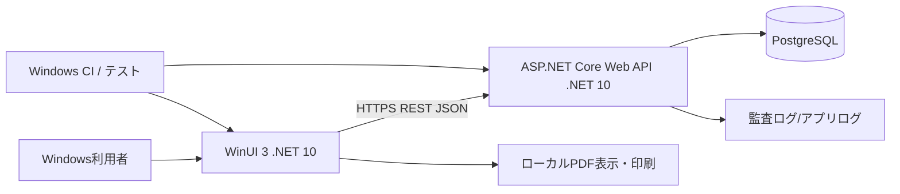
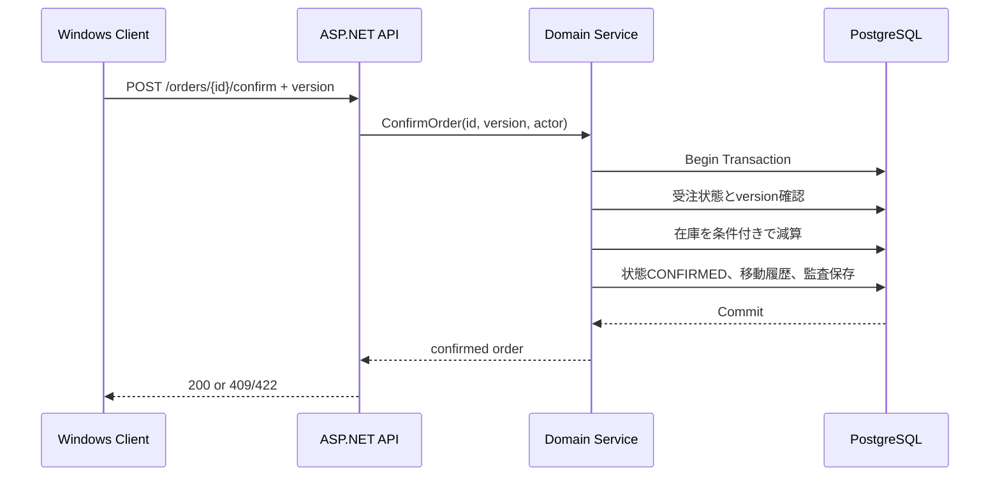

# 基本設計書 — C# Windowsネイティブ販売管理サンプル

| 項目 | 内容 |
|---|---|
| 文書ID | NET-BD-001 |
| 版 / 日付 | 1.1 / 2026-11-03（1.0 は 2026-11-02。1.0 から：PostgreSQL 17 を Windows に入れておく・.NET 版のキットを作らず Node 版を広げて当てる（8 章）・Issue を夜ごとの並びに書き直した） |
| 対象リポジトリ | 回ごとに `issue-driven-example-dotnet-r<回>`（新規作成） |
| 対応要件 | [`requirements.md`](requirements.md) NET-F/NET-BR/NET-AC |
| 共通の前提 | キットの `docs/guides/working/examples/README.md`（以下「共通 §n」） |

## 1. 全体構成



- Windowsクライアント：WinUI 3 + Windows App SDK + C# MVVM（CommunityToolkit.Mvvm等）。**Windowsネイティブとして新規構築**。
- APIサーバー：ASP.NET Core Web API、.NET 10、EF Core + Npgsql。Controller（またはEndpoint）→Application→Domain→Infrastructure。
- ファイル出力：CSV・PDFの生成対象を明確にする。CSV商品取込はクライアントで一次解析後APIに送信し、サーバーで再検証/一括反映。
- データの正はAPI/DB。クライアントの表示キャッシュは正としない。

## 2. ソリューション構成

```text
issue-driven-example-dotnet/
├── SalesFlow.slnx
├── src/
│   ├── SalesFlow.Desktop/              # WinUI 3 / Views, ViewModels, Services
│   ├── SalesFlow.Contracts/            # API DTO / enum / schema（UI,API間はJSON契約）
│   ├── SalesFlow.Api/                  # ASP.NET Core / endpoint, auth
│   ├── SalesFlow.Application/          # 用途別service, interfaces
│   ├── SalesFlow.Domain/               # Entity, rule, money, state
│   └── SalesFlow.Infrastructure/       # EF Core, repositories, logging
├── tests/
│   ├── SalesFlow.Domain.Tests/
│   ├── SalesFlow.Api.IntegrationTests/
│   ├── SalesFlow.Desktop.ViewModel.Tests/
│   └── SalesFlow.Desktop.UiSmoke/      # Windows対話実行環境で実行
├── database/seed/
├── docs/requirements.md
├── docs/basic-design.md
├── docs/decisions/
├── scripts/                            # キットの Node 版（test.mjs・issue-run/）
├── .github/workflows/
├── package.json                        # 依存なし。キットの issueKit の欄だけ
├── .env.example                        # 接続文字列の見本（実の値はユーザーの環境変数か .env）
├── README.md
└── CLAUDE.md
```

依存方向：Desktop→Contracts、Api→Application→Domain、Infrastructure→Application/Domain（DIで注入）。DesktopからInfrastructure/EF Coreへ直接参照しない。

## 3. データ・APIモデル

### 3.1 DB論理テーブル

| テーブル | 主なフィールド | 制約 |
|---|---|---|
| users | id, login_id, password_hash, role, active | login_id UNIQUE |
| refresh_tokens | id, user_id, token_hash, expires_at, revoked_at | 平文トークン保存禁止 |
| customers | id, code, name, active, version | code UNIQUE |
| products | id, code, name, unit_price_jpy, active, version | code UNIQUE |
| stocks | product_id, quantity, version | quantity >= 0 |
| orders | id, order_no, customer_id, status, subtotal_jpy, tax_jpy, total_jpy, version | order_no UNIQUE |
| order_items | id, order_id, line_no, product_id, code/name_snapshot, unit_price_jpy, quantity, amount_jpy | (order_id,line_no) UNIQUE |
| invoices | id, order_id, invoice_no, issued_at, subtotal_jpy, tax_jpy, total_jpy | order_id UNIQUE, invoice_no UNIQUE |
| invoice_items | id, invoice_id, line_no, label, qty, unit_price_jpy, amount_jpy | (invoice_id,line_no) UNIQUE |
| stock_movements | id, product_id, delta, reason, order_id?, actor_id, occurred_at | 監査追跡 |
| audit_logs | id, entity_type, entity_id, action, actor_id, occurred_at, request_id, data_json | append-only |

- PKはUUID、日時はUTC、金額はlong（円）。DTOの金額も整数値、JSONでdecimalの丸め混入を避ける。
- EF Core migrationをSQLレビュー可能な形でコミット。DB制約をアプリ側検証と二重化する。

### 3.2 HTTP API

| メソッド | パス | 用途 | 主要要件 |
|---|---|---|---|
| POST | `/api/v1/auth/login` | サインイン | NET-F-01 |
| POST | `/api/v1/auth/refresh` | トークン更新 | NET-F-01 |
| POST | `/api/v1/auth/logout` | サインアウト/失効 | NET-F-01 |
| GET/POST | `/api/v1/customers` | 顧客照会/登録 | NET-F-03 |
| PATCH | `/api/v1/customers/{id}` | 顧客変更 | NET-F-03 |
| GET/POST | `/api/v1/products` | 商品照会/登録 | NET-F-04 |
| PATCH | `/api/v1/products/{id}` | 商品変更 | NET-F-04 |
| POST | `/api/v1/products/{id}/stock-adjustments` | 在庫調整 | NET-F-05 |
| GET/POST | `/api/v1/orders` | 受注照会/新規 | NET-F-06 |
| PATCH | `/api/v1/orders/{id}` | 受注下書き編集 | NET-F-06 |
| POST | `/api/v1/orders/{id}/confirm` | 確定 | NET-F-07 |
| POST | `/api/v1/orders/{id}/cancel` | 取消 | NET-F-07 |
| POST | `/api/v1/orders/{id}/invoice` | 請求発行 | NET-F-08 |
| GET | `/api/v1/invoices/{id}` | 請求照会 | NET-F-08 |
| GET | `/api/v1/invoices/{id}/pdf` | 帳票PDFのダウンロード | NET-F-09 |
| POST | `/api/v1/products/import-preview` | CSV検証/プレビュー | NET-F-10 |
| POST | `/api/v1/products/import-commit` | CSV確定 | NET-F-10 |
| GET | `/api/v1/orders/export.csv` | 受注一覧CSV | NET-F-10 |
| GET | `/api/v1/audit-logs` | 監査ログ | NET-F-12 |
| GET | `/health/ready` | 稼働確認 | NET-F-14 |

- JSONはcamelCase、日時ISO8601、`{code,message,details,requestId}`を共通エラー形式とする。
- APIで400（形式不正）、401、403、404、409（状態・版競合）、422（業務ルール違反）、500を区別。
- APIスキーマはOpenAPIで公開・バージョン管理。DTO/クライアント型の差分検出テストを設ける。

## 4. Windowsクライアント基本設計

### 4.1 画面構成とUI状態

| 画面 | ViewModel | 主要状態・操作 |
|---|---|---|
| LoginPage | LoginViewModel | 認証中、入力エラー、失敗、画面遷移 |
| ShellPage | ShellViewModel | ナビゲーション、ユーザー表示、接続状態 |
| CustomersPage | CustomersViewModel | 検索、選択、ページ、編集、競合 |
| ProductsPage | ProductsViewModel | 商品、在庫、CSV、編集 |
| OrderEditPage | OrderEditViewModel | 明細行、計算プレビュー、保存/確定 |
| OrdersPage | OrdersViewModel | 状態フィルタ、詳細表示、取消 |
| InvoicesPage | InvoicesViewModel | 請求照会、PDF保存、印刷 |
| AuditPage | AuditViewModel | 条件指定、監査履歴 |

- `INotifyPropertyChanged`、非同期Command、入力検証をViewModelに集約し、画面コードビハインドにはビジネスロジックを置かない。
- `HttpClientFactory`相当とtyped API clientでHTTP呼出しを統一し、キャンセルトークン、タイムアウト、リクエストIDを扱う。
- 状態はIdle/Loading/Saving/Success/Error/Conflict。通信中ボタンをdisableし、成功不明の操作は取得APIで結果再確認。
- 主要操作はUI Automation対応のAccessible Nameを定義。100/150/200%DPIでレイアウト崩れを試験。

### 4.2 認証・トークン

- ローカルデモアカウントのID/パスワードをHTTPS送信し、サーバーが短寿命アクセストークンとローテーション可能な更新トークンを発行する（実企業のSSOは対象外）。
- 更新トークンはWindowsの保護されたCredential Locker等に保存し、トークンを平文ファイル・ログ・Gitへ出さない。
- サーバーでは更新トークンのハッシュと失効時刻を保存。logout時に失効。RBACはAPIで強制。
- デモ構成はローカルHTTP許可を当然としない。開発用TLS証明書の信頼手順をREADMEに明記する。

## 5. 業務処理シーケンス

### 5.1 受注確定



- DB行ロックまたは条件付き更新で在庫を守り、途中失敗時は全ロールバック。
- 状態変更と`version`条件一致を1トランザクションで保証。二重処理を防止。
- 金額は整数。`subtotal=sum(price×qty)`、`tax=floor(subtotal×10/100)`。請求は値のスナップショットから作成。

### 5.2 CSV取込（MVPは全件反映）

1. Windowsファイル選択→UTF-8 CSV読み込み。大容量を避けるため1万行/ファイル10MB上限（MVP規定）。
2. ヘッダーは`code,name,unitPriceJpy,initialStock`（新規商品のみ）。BOMあり・なしを許容し、区切りは`,`固定。
3. preview APIで全行検証、エラー位置と内容、検証ID/ハッシュを返す。
4. commit APIはプレビューIDとハッシュを要求。内容を再検証して一括DB反映。期限切れや他者による変更は拒否。
5. エラー1件でも全体反映0件。ロール・重複コード・異常値を検査。

### 5.3 PDF・印刷

- PDFはAPI側が**請求スナップショット**から生成し、クライアントがファイル保存/標準PDF表示を実行。
- 請求番号、宛先、品名、明細数量・単価、税、税込計、発行日時を含める。
- PDFの表示/印刷はシステムの標準アプリを起動。印刷実行自体のE2E合否は人手確認と切り分ける。
- PDF生成ライブラリはライセンス・日本語フォントの配布条件を確認してADR化。フォントファイルの再配布は別途権利確認。

## 6. 競合・例外・回復

- 古い`version`の保存は409、クライアントは最新取得/再編集を案内。
- timeout時のconfirm/invoiceは成功している可能性がある。リトライ前に受注/請求状態を再照会し、冪等性キーも検討。
- 外部ファイルパス・ユーザープロファイル名を監査や公開ログへ含めない。
- API障害では編集内容を画面上に残し、再操作の前にサーバー状態を確認する。

## 7. テストとビルド

| 試験種別 | 実行場所 | 方法・対象 | 期待 |
|---|---|---|---|
| Domain単体 | Windows/Linux可 | `dotnet test` / xUnit等 | NET-BR計算・遷移・境界値合格 |
| API統合 | Windows/Linux可 | PostgreSQL試験DB + HTTP | NET-AC-01～08、15 |
| ViewModel単体 | Windows（必要に応じ環境差を分離） | MVVMロジックのテスト | 入力・非同期状態・エラー表示 |
| UIスモーク | 対話Windowsセッション | Windows Application Driver等、実環境対応ツールを選定 | 起動、主操作、DPI、フォーカス |
| CSV/PDF | API/Windows | CSV fixture、PDFの内容抽出と人間による表示確認 | NET-AC-09～11 |
| MSIXインストール | WindowsテストVM | MSIX生成、信頼設定、導入/削除 | NET-AC-12 |

- `dotnet build -warnaserror`、`dotnet test`、DBマイグレーション、API契約、CSV/PDF、Windows UI確認を区別する。
- CIはWindows runnerでDesktopをビルド。GUIテストは**対話セッションで成功した証拠が必要**であり、非対話CIで未実行なら`NOT RUN`と記録。
- 試験の DB は Windows のサービスの PostgreSQL 17 の `salesflow_net_test`（共通 §2.2）。テストの入口が毎回マイグレーションを当て直してシードを入れる。DB につながらないときは理由を 1 行出して `Result: FAIL`。
- ビルド成果物・MSIX・署名素材をGitのソース管理対象にしない。テストログは個人情報をマスク。

## 8. issue-driven-kit の当て方・Issue の並び

### 8.1 当て方（.NET 版のキットは作らない）

1.0 では .NET 版のキット（KIT-NET-01〜05）を新しく作る案だった。1.1 では、**キットの Node 版を入れ、テストの入口を広げて当てる**（共通 §3）。先に済ませるキットの準備は次のとおり（計画 4 章）。

| # | キット側の準備 | このアプリで要る理由 |
|---|---|---|
| P-1 | テストの入口が決めたコマンド（`dotnet build -warnaserror` と `dotnet test --logger junit` など）を回し、結果の XML を読んで `Result:` 行を出す。0 件は FAIL | `dotnet test` の合否を無人の回の合格の条件にする |
| P-2 | 点検（doctor）が `dotnet`・Windows App SDK を見る | 夜に「道具が無い」で落ちないように |
| P-6 | Node 版の `CLAUDE.md` のひな形と実行用の設定を、vitest などの前提から外す | .NET のリポジトリに Node の決まりが混ざらないように |

- 確認コマンドは ```` ```js ````（Node.js で `dotnet` を呼ぶ）。リポジトリには依存を持たない `package.json` を置く。
- 画面のスモークテスト（UI Automation）は、ログインしたままの画面が要る。その Issue を回す夜は Windows をロックしない。ロックされていて動かせないときは `NOT RUN` として FAIL にせず、Issue の合格の条件にも入れない（人が別に記録する）。

### 8.2 Issue の並び（回1の初版）

番号（N01…）は作る順で、そのまま実行の順になる。その夜の分は前の日の昼に作る（共通 §4.2）。行数は本体とテスト、分は 1 回で合格したときの見込み。**API の権限の枠（N07）を先に作り、ログインとトークン（N08）は後から差し込む**ので、マスターの API は N08 を待たない。

| 時 | 番号 | Issue | 前提 | 行数 | 分 |
|---|---|---|---|---|---|
| 1日目 昼 | C1 | 初期化（`SalesFlow.slnx`・6 プロジェクト・nullable・解析器・`package.json`）・PostgreSQL の DB とユーザー・開発用の TLS 証明書 | — | 会話 | — |
| 1日目 昼 | C2 | キットを入れる（P-1・P-2・P-6 の後の版）・点検・ラベル・Windows の設定（共通 §2.1）・DB につながることを手で確かめる | C1 | 会話 | — |
| 夜1 | N01 | テストの入口：`dotnet build -warnaserror`・`dotnet test` の XML・0 件 FAIL・わざと落とす・DB につながらないときの FAIL | — | 400 | 40 |
| 夜1 | N02 | ドメイン：金額の計算・状態の遷移（NET-BR-02〜04） | N01 | 450 | 35 |
| 夜1 | N03 | ドメイン：明細の上限・数量と単価の範囲・在庫の不変条件 | N02 | 400 | 30 |
| 夜1 | N04 | EF Core のスキーマ・マイグレーション（11 表・制約） | N01 | 600 | 45 |
| 夜1 | N05 | シード・試験用の DB の作り直し（NET-AC-15 の土台） | N04 | 450 | 40 |
| 夜1 | N06 | API の共通：エラーの形・requestId・構造化ログ・`/health/ready` | N01 | 500 | 40 |
| 夜1 | N07 | API の権限の枠：ロールの判定・要求者を取り出す口・401 と 403（NET-BR-09・NET-AC-08） | N06 | 500 | 40 |
| 夜2 | N08 | 認証：ログイン・短命のアクセストークン・更新トークン（ハッシュで保存）・ログアウトで失効 | N05, N07 | 650 | 50 |
| 夜2 | N09 | OpenAPI の契約・Contracts の DTO・差分を見つけるテスト | N06 | 450 | 35 |
| 夜2 | N10 | 顧客の API（作成・一覧・検索・変更・無効化・版の競合） | N05, N07 | 550 | 40 |
| 夜2 | N11 | 商品の API | N05, N07 | 550 | 40 |
| 夜2 | N12 | 在庫の調整の API・在庫の動き・監査ログを書く | N11 | 450 | 40 |
| 夜2 | N13 | デスクトップの土台：Shell・画面の移動・MVVM・状態（Idle・Loading・Saving・Error・Conflict） | N01 | 600 | 50 |
| 夜2 | N14 | API の呼び出し：型つきの client・タイムアウト・キャンセル・requestId | N09, N13 | 450 | 40 |
| 夜3 | N15 | サインインの画面・資格情報の保持（Credential Locker）・サインアウト（NET-AC-14） | N08, N14 | 550 | 50 |
| 夜3 | N16 | 顧客の画面（一覧・検索・編集のダイアログ・競合の表示） | N10, N15 | 600 | 50 |
| 夜3 | N17 | 商品と在庫の画面（一覧） | N11, N15 | 550 | 45 |
| 夜3 | N18 | 在庫の調整のダイアログ | N12, N17 | 350 | 35 |
| 夜3 | N19 | 受注の下書きの API（明細・合計・NET-AC-01） | N03, N10, N11 | 550 | 45 |
| 夜3 | N20 | 受注の確定の API（1 つのトランザクション・在庫・NET-AC-02・03） | N12, N19 | 450 | 45 |
| 夜4 | N21 | 受注の取消・二重に戻さない（NET-AC-04） | N20 | 400 | 40 |
| 夜4 | N22 | 同時更新の 409・並行テスト（NET-AC-07） | N21 | 400 | 40 |
| 夜4 | N23 | 受注登録の画面：顧客の選択・明細のグリッド | N16, N17, N19 | 600 | 50 |
| 夜4 | N24 | 受注登録の画面：計算のプレビュー・保存・連打の防止 | N23 | 450 | 40 |
| 夜4 | N25 | 受注の一覧と詳細：確定・取消・競合の警告 | N22, N24 | 550 | 50 |
| 夜4 | N26 | 請求書の発行の API（スナップショット・二重発行の防止・NET-AC-05・06） | N20 | 500 | 45 |
| 夜5 | N27 | 請求書の PDF の生成（API・NET-AC-11） | N26 | 500 | 45 |
| 夜5 | N28 | 請求の画面：一覧・詳細・PDF の保存・印刷の起動 | N25, N27 | 550 | 50 |
| 夜5 | N29 | CSV の取り込み：preview の API（行ごとのエラー） | N11 | 450 | 40 |
| 夜5 | N30 | CSV の取り込み：commit の API（ハッシュ・全件か 0 件・NET-AC-09・10） | N29 | 400 | 40 |
| 夜5 | N31 | CSV の画面（選択・プレビュー・反映）・受注一覧の CSV の書き出し | N17, N30 | 550 | 50 |
| 夜5 | N32 | 監査ログの API と画面 | N12, N15 | 500 | 45 |
| 夜6 | N33 | ホームの画面（確定待ち・未請求の件数） | N15, N20 | 350 | 35 |
| 夜6 | N34 | 画面のスモークテスト（起動・主な操作・DPI 100・150・200%）。**この夜はロックしない** | N28, N31 | 500 | 50 |
| 夜6 | N35 | MSIX のパッケージ・導入と削除の手順（NET-AC-12 は人が記録） | N34 | 300 | 40 |
| 夜6 | N36 | README・運用の文書（PostgreSQL を入れる・証明書・復旧）・性能の測定（受注 1 万件の一覧） | N35 | 400 | 40 |
| 7日目 昼 | — | 完成の判定（要件 §10。GUI と MSIX は人が記録する） | 全部 | — | — |

夜の中の鎖はいちばん長くて 3 段（夜1の N01→N02→N03 など）。手直しの Issue（約 6 件）は、その朝に作り、その夜の最初に回る。

## 9. デプロイ・運用

- API: `ASPNETCORE_ENVIRONMENT`、接続文字列など環境変数/秘密管理で分離。最低限`/health/ready`と構造化ログ。
- DB: PostgreSQLのバックアップ/復旧・migration forward/backward手順をREADMEで示す。サンプルでは本番自動運用を保証しない。
- Windows: MSIX配布テストは自己署名証明書による**開発機限定**の手順を示し、本番配布の署名要件と区別。
- バージョン: .NET SDK、Windows App SDK、NuGet、OSビルド番号を記録して再現可能にする。

## 10. トレーサビリティ・決定待ち

- NET-F-03/04/05→商品・顧客・在庫API→NET-UI-03/04→NET-AC-01～03。
- NET-F-06/07/08→受注/請求API→NET-UI-05/06/07→NET-AC-04～08。
- NET-F-09/10→PDF/CSV API→NET-UI-07/08→NET-AC-09～11。
- NET-F-13/14→CI/MSIX/診断→NET-AC-12～15。
- 初期ADR：グリッドUIライブラリ、日本語PDFライブラリ、MSIX署名、UIスモーク手段、authトークン実装、PostgreSQLテスト実行基盤。
