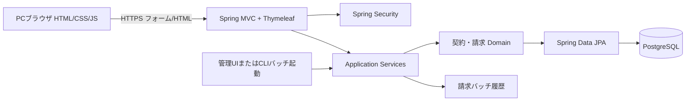
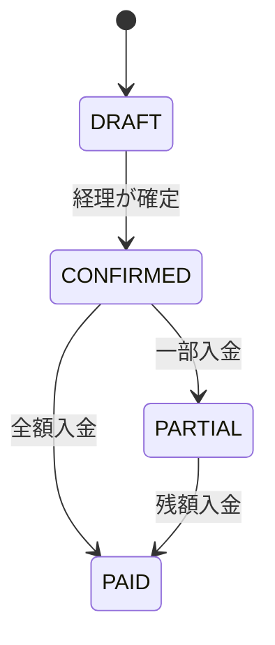
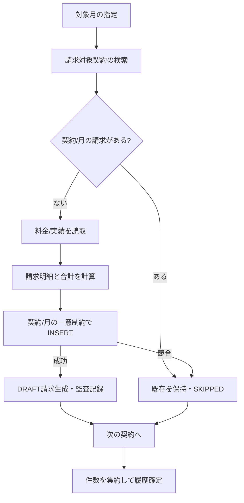

# 基本設計書 — Java契約・月次請求管理サンプル

| 項目 | 内容 |
|---|---|
| 文書ID | JAVA-BD-001 |
| 版 / 日付 | 1.1 / 2026-11-03（1.0 は 2026-11-02。1.0 から：Docker Compose と Testcontainers をやめ PostgreSQL 17 を Windows に入れておく・Java 版のキットを作らず Node 版を広げて当てる（8 章）・Issue を夜ごとの並びに書き直した） |
| 対象リポジトリ | 回ごとに `issue-driven-example-java-r<回>`（新規作成） |
| 対応要件 | [`requirements.md`](requirements.md) JAVA-F / JAVA-BR / JAVA-AC |
| 共通の前提 | キットの `docs/guides/working/examples/README.md`（以下「共通 §n」） |

## 1. システムアーキテクチャ



- **クライアント**：ブラウザ。HTMLはSpring MVC + Thymeleafでサーバー生成。JavaScriptは確認ダイアログ、入力補助、プレビュー結果の表示に限定。
- **サーバー**：Java 25、Spring Boot 4、Spring MVC、Thymeleaf、Spring Security、Spring Data JPA。単一デプロイ単位のモジュラーモノリス。
- **DB**：PostgreSQL、Flywayマイグレーション。認証、請求、実績、入金、ジョブ履歴を管理。
- **バッチ**：Application Serviceから対象月ごとの請求作成を開始する。スケジューラ常時運用はMVP対象外。手動実行・再実行の確実性を先に検証。

## 2. プロジェクト/パッケージ構成

```text
issue-driven-example-java/
├── mvnw / mvnw.cmd / .mvn/
├── pom.xml
├── src/main/java/example/billing/
│   ├── BillingApplication.java
│   ├── security/
│   ├── customer/                     # MVC, service, entity, repository
│   ├── plan/
│   ├── contract/
│   ├── usage/
│   ├── invoice/
│   ├── payment/
│   ├── batch/
│   ├── audit/
│   └── common/                       # error, money, time, transaction
├── src/main/resources/
│   ├── templates/                     # Thymeleaf: login, dashboard, customers...
│   ├── static/                        # css/js
│   ├── db/migration/                  # Flyway
│   └── application.yml
├── src/test/java/example/billing/     # JUnit 5, MockMvc, integration
├── src/test/resources/fixtures/
├── docs/requirements.md
├── docs/basic-design.md
├── docs/decisions/
├── scripts/                            # キットの Node 版（test.mjs・issue-run/）
├── package.json                        # 依存なし。キットの issueKit の欄だけ
├── .env.example                        # 接続文字列の見本（実の値はユーザーの環境変数か .env）
└── .github/workflows/
```

パッケージは業務機能ごとの縦割りとし、MVCコントローラーからRepositoryへ直接書き込まず、Application Serviceでユースケース・トランザクションを統制する。

## 3. データ設計

### 3.1 論理データモデル

| テーブル | 主要列 | キー/制約 |
|---|---|---|
| `users` | id, login_id, password_hash, role, active | login_id UNIQUE |
| `customers` | id, customer_code, name, active, version | customer_code UNIQUE |
| `plans` | id, plan_code, name, active | plan_code UNIQUE |
| `plan_rates` | id, plan_id, effective_month, base_fee_jpy, usage_unit_jpy | (plan_id,effective_month) UNIQUE |
| `contracts` | id, contract_no, customer_id, plan_id, start_month, end_month, version | contract_no UNIQUE、月の整合性 |
| `usage_records` | id, contract_id, target_month, external_key, quantity, created_at | (contract_id,external_key) UNIQUE |
| `invoices` | id, contract_id, target_month, status, subtotal_jpy, tax_jpy, total_jpy, version, confirmed_at | (contract_id,target_month) UNIQUE |
| `invoice_items` | id, invoice_id, line_no, item_type, description, qty, unit_price_jpy, amount_jpy | (invoice_id,line_no) UNIQUE |
| `payments` | id, invoice_id, reference_no, amount_jpy, paid_at, actor_id | (invoice_id,reference_no) UNIQUE |
| `billing_runs` | id, target_month, request_id, status, started_at, ended_at, scanned, created, skipped, failed, error_summary | request_id UNIQUE |
| `audit_logs` | id, actor_id, action, entity_type, entity_id, old_new_summary, occurred_at, request_id | append-only |

- idはUUID（実装ではDB互換とJPAマッピングを確認）、月は`YYYY-MM`を意味する`YearMonth`として扱い、DB上は月初`date`か`char(7)`のどちらかへ統一する。**推奨は月初DATE**。
- `plan_rates`は発効月で管理し、対象月以下の最大発効月を採用する。過去の料金レコードは更新禁止（新レコード追加のみ）。
- 請求作成時に料金・対象月・利用数量を`invoice_items`へスナップショット化する。確定後は不変。
- 金額は`long`（円）。乗算時は`Math.multiplyExact`、加算は`Math.addExact`でオーバーフローを検出。
- 確定済み請求の後からの料金変更で過去請求を書換えない。

### 3.2 データ例（固定fixture）

| 対象 | 値 |
|---|---|
| 顧客 | C001 架空企業A |
| 契約 | S001、2026-01開始、終了なし、プランBASIC |
| 料金 | BASIC：基本1000円/月、従量150円/単位 |
| 利用実績 | 2026-10、3単位、external_key=`usage-S001-202610-001` |
| 請求プレビュー | 税抜1450円、税145円、税込1595円 |

### 3.3 状態定義



- `DRAFT/CONFIRMED/PARTIAL/PAID`は画面で見せる**請求の状態**。実装では`invoice_status(DRAFT/CONFIRMED)`と`payment_status(UNPAID/PARTIAL/PAID)`を別列/導出値として管理してもよいが、テスト上は上図と同じ振る舞いとする。
- 料金変更後の再計算はDRAFTのみ。確定後の訂正はMVP対象外。
- 契約の請求対象は開始月～終了月（両端含む）で決定。`PAUSED`等の複雑な状態はMVPで使わない。

## 4. 課金計算・バッチ基本設計

### 4.1 計算式

```text
planRate = latest rate with effectiveMonth <= targetMonth
usageQty = sum(usage.quantity for contract and targetMonth)
subtotal = planRate.baseFeeJpy + planRate.usageUnitJpy * usageQty
tax      = floor(subtotal * 10 / 100)
total    = subtotal + tax
```

- 料金単価・基本料金はいずれも非負。0利用でも基本料金を請求する。
- 税率は業務デモ用10%固定で、請求単位に切捨て。税務上の一般解ではない。
- `YearMonth`で対象月を厳密に決め、TZ変更で対象月がずれないようにする。
- 上記の算術オーバーフロー時は対象レコードを失敗扱いとして履歴に記録。

### 4.2 月次請求の処理フロー



#### トランザクション方針

- 請求を**契約単位の短いDBトランザクション**で作成。1件の処理失敗で他の契約を長時間ロックしない。
- 完了済み請求は再実行でSKIPPED。`UNIQUE(contract_id,target_month)`と条件付きINSERT/競合ハンドリングを併用。
- ジョブ全体の`billing_runs`にSUCCESS/PARTIAL_FAILED/FAILEDと処理件数を記録。部分失敗があればリトライで未作成契約のみ補完可能。
- 同一月のバッチ同時起動は**実行単位の排他制御**を設ける（DB advisory lockまたはロックテーブルを初期ADRで確定）。仮に重複起動しても一意制約によって二重請求を防ぐ。
- 失敗注入テスト：対象契約の一部で例外を起こし、再実行後に1件/契約/月となることを確認。
- 利用実績と料金変更が請求作成中に発生する場合は、請求対象月の実績締めを明示する。MVPでは**プレビューと本実行の間に実績を変更し得る**ため、実行時点の再計算を正とし、プレビュー結果との差分は明示する。
- DRAFT請求の再計算は経理が明示的に要求した場合のみ実行し、利用実績が変わっても自動更新しない。プレビューで最新値と既存DRAFTの差を示す。

### 4.3 入金処理

1. 経理担当が確定済み請求を開き、入金日・金額・参照番号を送信。
2. サーバーは権限・状態・正の金額・参照番号一意・未収額を検証。
3. 該当請求の更新をロックして累計入金を計算。超過入金は禁止。
4. paymentsとaudit_logsを一トランザクションで保存。入金参照番号の再送は重複レコードにしない。
5. 未収額が正ならPARTIAL、0ならPAIDと画面で表現。

## 5. MVC画面・URL設計

| メソッド・パス | 画面/処理 | 権限 |
|---|---|---|
| GET `/login` / POST `/login` | ログイン画面/認証（Spring Security） | 匿名 |
| GET `/dashboard` | ダッシュボード | 認証済 |
| GET/POST `/customers` | 顧客一覧/登録 | 全員表示、登録admin/sales |
| GET/POST `/plans` | プラン一覧/登録 | 全員表示、変更admin/sales |
| GET/POST `/contracts` | 契約一覧/登録 | 全員表示、登録admin/sales |
| GET/POST `/usage-records` | 利用実績一覧/登録 | 全員表示、登録admin/sales |
| GET `/billing/preview?month=YYYY-MM` | 請求プレビュー | admin/accounting |
| POST `/billing/runs` | 月次請求バッチ起動 | admin/accounting |
| GET `/billing/runs/{id}` | バッチ履歴詳細 | admin/accounting |
| GET `/invoices` / GET `/invoices/{id}` | 請求一覧/明細 | 全員 |
| POST `/invoices/{id}/confirm` | 請求確定 | admin/accounting |
| POST `/invoices/{id}/payments` | 入金登録 | admin/accounting |
| GET `/audit-logs` | 監査ログ | admin/accounting |
| GET `/actuator/health` | ヘルス | システム |

- HTML formはPOST-Redirect-GETを基本とし、二重送信時の防止策とCSRF tokenを含める。
- `400`バリデーション、`403`権限不足、`404`対象なし、`409`競合、`422`業務エラーを画面用メッセージへ変換。HTMLのエスケープを有効化。
- 経理操作には明示的な確認画面と結果メッセージを提供。

## 6. 認証・認可・監査

- Spring Securityのform login/セッション認証。パスワードを安全なハッシュで保存。セッションはHttpOnly/Secure/SameSite Cookieを適切に設定し、CSRFトークンを使用。
- Controller側の画面制御に加えService/メソッドレベルで権限を強制する。
- 実在ユーザー情報、パスワード、Cookie、DB秘密、Stack Trace全文を画面/ログに表示しない。
- 重要イベント：料金変更、契約登録/終了、実績登録、バッチ、請求確定、入金登録。監査は対象ID、時刻、actor、イベントを保持。
- マイグレーションとシードは別権限・別手順で実行。DBの本番認証情報をGitに置かない。

## 7. テスト設計

| 層 | 技術・方式 | 重点条件 |
|---|---|---|
| 単体 | JUnit 5 + AssertJ等 | JAVA-BR-01～11、金額/年月の境界値 |
| MVC | Spring MockMvc | ログイン/CSRF/role/画面遷移、JAVA-AC-12/16 |
| 統合 | Windows のサービスの PostgreSQL 17 の `billing_java_test`（共通 §2.2） | unique、lock、請求・入金トランザクション |
| バッチ | 固定seed、並列実行、失敗注入 | JAVA-AC-02～05/14 |
| E2E | Playwright等のブラウザ試験（任意に導入） | 契約→実績→月次請求→確定→入金 |
| 再現 | `./mvnw verify`、seedリセット | JAVA-AC-15 |

- H2だけの試験ではPostgreSQLの排他・一意制約・トランザクション特性を証明しない。結合テストはPostgreSQLで回す。
- 試験の入口が毎回 Flyway で `billing_java_test` を作り直してシードを入れる（`clean` は試験の DB だけに許す）。DB につながらないときは理由を 1 行出して `Result: FAIL`。Testcontainers（Docker）は使わない。
- Maven Surefire/Failsafeを用い単体と結合を明示的に実行。0件テストを成功として扱わない契約を検証する。
- CI例：JDK25→Maven依存解決→静的解析→unit→DBマイグレーション→integration→batch並列→package→レポート保管。

## 8. issue-driven-kit の当て方・Issue の並び

### 8.1 当て方（Java 版のキットは作らない）

1.0 では Java 版のキット（KIT-JAVA-01〜05）を新しく作る案だった。1.1 では、**キットの Node 版を入れ、テストの入口を広げて当てる**（共通 §3）。先に済ませるキットの準備は .NET と同じ P-1・P-2・P-6（計画 4 章）で、Java の分は次のとおり。

| # | Java で要ること |
|---|---|
| P-1 | テストの入口が `mvnw.cmd verify` を回し、`target/surefire-reports/` と `target/failsafe-reports/` の XML を読んで `Result:` 行を出す。0 件は FAIL |
| P-2 | 点検（doctor）が JDK 25 と `mvnw.cmd` を見る |
| P-6 | Node 版の `CLAUDE.md` のひな形と設定を、vitest など Node の前提から外す |

- 確認コマンドは ```` ```js ````（Node.js で `mvnw.cmd` を呼ぶ）。リポジトリには依存を持たない `package.json` を置く。
- 判定に使うテストと見本（`src/test/resources/fixtures/`）は、実装の Issue より前に別の Issue で固め、実装の Issue では守るファイルにする（共通 §4.2）。

### 8.2 Issue の並び（回1の初版）

番号（J01…）は作る順で、そのまま実行の順になる。その夜の分は前の日の昼に作る（共通 §4.2）。行数は本体とテスト、分は 1 回で合格したときの見込み。

| 時 | 番号 | Issue | 前提 | 行数 | 分 |
|---|---|---|---|---|---|
| 1日目 昼 | C1 | 初期化（Maven Wrapper・JDK 25・Spring Boot 4・パッケージの枠・`package.json`）・PostgreSQL の DB とユーザー | — | 会話 | — |
| 1日目 昼 | C2 | キットを入れる（P-1・P-2・P-6 の後の版）・点検・ラベル・Windows の設定（共通 §2.1）・DB につながることを手で確かめる | C1 | 会話 | — |
| 夜1 | J01 | テストの入口：`mvnw.cmd verify`・Surefire と Failsafe の XML・0 件 FAIL・わざと落とす・DB につながらないときの FAIL | — | 400 | 45 |
| 夜1 | J02 | Flyway のスキーマ（11 表・一意制約） | J01 | 500 | 40 |
| 夜1 | J03 | シード（3.2 の固定データ）・試験用の DB の作り直し（JAVA-AC-15 の土台） | J02 | 400 | 40 |
| 夜1 | J04 | ドメイン：`YearMonth`・金額（`multiplyExact`）・料金の計算（JAVA-BR-01・04） | J01 | 450 | 35 |
| 夜1 | J05 | 共通：エラーの変換・相関 ID・ログ・`/actuator/health` | J01 | 400 | 35 |
| 夜1 | J06 | セキュリティ：フォームのログイン・セッション・CSRF・パスワードのハッシュ（JAVA-AC-16） | J03, J05 | 550 | 50 |
| 夜2 | J07 | 権限：ロールごとのメソッドの認可・403（5.2 の表・JAVA-AC-12） | J06 | 450 | 40 |
| 夜2 | J08 | 共通のレイアウト・ダッシュボードの枠 | J06 | 450 | 40 |
| 夜2 | J09 | 顧客：サービスとリポジトリ | J03, J07 | 450 | 40 |
| 夜2 | J10 | 顧客：画面 | J08, J09 | 450 | 40 |
| 夜2 | J11 | 料金プラン：発効月ごとの料金・履歴（追加だけ・JAVA-BR-03） | J03, J07 | 550 | 45 |
| 夜2 | J12 | 料金プラン：画面 | J08, J11 | 450 | 40 |
| 夜3 | J13 | 契約：サービス（開始月と終了月の整合・版） | J09, J11 | 500 | 45 |
| 夜3 | J14 | 契約：画面 | J10, J13 | 450 | 40 |
| 夜3 | J15 | 契約：請求の対象の判定（JAVA-BR-02・JAVA-AC-13） | J04, J13 | 400 | 35 |
| 夜3 | J16 | 利用実績：登録・外部キーの重複の排除（JAVA-AC-05） | J13 | 500 | 40 |
| 夜3 | J17 | 利用実績：画面 | J14, J16 | 450 | 40 |
| 夜3 | J18 | 請求のプレビュー：計算（JAVA-AC-01） | J04, J15, J16 | 500 | 45 |
| 夜4 | J19 | 請求のプレビュー：画面 | J17, J18 | 400 | 40 |
| 夜4 | J20 | 月次のバッチ：契約ごとのトランザクション・SKIPPED・`billing_runs`（JAVA-AC-02・03） | J18 | 600 | 50 |
| 夜4 | J21 | 月次のバッチ：排他（advisory lock）・並行の起動（JAVA-AC-04） | J20 | 450 | 45 |
| 夜4 | J22 | 月次のバッチ：失敗の注入・再実行（JAVA-AC-14）・実行の画面 | J21 | 550 | 50 |
| 夜4 | J23 | 請求の確定・確定後は変えない・競合（JAVA-AC-06・07） | J20 | 500 | 45 |
| 夜4 | J24 | 請求の一覧と詳細の画面 | J19, J23 | 450 | 40 |
| 夜5 | J25 | 入金の登録（JAVA-AC-08〜11） | J23 | 550 | 45 |
| 夜5 | J26 | 入金の画面・残額 | J24, J25 | 450 | 40 |
| 夜5 | J27 | 監査ログと画面 | J07, J23 | 500 | 45 |
| 夜5 | J28 | バッチの履歴の画面・ダッシュボードの数字 | J22, J26 | 450 | 40 |
| 夜5 | J29 | シナリオの試験：契約 → 実績 → 月次の請求 → 確定 → 入金（MockMvc） | J26 | 450 | 45 |
| 夜5 | J30 | 性能（1 万契約の月次のドラフトを 5 分以内という目標を測る）・セキュリティの試験 | J22 | 450 | 45 |
| 夜5 | J31 | README・運用と復旧の文書（PostgreSQL を入れるところから） | J29 | 350 | 30 |
| 6日目 昼 | — | 完成の判定（要件 §10） | 全部 | — | — |

夜の中の鎖はいちばん長くて 3 段（夜1の J01→J02→J03、夜4の J20→J21→J22）。夜1の J06 は J03 と J05 を待つ 4 段目。手直しの Issue（約 5 件）は、その朝に作り、その夜の最初に回る。

## 9. 開発・デプロイ・復旧

- ローカル起動：Windows のサービスの PostgreSQL 17（共通 §2.2）に Flyway → seed → `mvnw.cmd spring-boot:run`。Docker は使わない。
- 配布物：Spring Boot実行JAR。HTTPSはリバースプロキシ/実行環境を明記し、認証Cookieの安全な設定を適用。
- DBはバックアップ/復旧手順、migration適用時の失敗手順をREADMEに掲載。
- バッチ障害時：`billing_runs`の状態確認→原因是正→同対象月で再実行。二重作成がないことを試験。
- ジョブ履歴には対象月、開始終了、実行者、件数、失敗サマリ、追跡ID。秘密情報を記録しない。

## 10. 要件との対応・未決事項

- JAVA-F-03～06→customer/plan/contract/usage→JAVA-AC-05/13。
- JAVA-F-07～09→invoice/batch→JAVA-AC-01～07/14。
- JAVA-F-10/11→payment/invoice views→JAVA-AC-08～11。
- JAVA-F-01/02/12/13→security/audit/billing_runs→JAVA-AC-12/16。
- 初期ADR：バッチ排他の実装（DB advisory lock vs lock table）、`YearMonth` DB型、コントラクトの並行更新条件、ジョブ再実行時のドラフト再計算、MavenのバージョンとJDK配備。
