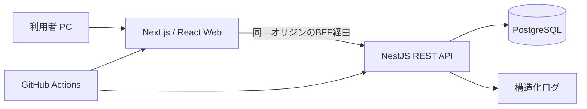
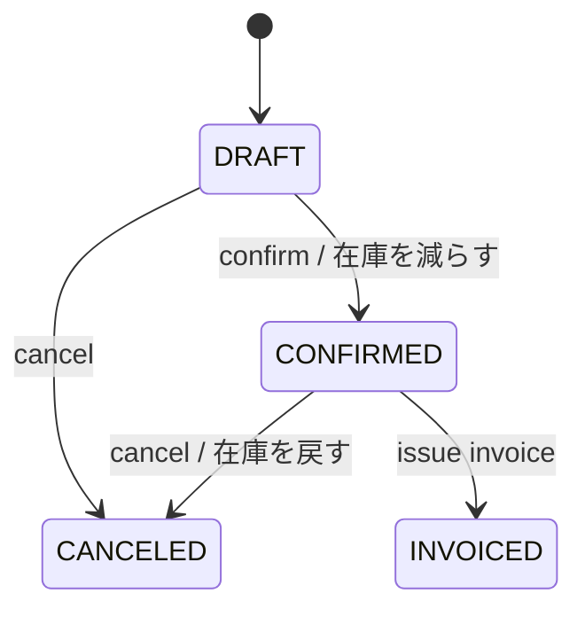

# 基本設計書 — TypeScript フルスタック受発注管理サンプル

| 項目 | 内容 |
|---|---|
| 文書ID | TS-BD-001 |
| 段 | **上流**（受注の後に人が書き、受注先と合意した文書という想定。共通 §1.2）。生成 AI 駆動の段（詳細設計・実装・テスト）の入力で、その段の中では変えない |
| 版/日付 | 1.1 / 2026-11-03（1.0 は 2026-11-02。1.0 から：Docker Compose をやめ PostgreSQL 17 を Windows に入れておく・テストの DB の決まり・1.1 に使う技術と版を足した・11 章に詳細設計の単位と決めた方式を書き、Issue の並びは案件のリポジトリで作る形にした） |
| 対象 | 回ごとに `issue-driven-example-typescript-r<回>`（新規リポジトリ） |
| 対応要件 | [`requirements.md`](requirements.md) TS-F / TS-BR / TS-AC |
| 共通の前提 | キットの `docs/guides/working/examples/README.md`（以下「共通 §n」） |

## 1. アーキテクチャ



- **クライアント**：Next.js App Router、React、TypeScript strict。操作画面はクライアントコンポーネント中心、初期表示や認証境界はサーバー側で制御する。
- **サーバー**：NestJS（API、ユースケース、ドメイン規則、永続化境界）。PrismaでPostgreSQLへアクセス。
- **接続**：Next.js側の同一オリジンBFF（route handlers等）経由でAPIに到達させる。ブラウザからAPIへ認証秘密を直接渡さない。
- **トランザクション**：在庫減算、受注確定、請求発行をDB原子的に処理。PrismaトランザクションとDB制約を併用。
- **配布**：ローカル開発は Windows のサービスの PostgreSQL 17（共通 §2.2）、クライアント・API は各開発プロセス。Docker は使わない。本番公開は MVP 必須ではない。

### 1.1 使う技術と版（詳細設計の前に決めておく）

**2026-11-03 にレジストリ（npm）で確かめた安定版**から選んだ。基本設計で**メジャーとマイナーまで**決める。パッチは C1 で入れた時点の最新を `package-lock.json` に固定し、README に書く。メジャーかマイナーを上げるときは、上流（基本設計）に戻して直す（共通 §1.2）。

| 層 | 使う物 | 版 | 選んだ理由・注意 |
|---|---|---|---|
| 実行環境 | Node.js | 22.14.0 | キットと同じ（`.nvmrc`）。下の物の要る版（`^22.12` など）を満たす |
| 実行環境 | npm | 11.6.2 | キットと同じ |
| 言語 | TypeScript | 6.0.x | 7.0 は `typescript-eslint` がまだ対応していない（対応は 6.1 未満まで） |
| 画面 | Next.js（App Router）・React・react-dom | 16.4.x・19.3.x・19.3.x | — |
| API | NestJS（`@nestjs/core`・`@nestjs/common`・`@nestjs/platform-express`） | 12.3.x | — |
| API | `@nestjs/swagger`（OpenAPI） | 12.1.x | A2 |
| API | `class-validator`・`class-transformer` | 0.15.x・0.5.x | DTO の検証 |
| API | `express-session`・`connect-pg-simple`・`csrf-csrf` | 1.19.x・10.0.x・4.1.x | A3 |
| API | `bcryptjs` | 3.0.x | A6 |
| API | `pino`・`nestjs-pino`（JSON のログ） | 10.4.x・5.3.x | — |
| ORM | Prisma（`prisma`・`@prisma/client`・`@prisma/adapter-pg`） | 7.10.x | npm の `latest` のタグは 8.0 の rc を指しているので使わない |
| 型の生成 | `openapi-typescript` | 7.13.x | A2 |
| DB | PostgreSQL | 17（確かめた時点の最新は 17.11） | Windows のサービス（共通 §2.2）。18 より、使う ORM と道具の対応が長い |
| テスト | Vitest | 5.1.x | 単体と API の統合 |
| テスト | Playwright（`@playwright/test`） | 1.64.x | E2E（A4） |
| 静的解析 | ESLint・`typescript-eslint` | 10.14.x・8.72.x | — |

## 2. ディレクトリ構成

```text
issue-driven-example-typescript/
├── apps/
│   ├── web/                 # Next.js: app/, components/, features/, lib/
│   └── api/                 # NestJS: src/modules/{auth,customers,products,inventory,orders,invoices,audit}
├── packages/
│   └── contracts/           # OpenAPI由来のDTO型またはスキーマ
├── prisma/                  # schema.prisma, migrations, seed
├── tests/
│   ├── fixtures/
│   ├── integration/
│   └── e2e/
├── docs/
│   ├── inspecs/<年>/<月>/   # requirements.md・basic-design.md（上流から受け取る。Claude は書き換えない）
│   └── guides/working/      # detailed-design/（詳細設計）・issue-plan.md（Issue の並び）
├── scripts/                 # kit導入後の test.mjs / issue-run/
├── .github/workflows/
├── .env.example             # 接続文字列の見本（実の値は .env。コミットしない）
├── package.json
├── package-lock.json
└── CLAUDE.md
```

契約を共有しても、サーバーの業務ロジックをフロントエンドに流出させない。内部importによるAPI層の迂回は禁止。

## 3. レイヤー・責務

| 層 | 責務 | 制約 |
|---|---|---|
| Web UI | 入力支援、状態表示、フォームバリデーション | 金額・権限・在庫の最終判定をしない |
| Web BFF | Cookie/セッション確認、サーバーAPIへの代理要求 | 機密情報のブラウザ公開禁止 |
| Nest Controller | RESTルート、DTO検証、HTTPステータス、認可ガード | DB直接更新禁止 |
| Application Service | 受注確定・取消・請求発行ユースケース、取引境界 | 冪等性と競合判定 |
| Domain | 状態遷移、金額計算、在庫制約 | 外部依存を最小化 |
| Repository | Prismaモデルへの永続化と検索 | DB制約との一貫性 |

## 4. データモデル（論理）

| テーブル | 主な列 | キー・制約 |
|---|---|---|
| `users` | id, login_id, password_hash, role, active, created_at | id PK、login_id UNIQUE |
| `customers` | id, code, name, active, version, timestamps | code UNIQUE |
| `products` | id, code, name, current_price_jpy, active, version | code UNIQUE |
| `stocks` | product_id, quantity, version | product_id PK/FK、quantity>=0 |
| `orders` | id, order_no, customer_id, status, subtotal_jpy, tax_jpy, total_jpy, version, timestamps | order_no UNIQUE、FK |
| `order_items` | id, order_id, line_no, product_id, product_code_snapshot, product_name_snapshot, unit_price_jpy, quantity, line_total_jpy | (order_id,line_no) UNIQUE |
| `invoices` | id, invoice_no, order_id, issued_at, subtotal_jpy, tax_jpy, total_jpy | order_id UNIQUE、invoice_no UNIQUE |
| `inventory_movements` | id, product_id, delta, reason, source_type, source_id, actor_id, created_at | 業務処理ごと追跡可能 |
| `audit_logs` | id, actor_id, action, entity_type, entity_id, metadata_json, occurred_at, request_id | append-only |

- PKはUUID、日時はUTC timestamptz、金額と数量は整数型。集計・計算過程で符号と範囲を確認し、必要な箇所はbigintを用いる。
- `stocks.quantity >= 0` と請求書の`order_id UNIQUE` はアプリ側だけでなくDBでも強制する。
- 監査ログにはパスワード・トークン・決済情報を格納しない。
- `version`で楽観ロックを行い、version不一致時にHTTP 409を返す。

## 5. 状態遷移



- DRAFTのみ明細変更可能。CONFIRMEDへの遷移時に明細と合計を確定。
- CANCELEDとINVOICEDからの遷移はMVPでは不可。
- confirm/cancel/issueはサーバー側で現在状態を条件に更新し、成功更新件数を検証。リトライ時の二重更新を防ぐ。

## 6. 金額・在庫処理

```text
subtotal = sum(unit_price_jpy * quantity)
tax      = floor(subtotal * 10 / 100)
total    = subtotal + tax
```

- 税計算は明細ごとでなく受注税抜計に対して一度実施。テスト固定値：2350→税235→計2585。
- confirm時は対象商品の在庫行を一貫した順序でロックするか、条件付き在庫減算を使用。数量不足時は全処理ロールバック。
- 注文・在庫移動・監査を同一トランザクションで保存。取消も同様。
- 請求書発行では`invoices.order_id`の一意制約と状態条件を併用し、二重発行を防ぐ。
- PostgreSQLの分離レベル、競合時再試行は専用の並行テストで検証して確定する。

## 7. API基本設計

JSONはcamelCase、日付はISO8601、エラーは `{code,message,details,requestId}`。ページングは`page`/`pageSize`。`If-Match`または明示的`version`をリクエストに含める（実装時に一つに統一）。

| 操作 | メソッド・パス | 権限 | 主な応答 |
|---|---|---|---|
| ログイン | `POST /api/v1/auth/login` | 匿名 | 200/401 |
| ログアウト | `POST /api/v1/auth/logout` | 認証済 | 204 |
| 顧客一覧・登録 | `GET/POST /api/v1/customers` | 全員参照/登録admin | 200/201 |
| 顧客変更 | `PATCH /api/v1/customers/{id}` | admin | 200/409 |
| 商品一覧・登録 | `GET/POST /api/v1/products` | 全員参照/登録admin | 200/201 |
| 在庫調整 | `POST /api/v1/products/{id}/stock-adjustments` | admin | 201/422 |
| 受注一覧・登録 | `GET/POST /api/v1/orders` | 全員参照/作成operator以上 | 200/201 |
| 受注明細変更 | `PATCH /api/v1/orders/{id}` | operator以上 | 200/409 |
| 受注確定 | `POST /api/v1/orders/{id}/confirm` | operator以上 | 200/409/422 |
| 受注取消 | `POST /api/v1/orders/{id}/cancel` | operator以上 | 200/409 |
| 請求発行 | `POST /api/v1/orders/{id}/invoice` | operator以上 | 201/200(既存)/409 |
| 請求一覧/詳細 | `GET /api/v1/invoices[/{id}]` | 全員 | 200/404 |
| 監査ログ | `GET /api/v1/audit-logs` | admin | 200/403 |
| ヘルス | `GET /health/live`, `/health/ready` | システム | 200/503 |

401=未認証、403=権限不足、404=なし、409=版/状態競合、422=業務ルール違反、500=想定外。DB内部エラーは公開しない。

## 8. 画面設計（概要）

| 画面ID | 画面 | 表示・入力 | 検証 |
|---|---|---|---|
| TS-UI-01 | ログイン | ログインID、パスワード、送信 | 空値、失敗理由の抽象化 |
| TS-UI-02 | ダッシュボード | 受注件数、未請求件数、在庫一覧導線 | 集計時点を表示 |
| TS-UI-03 | 顧客 | 一覧、検索、コード、名前、有効フラグ | 重複コード/競合 |
| TS-UI-04 | 商品 | 一覧、検索、コード、品名、単価、在庫 | 単価上限/無効化 |
| TS-UI-05 | 受注 | 明細行の追加削除、合計、確定、取消 | 明細不足、状態に応じボタン制御 |
| TS-UI-06 | 請求 | 発行、請求詳細、印刷向けHTML | 二重押下の防止 |
| TS-UI-07 | 監査 | 日時/操作者/操作のフィルタ | adminのみ |

エラーは入力項目と画面上部の双方に表示。API拒否をUIのみに頼って握り潰さない。

## 9. 認証・セキュリティ

- デモ用ローカルユーザーをシードで作成（初期パスワードは環境変数で設定し、実値をGitに含めない）。強固なパスワードハッシュを使用。
- Webからの認証は同一オリジンBFF経由でSecure/HttpOnly/SameSite Cookieを用いる。状態変更リクエストのCSRF対策を実装する。
- BFF→APIの認証情報はサーバー間のみで保持。roleはサーバーで検証し、UIは表示制御に限る。
- DTO検証、レスポンスの秘密除去、リクエストサイズ/レート制限、セキュリティヘッダーを適用する。

## 10. テスト・CI設計

| テスト階層 | 対象 | 合格基準 |
|---|---|---|
| 単体 | 金額計算、状態遷移、入力検証 | TS-BR全件の境界値確認 |
| API統合 | DBを使う受注確定/取消/請求 | TS-AC-01～09、12 |
| 同時実行 | 同一受注の競合、在庫競合 | 二重減算/請求0件 |
| Web E2E | ログイン→受注→確定→請求→照会 | TS-AC主要シナリオを実画面で確認 |
| セキュリティ | 未ログイン、viewer、CSRF | 401/403、書込なし |
| 再現性 | DB初期化→seed→testを2連続 | TS-AC-10 |

- 推奨：Vitest（単体/API）、Playwright（E2E）、PostgreSQLテストDB。
- CIステップ：install→format/lint→tsc→unit→integration→web build→e2e→結果集約。
- kitの`node scripts/test.mjs`が確実に終了コードと`Result: PASS/FAIL`を返す契約を保持。テスト未検出はFAIL。
- DB は Windows のサービスの PostgreSQL 17 の `salesflow_ts_test`（共通 §2.2）。テストの入口が毎回スキーマを作り直してシードを入れる（`prisma migrate reset --force`）。DB につながらないときは理由を 1 行出して `Result: FAIL`。確認コマンドの中で DB を起動しない。
- CI は GitHub Actions の `services: postgres`（`postgres:17`）。

## 11. issue-driven-kit組込み・詳細設計の単位

### 11.1 組込み

1. キットの Node 版の `editions/node/install.mjs` を `--dry-run` で確かめてから入れる。入れたコミットを先に確定し、版を `.issue-kit/version` に残す。
2. 仕様・テスト・見本の変更は、実装の Issue と別の Issue（またはコミット）で先に固め、実装の Issue では守るファイルにする（共通 §4.2）。
3. 対象の Issue に `claude-run` を付ける。閉じるのは人。結果はアプリの `docs/reports/` に残る。
4. 夜は `node scripts/issue-run/issue-run.mjs --round-minutes 60 --max-rounds 2`（共通 §4.3）。
5. Issue の並び（夜ごとの表）はこの文書に書かない。案件のリポジトリで、要件定義書とこの文書から Claude Code が作る（共通 §4.4）。

### 11.2 詳細設計の単位

この基本設計だけで実装の Issue が書ける部分（テストの入口・スキーマ・シード・ドメイン）は、詳細設計を作らない。ほかは、下の単位ごとに**夜の「設計書を書く」Issue**（D 番号）で、実装の 1 晩前に詳細設計を書かせ、人が朝に読んで直す（共通 §3.2）。形は共通 §3.3。

| 単位 | 案件のリポジトリでのファイル | 中身（API・画面） | 受け持つ要件 |
|---|---|---|---|
| DD-01 共通と認証 | `docs/guides/working/detailed-design/dd-01-common-auth.md` | エラーの `code` の一覧・ページング・ログ・ヘルスチェック・ログインとログアウト・セッション・ロールのガード・BFF・CSRF・ログイン画面 | TS-F-01・02・13、TS-BR-10、TS-AC-07・11 |
| DD-02 マスターと在庫 | `docs/guides/working/detailed-design/dd-02-masters.md` | 顧客・商品・在庫の調整の API と画面（TS-UI-03・04） | TS-F-03〜05・11、TS-BR-09、TS-AC-12 |
| DD-03 受注 | `docs/guides/working/detailed-design/dd-03-orders.md` | 受注の下書き・確定・取消・同時更新の API と画面（TS-UI-05） | TS-F-06〜08、TS-BR-02〜06・08、TS-AC-01〜04・08 |
| DD-04 請求・監査・ダッシュボード | `docs/guides/working/detailed-design/dd-04-invoices-audit.md` | 請求書の発行と照会・印刷向けの HTML・監査ログ・ダッシュボード（TS-UI-02・06・07） | TS-F-09・10、TS-BR-07、TS-AC-05・06・09 |
| DD-05 E2E・性能・運用 | `docs/guides/working/detailed-design/dd-05-e2e-ops.md` | E2E のシナリオ・2 回続けて回す確かめ・性能の測り方・README と運用の文書の目次 | TS-AC-10、§7 の性能・運用 |

### 11.3 決めた方式（詳細設計の前に決めておく）

1.1 の「使う技術と版」と一緒に、基本設計で決めておく（夜の Issue の中で決めさせない。共通 §1.2）。

| # | 決めたこと | 決定 | 選ばなかった案 |
|---|---|---|---|
| A1 | 同時更新の版の渡し方 | 要求の本文の `version`（.NET・Java とそろえる） | `If-Match` ヘッダー |
| A2 | API の型の共有のしかた | NestJS の OpenAPI（`@nestjs/swagger`）を出し、`openapi-typescript` で `packages/contracts` に型を作る | 手で書いた型 |
| A3 | セッションの持ち方 | サーバーのセッション（`express-session`・`connect-pg-simple` で PostgreSQL に保存）と HttpOnly の Cookie。CSRF は `csrf-csrf` | 署名付きトークン |
| A4 | E2E の道具 | Playwright（Chromium だけ） | — |
| A5 | 受注の確定のロック | 条件付きの更新（在庫が足りるときだけ減らす） | 行のロック |
| A6 | パスワードのハッシュ | `bcryptjs`（JS だけで動き、Windows でネイティブのビルドが要らない） | `argon2`（ネイティブのモジュール） |

## 12. トレーサビリティと未決事項

- TS-F-03/04→TS-UI-03/04→マスタAPI→TS-AC-09/12。
- TS-F-06/07/08→TS-UI-05→受注API→TS-AC-01～04/08。
- TS-F-09→TS-UI-06→請求API→TS-AC-05/06。
- TS-F-01/02→TS-UI-01→認証/権限→TS-AC-07/11。
- 使う物の版は 1.1 で決めた（メジャーとマイナー）。パッチは C1 で lock に固定する。
- APIスキーマ生成方式、認証の方式、E2E の道具は 11.3 で決めた（夜の Issue の中で決めさせない）。
