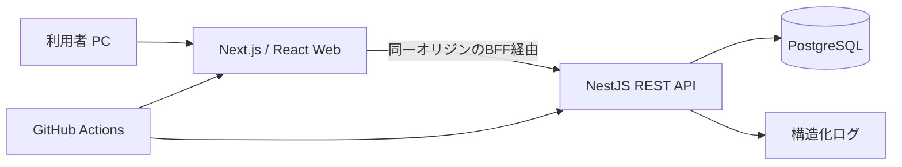
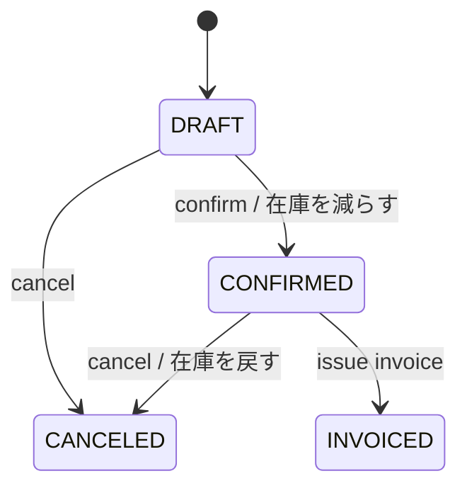

# 基本設計書 — TypeScript フルスタック受発注管理サンプル

| 項目 | 内容 |
|---|---|
| 文書ID | TS-BD-001 |
| 版/日付 | 1.0 / 2026-11-02 |
| 対象 | `issue-driven-example-typescript`（新規リポジトリ案） |
| 対応要件 | [`requirements.md`](requirements.md) TS-F / TS-BR / TS-AC |

## 1. アーキテクチャ



- **クライアント**：Next.js App Router、React、TypeScript strict。操作画面はクライアントコンポーネント中心、初期表示や認証境界はサーバー側で制御する。
- **サーバー**：NestJS（API、ユースケース、ドメイン規則、永続化境界）。PrismaでPostgreSQLへアクセス。
- **接続**：Next.js側の同一オリジンBFF（route handlers等）経由でAPIに到達させる。ブラウザからAPIへ認証秘密を直接渡さない。
- **トランザクション**：在庫減算、受注確定、請求発行をDB原子的に処理。PrismaトランザクションとDB制約を併用。
- **配布**：ローカル開発はDocker ComposeでDB、クライアント・APIは各開発プロセス。本番公開はMVP必須ではない。

## 2. ディレクトリ構成

```text
issue-driven-example-typescript/
├── apps/
│   ├── web/                 # Next.js: app/, components/, features/, lib/
│   └── api/                 # NestJS: src/modules/{auth,customers,products,inventory,orders,invoices,audit}
├── packages/
│   └── contracts/           # OpenAPI由来のDTO型またはスキーマ
├── prisma/                  # schema.prisma, migrations, seed
├── tests/
│   ├── fixtures/
│   ├── integration/
│   └── e2e/
├── docs/
│   ├── requirements.md
│   ├── basic-design.md
│   └── decisions/
├── scripts/                 # kit導入後の test.mjs / issue-run/
├── .github/workflows/
├── compose.yaml
├── package.json
├── package-lock.json
└── CLAUDE.md
```

契約を共有しても、サーバーの業務ロジックをフロントエンドに流出させない。内部importによるAPI層の迂回は禁止。

## 3. レイヤー・責務

| 層 | 責務 | 制約 |
|---|---|---|
| Web UI | 入力支援、状態表示、フォームバリデーション | 金額・権限・在庫の最終判定をしない |
| Web BFF | Cookie/セッション確認、サーバーAPIへの代理要求 | 機密情報のブラウザ公開禁止 |
| Nest Controller | RESTルート、DTO検証、HTTPステータス、認可ガード | DB直接更新禁止 |
| Application Service | 受注確定・取消・請求発行ユースケース、取引境界 | 冪等性と競合判定 |
| Domain | 状態遷移、金額計算、在庫制約 | 外部依存を最小化 |
| Repository | Prismaモデルへの永続化と検索 | DB制約との一貫性 |

## 4. データモデル（論理）

| テーブル | 主な列 | キー・制約 |
|---|---|---|
| `users` | id, login_id, password_hash, role, active, created_at | id PK、login_id UNIQUE |
| `customers` | id, code, name, active, version, timestamps | code UNIQUE |
| `products` | id, code, name, current_price_jpy, active, version | code UNIQUE |
| `stocks` | product_id, quantity, version | product_id PK/FK、quantity>=0 |
| `orders` | id, order_no, customer_id, status, subtotal_jpy, tax_jpy, total_jpy, version, timestamps | order_no UNIQUE、FK |
| `order_items` | id, order_id, line_no, product_id, product_code_snapshot, product_name_snapshot, unit_price_jpy, quantity, line_total_jpy | (order_id,line_no) UNIQUE |
| `invoices` | id, invoice_no, order_id, issued_at, subtotal_jpy, tax_jpy, total_jpy | order_id UNIQUE、invoice_no UNIQUE |
| `inventory_movements` | id, product_id, delta, reason, source_type, source_id, actor_id, created_at | 業務処理ごと追跡可能 |
| `audit_logs` | id, actor_id, action, entity_type, entity_id, metadata_json, occurred_at, request_id | append-only |

- PKはUUID、日時はUTC timestamptz、金額と数量は整数型。集計・計算過程で符号と範囲を確認し、必要な箇所はbigintを用いる。
- `stocks.quantity >= 0` と請求書の`order_id UNIQUE` はアプリ側だけでなくDBでも強制する。
- 監査ログにはパスワード・トークン・決済情報を格納しない。
- `version`で楽観ロックを行い、version不一致時にHTTP 409を返す。

## 5. 状態遷移



- DRAFTのみ明細変更可能。CONFIRMEDへの遷移時に明細と合計を確定。
- CANCELEDとINVOICEDからの遷移はMVPでは不可。
- confirm/cancel/issueはサーバー側で現在状態を条件に更新し、成功更新件数を検証。リトライ時の二重更新を防ぐ。

## 6. 金額・在庫処理

```text
subtotal = sum(unit_price_jpy * quantity)
tax      = floor(subtotal * 10 / 100)
total    = subtotal + tax
```

- 税計算は明細ごとでなく受注税抜計に対して一度実施。テスト固定値：2350→税235→計2585。
- confirm時は対象商品の在庫行を一貫した順序でロックするか、条件付き在庫減算を使用。数量不足時は全処理ロールバック。
- 注文・在庫移動・監査を同一トランザクションで保存。取消も同様。
- 請求書発行では`invoices.order_id`の一意制約と状態条件を併用し、二重発行を防ぐ。
- PostgreSQLの分離レベル、競合時再試行は専用の並行テストで検証して確定する。

## 7. API基本設計

JSONはcamelCase、日付はISO8601、エラーは `{code,message,details,requestId}`。ページングは`page`/`pageSize`。`If-Match`または明示的`version`をリクエストに含める（実装時に一つに統一）。

| 操作 | メソッド・パス | 権限 | 主な応答 |
|---|---|---|---|
| ログイン | `POST /api/v1/auth/login` | 匿名 | 200/401 |
| ログアウト | `POST /api/v1/auth/logout` | 認証済 | 204 |
| 顧客一覧・登録 | `GET/POST /api/v1/customers` | 全員参照/登録admin | 200/201 |
| 顧客変更 | `PATCH /api/v1/customers/{id}` | admin | 200/409 |
| 商品一覧・登録 | `GET/POST /api/v1/products` | 全員参照/登録admin | 200/201 |
| 在庫調整 | `POST /api/v1/products/{id}/stock-adjustments` | admin | 201/422 |
| 受注一覧・登録 | `GET/POST /api/v1/orders` | 全員参照/作成operator以上 | 200/201 |
| 受注明細変更 | `PATCH /api/v1/orders/{id}` | operator以上 | 200/409 |
| 受注確定 | `POST /api/v1/orders/{id}/confirm` | operator以上 | 200/409/422 |
| 受注取消 | `POST /api/v1/orders/{id}/cancel` | operator以上 | 200/409 |
| 請求発行 | `POST /api/v1/orders/{id}/invoice` | operator以上 | 201/200(既存)/409 |
| 請求一覧/詳細 | `GET /api/v1/invoices[/{id}]` | 全員 | 200/404 |
| 監査ログ | `GET /api/v1/audit-logs` | admin | 200/403 |
| ヘルス | `GET /health/live`, `/health/ready` | システム | 200/503 |

401=未認証、403=権限不足、404=なし、409=版/状態競合、422=業務ルール違反、500=想定外。DB内部エラーは公開しない。

## 8. 画面設計（概要）

| 画面ID | 画面 | 表示・入力 | 検証 |
|---|---|---|---|
| TS-UI-01 | ログイン | ログインID、パスワード、送信 | 空値、失敗理由の抽象化 |
| TS-UI-02 | ダッシュボード | 受注件数、未請求件数、在庫一覧導線 | 集計時点を表示 |
| TS-UI-03 | 顧客 | 一覧、検索、コード、名前、有効フラグ | 重複コード/競合 |
| TS-UI-04 | 商品 | 一覧、検索、コード、品名、単価、在庫 | 単価上限/無効化 |
| TS-UI-05 | 受注 | 明細行の追加削除、合計、確定、取消 | 明細不足、状態に応じボタン制御 |
| TS-UI-06 | 請求 | 発行、請求詳細、印刷向けHTML | 二重押下の防止 |
| TS-UI-07 | 監査 | 日時/操作者/操作のフィルタ | adminのみ |

エラーは入力項目と画面上部の双方に表示。API拒否をUIのみに頼って握り潰さない。

## 9. 認証・セキュリティ

- デモ用ローカルユーザーをシードで作成（初期パスワードは環境変数で設定し、実値をGitに含めない）。強固なパスワードハッシュを使用。
- Webからの認証は同一オリジンBFF経由でSecure/HttpOnly/SameSite Cookieを用いる。状態変更リクエストのCSRF対策を実装する。
- BFF→APIの認証情報はサーバー間のみで保持。roleはサーバーで検証し、UIは表示制御に限る。
- DTO検証、レスポンスの秘密除去、リクエストサイズ/レート制限、セキュリティヘッダーを適用する。

## 10. テスト・CI設計

| テスト階層 | 対象 | 合格基準 |
|---|---|---|
| 単体 | 金額計算、状態遷移、入力検証 | TS-BR全件の境界値確認 |
| API統合 | DBを使う受注確定/取消/請求 | TS-AC-01～09、12 |
| 同時実行 | 同一受注の競合、在庫競合 | 二重減算/請求0件 |
| Web E2E | ログイン→受注→確定→請求→照会 | TS-AC主要シナリオを実画面で確認 |
| セキュリティ | 未ログイン、viewer、CSRF | 401/403、書込なし |
| 再現性 | DB初期化→seed→testを2連続 | TS-AC-10 |

- 推奨：Vitest（単体/API）、Playwright（E2E）、PostgreSQLテストDB。
- CIステップ：install→format/lint→tsc→unit→integration→web build→e2e→結果集約。
- kitの`node scripts/test.mjs`が確実に終了コードと`Result: PASS/FAIL`を返す契約を保持。テスト未検出はFAIL。
- ネットワーク依存のない確認から始め、DBを必要とするIssueではDB起動・seedを確認コマンド内で再現可能にする。

## 11. issue-driven-kit組込み・変更境界

1. 本体の`editions/node/install.mjs`を`--dry-run`で確認して導入。導入コミットを先に確定。
2. 利用するキットのコミットを`.issue-kit/version`に記録。docsのIssueに合格の条件を記述。
3. 仕様・テスト・fixtureはIssue実行時に勝手に書換えさせないよう**別コミットで固定**する。キットの確認コマンドに守るファイルとして組み込むことを検討する。
4. 対象Issueは`claude-run`ラベル、人間がCloseを判断。実行結果は個別Issueと`docs/reports`に保存。
5. 既存Node版がVitest向けである点とmonorepo構成の相性を第1フェーズで検証。無理にアプリテストへキット内部を書き換えない。

### Issue分割案（依存順・例）

| ID案 | Issue | 前提 | 確認観点 |
|---|---|---|---|
| TS-I-01 | リポジトリ初期化、DB、lint/test導線 | なし | build/test/seed |
| TS-I-02 | Node版kit導入・doctor・dry-run | TS-I-01 | kitの合格判定 |
| TS-I-03 | DBスキーマ/fixture | TS-I-02 | migration/seed/制約 |
| TS-I-04 | 認証・権限・Webログイン | TS-I-03 | 401/403/セッション |
| TS-I-05 | 顧客・商品マスターと画面 | TS-I-04 | CRUD/重複/競合 |
| TS-I-06 | 在庫照会・調整 | TS-I-05 | 監査と非負制約 |
| TS-I-07 | 受注下書き/明細と画面 | TS-I-06 | バリデーション/合計 |
| TS-I-08 | 受注確定/取消と競合 | TS-I-07 | 在庫原子性/冪等性 |
| TS-I-09 | 請求書発行/照会 | TS-I-08 | 二重発行防止 |
| TS-I-10 | 監査画面、E2E、運用文書 | TS-I-09 | 全受入条件・再現性 |

※表のIssue番号は案であり、実際のGitHub Issue番号ではない。各Issueの`## 合格の条件`には、確認コードと仕様を固定してから`claude-run`を付ける。

## 12. トレーサビリティと未決事項

- TS-F-03/04→TS-UI-03/04→マスタAPI→TS-AC-09/12。
- TS-F-06/07/08→TS-UI-05→受注API→TS-AC-01～04/08。
- TS-F-09→TS-UI-06→請求API→TS-AC-05/06。
- TS-F-01/02→TS-UI-01→認証/権限→TS-AC-07/11。
- 導入時にNext.js/NestJS/Prismaの対応済みバージョンを検証しlock固定。
- APIスキーマ生成方式、認証ライブラリ、CIのE2Eブラウザ実行基盤は初期IssueでADRとして確定。
